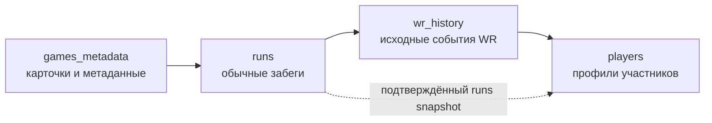
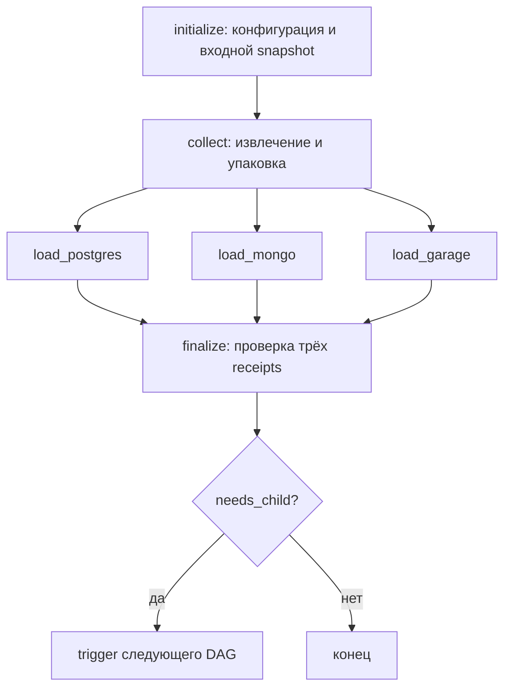

# DAG для ЛР1

В текущей модели `entity-v3` реализованы четыре DAG в каталоге [dags/ods](dags/ods):

Каждый DAG создаёт собственный снимок, загружает его в PostgreSQL, MongoDB и Garage S3 и проверяет подтверждения трёх хранилищ. Дочерние запуски связываются конкретными snapshot ID. История до текущей версии документа сохранена в Git.

| DAG | Вход | Результат |
|---|---|---|
| `games_metadata` | Каталог либо ID/slug выбранной игры | Карточки, правила, категории, переменные и платформы |
| `runs` | Подтверждённые метаданные игры | Раны выбранных full-game категорий и трёх статусов, stats и coverage |
| `wr_history` | Подтверждённые метаданные и runs | Исходная история WR по категориям, ссылки на раны и диагностика покрытия |
| `players` | Подтверждённые runs и WR | Доступные профили участников обоих входов, включая WR-only |

Каталог собирается один раз перед пакетным обходом. Для одиночной известной игры `games_metadata` получает только её метаданные. Каталог и запуск `--metadata-only` намеренно не создают дочерних DAG.

## Задачи и зависимости

Для DAG с дочерним этапом структура следующая:

`collect` включает получение данных и упаковку; отдельной задачи упаковки в графе нет. Три загрузчика — отдельные ветви. Pool `ods_load` имеет два слота, поэтому одновременно выполняются не более двух загрузок. `finalize` с правилом `all_done` фиксирует готовность либо диагностику ошибки. У `players` дочерней задачи нет.

В `runs` задача называется `trigger_next`: для `entity-v3` она запускает `wr_history`, для совместимого `entity-v2` — `players`. Детерминированный DagRun ID содержит ID и название игры; повтор не создаёт дубликат дочернего запуска. У всех четырёх DAG `schedule=None`, `catchup=False`, `max_active_runs=1` и два task retry. Код DAG не обращается к сети при импорте; XCom хранит ссылки и небольшие метаданные.

## Область и покрытие

- `runs` обходит доступные full-game категории, включая архивные, и статусы `new`, `verified`, `rejected`; исходные поля и контекст ответа сохраняются.
- `wr_history` отдельно сохраняет полученные события источника. `partial` и `unavailable` обозначают ограничения покрытия, а не доказывают отсутствие истории.
- `players` использует доступные встроенные профили участников runs и WR. Отсутствие страны допустимо; профильные HTTP-запросы на каждого игрока не выполняются.
- Обычная пагинация — режим по умолчанию; `--accelerate-dates` включает разрезы дат явно. Стратегия и checkpoints сохраняются при resume.

Pool `source_api` имеет один слот; общий клиент дополнительно ограничивает начала запросов и использует сохранённое состояние limiter. В текущем проходе потолок — 40 запросов/мин и окно до четырёх страниц. Фактическая скорость зависит от источника, размера ответов и повторов.

Сетевой ответ сначала сохраняется в journal, затем продвигается checkpoint. При сбое загрузчика повтор использует прежний пакет и ключи. Готовность снимка подтверждается только после readback и согласованных receipts всех трёх сервисов; распределённой транзакции между ними нет. Технический успех загрузки и полнота данных источника — разные показатели.

## Текущий запуск и демонстрация

Очередь `lab1-popular500-20261030` упорядочена по свежему каталожному `runCount DESC`; после 135 из 500 игр она вручную остановлена для подготовки отчёта. Driver и автоматическое продолжение остановлены. Не возобновлять сбор без нового указания; актуальное состояние — [docs/HANDOFF.md](docs/HANDOFF.md).

Для просмотра сохранённых запусков, чтения одного рана из трёх хранилищ и показа логов используйте [сценарий демонстрации](reports/lab1/DEMO.md). Схемы и реальные снимки UI находятся в [отчёте](reports/lab1/REPORT.md). Подробности модели и ограничений — [DATA_MODEL.md](DATA_MODEL.md) и [SOURCE_CONTRACT.md](SOURCE_CONTRACT.md). DDS, SCD и Data Quality относятся к ЛР2.
