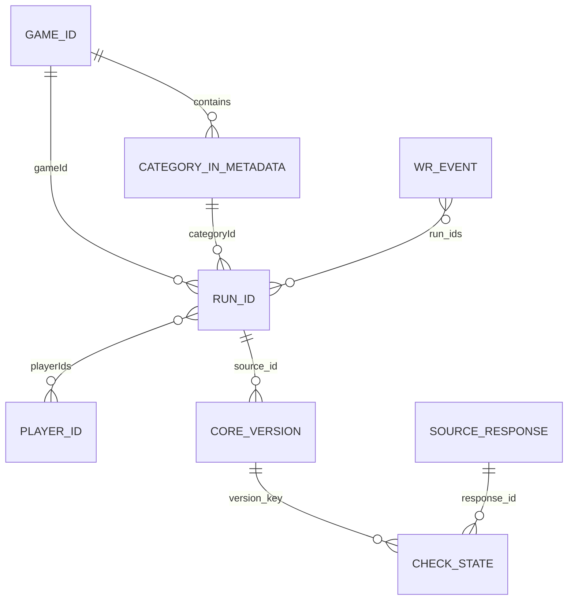
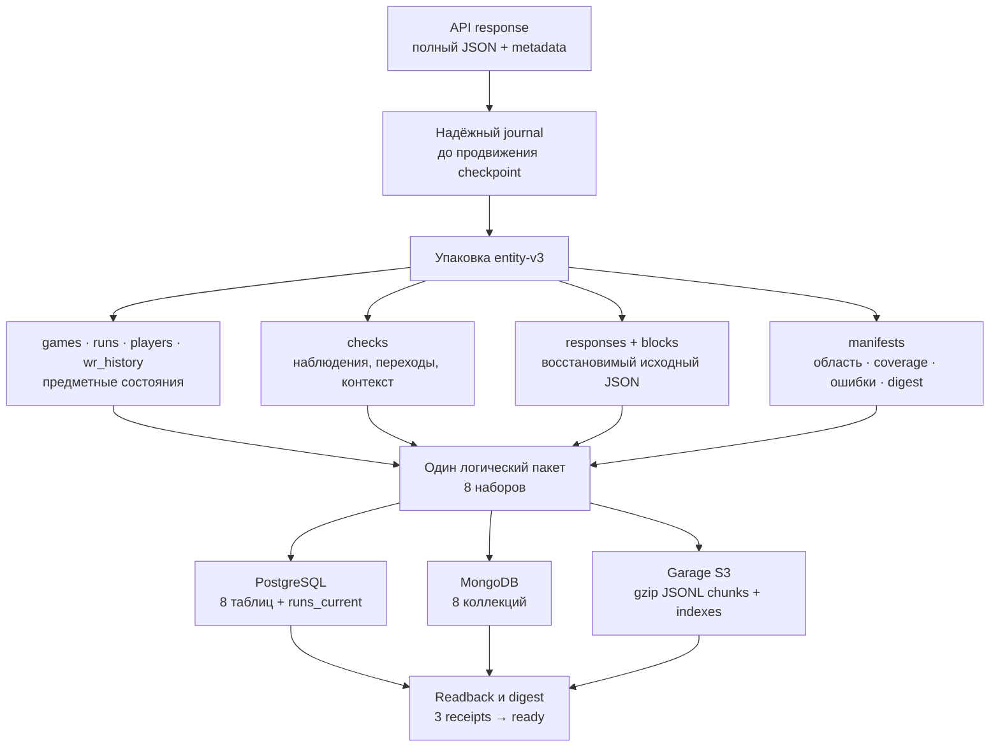
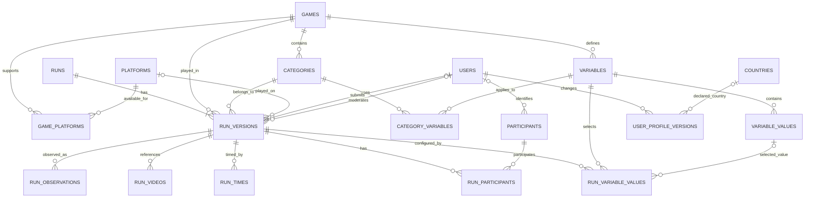

# Модель данных Speedrun.com

## Актуальное состояние: entity-v3, 30 октября

Новая модель реализована в отдельном namespace `entity_v3`, старая `entity_v2`
читается прежним кодеком. После157успешныхтестов и свежихпроверок пользователь
подтвердил вайп рабочихданных и новый проход500игр; старыеODS теперь вD:backup.
Актуальное состояние и подтверждения — начало docs/HANDOFF.md.

- `runs` хранит единые core-состояния с projection=run_core. Изменившиеся
  собственные поля создают версии; пагинация не размножает неизменную сущность.
- `place`/`obsolete` не входят в core hash, но НЕ теряются. Для ответов без
  minRunDate/maxRunDate они доступны в checks.unfiltered_leaderboard, вместе
  с фильтрами/response ID/путём/временем/переходами состояний. Исходные значения
  из всех ответов, включая date-фильтры, сохраняются в восстановимом responses.
- PG `entity_v3.runs_current` даёт одну последнюю core-версию на ID, нативные
  поля в `data`, `obsolete`, `place` и отдельное время/происхождение контекста.
  Отсутствующий общий флаг неизвестен, а не false. Default-сбор стандартный,
  поэтому обычные раны получают исходные флаги без вмешательства разрезов дат.
- Восстановимые небольшие сущности используют native-json-v1 (`raw.value`);
  неподдерживаемые точныечисла/ключи/крупныефрагменты — прежние codecs/blocks.
  Неизвестные поля, null и массивы сохраняются. Это ODS, не нормализованный DDS.
- `wr_history` содержит исходные события с полями события и run_ids, а полные
  вложенные WR-run объекты остаются в exact response. Известный runs-input ID
  связывается по ID, не заменяет обычный ран частичнойWRпроекцией. WR-only ID
  сохраняется как доступный core-объект с собственным происхождением.
- Players выделяет участников обоих подтверждённых входов; неизвестная страна
  допустима, все наблюдаемые профили/изменения сохраняются без профильныхHTTP.

Основные таблицы/коллекции и JSON-ключи во всех3ODS логически одинаковы.
Старый текст ниже — история решения до внедрения; он не отменяет этот раздел.

### Предметные связи текущей ODS



Это логические связи по ID, а не объявленные SQL FK. Категории/правила/переменные
остаются внутри полного `game_detail`; DDS и отдельная таблица участников
ради диаграммы не создавались. Карточка, состояния сущности и наблюдения
снимка различаются. Ран может иметь нескольких участников, WR-событие — run ID.

### От ответа к физическим копиям



| Набор | Устойчивый ключ | Назначение |
|---|---|---|
| Предметные версии | Hash системы, source ID, проекции и содержимого | Различающиеся состояния; неизменное появление не создаёт новую версию |
| `checks` | Hash snapshot ID, набора, source ID и проекции | first/last, переходы, время/происхождение; отдельный unfiltered-контекст рана |
| `responses` | Сохранённый response ID | Metadata запроса, hash полного JSON, восстановимое тело |
| `blocks` | SHA-256 байтов блока | Большие фрагменты и повторяемый playerList с полным порядком/полями |
| `manifests` | Ключ пакета снимка | Область; техническая готовность отдельно от полноты источника |

В PG каждая таблица имеет `key` (PK), индексируемые `source_id`, `projection`,
`game_id`, `category_id`, `status` и полный `document JSONB`. В Mongo `_id=key`,
атрибуты поиска находятся в обёртке, логическая запись — в `document`.
В S3 индекс снимка ссылается на чанки по набору/шарду с SHA-256 и счётчиками.
Восемь наборов не означают восемь записей на каждый ран; число объектов S3
не равно числу строк/документов PG/Mongo.

Совместимые небольшие JSON сохраняются нативно. Точные неподдерживаемые значения
и большие фрагменты используют явные codecs/blocks. Декодер сохраняет missing/null,
массивы, повторяющиеся элементы и неизвестные поля. `runs_current` соединяет
последнюю core-версию с последним известным общим контекстом; их времена могут
различаться. Это не собственный расчёт PB/WR или история места до начала наблюдений.

[Реальный пример Portal](reports/lab1/ods_example_20261030/README.md): исходный ран,
core, checks, профиль, правила игры/категорий и сверка трёх хранилищ.

## Решение 30 октября: единые раны и отдельная история WR (к реализации)

Пользователь запросил мягкую остановку и восстанавливаемый бэкап перед
переработкой. Описанная здесь замена ещё НЕ внедрена: существующие entity-v2
пакеты, projections и их история сохраняются. Старый сбор не возобновлять
автоматически, данные и бэкап не удалять. Состояние остановки — docs/HANDOFF.md.

- Одна сущность рана определяется source ID; версия — изменением собственных
  исходных атрибутов. Способ скачивания, диапазон дат, страница и попадание в
  WR не создают дополнительной полной копии рана.
- `place` и `obsolete` из GetGameLeaderboard2 зависят от фильтров. Отделить их
  от общих атрибутов ДЛЯ ВСЕХ ранов, а не только date-large. Значения и параметры
  оставить в полном исходном ответе и его контексте; объединённое представление
  не должно заставлять аналитика вручную удалять date-проекции.
- В обычном ответе без дат и в ответе за день место означает разное.
  Отсутствующее общее место/obsolete остаётся неизвестным. Не подставлять
  место из диапазона, не вычислять общее место/WR самостоятельно в ODS.
- Сохранить все остальные исходные поля и реальные изменения. Не выбирать
  произвольную проекцию по MAX(key); неполная WR-проекция не затирает полную.
  Отсутствующее поле и null различаются. Объединение совместимых частичных
  объектов требует явного происхождения, а не молчаливого дополнения полей.
- WR хранится как самостоятельная последовательность событий источника
  по игре/категории/явным фильтрам, со ссылками на ID ранов. Полный WR-ответ
  сохраняется; само участие рана в событии не дублирует общую сущность.
- Полные исходные ответы, в том числе промежуточные пробы дробления дат,
  позволяют восстановить исходный JSON. Это технический след сбора,
  НЕ история позиций рана на сайте в прошлые годы.

Точное новое физическое представление/версия пакета должны быть проверены
на малой игре, Subway и Minecraft с восстановлением ответов, A→B→A,
идемпотентностью, недоступной WR-историей и равенством трёх ODS. Совместимость
старого чтения сохранить; готовые entity-v2 пакеты не переписывать на месте.
Повторное скачивание для проверки преобразования имеющихся raw не требуется;
новый производственный сбор будет отдельным свежим проходом после проверки.

Уточнение по результатам тестов 28 октября: в нашем Garage 2.4.1 условные
PUT с устаревшим If-Match и существующим If-None-Match:* вернули 200 и заменили
объекты. Отправка заголовков и разные ETag проверены. Эти заголовки не являются
CAS-защитой нашего протокола: использовать immutable hash-ключи, readback и
согласование готовности в control PG. Результат относится к этой версии/стенду;
доказательство docs/research/evidence/lab1_history_20261030/storage_workloads_20261028/garage_additional_verified.json.
Рабочие типизированные проекции storage_workloads — только тестовые копии,
не новая production-схема и не начало DDS.

Уточнение физического хранения от 28 октября: в новых пакетах `entity-v2`
массивы `playerList` от 1000 объектов вынесены в общие сжатые `blocks`.
Ответ хранит оболочку и ссылку на массив (`json-v1-player-list-ref`); его
`body_hash` считается по полному исходному JSON. Порядок, повторяющиеся объекты,
неизвестные поля и точные числа восстанавливаются. Предметные сущности, ID,
версии профилей и схема коллекций/таблиц остаются прежними. Старые codecs
читаются; готовые пакеты автоматически не переписываются.

Для непрерывной серии полностью одинаковых списков с уникальными ID профили
обрабатываются в первом и последнем ответах: сохраняются first/last и все
переходы состояний A → B → A. Если ID повторяются внутри списка, сокращение
обработки отключено. Сетевые ответы и исходный HTTP-journal этим способом не
сокращаются. Проверки и ограниченный замер: docs/research/evidence/lab1_history_20261030/player_list_compaction_20261028.json.

## Актуальное решение пользователя: игры, раны, игроки

Уточнение 2026-10-16 после проверки производительности: пользователь ожидает
предметные наборы, подобные сущностям прежних CSV, загружаемые в три хранилища:

| Набор | Содержание и связи |
|---|---|
| Игры | ID, название, полная карточка; доступные категории, правила, переменные и справочники сохраняются |
| Раны | ID, ссылка на игру, участники по ID, все таймеры, даты, статус, категория, значения переменных и остальные исходные поля |
| Игроки | ID, полные доступные профили; один игрок может участвовать в нескольких ранах и играх |

Участники, submitter и moderator — разные роли; несколько участников рана
не сводятся к одному имени. Пример пользователя «ID — время — имя — дата»
иллюстрировал сущностную организацию, а не ограничивал перечень полей.

Неизменная сущность не размножается при появлении на следующих страницах.
Полные исходные поля, изменившиеся состояния, повторные свежие проверки и
происхождение сохраняются; retry отличается от новой проверки. Для этого
не требуется отдельный документ на каждое повторное появление профиля.
Метаданные запросов, исходные ответы, манифесты и coverage — вспомогательные
данные, а не замена доступным наборам игр/ранов/игроков. Полная нормализация
и SCD/DDS по-прежнему относятся к ЛР2.

Стек PostgreSQL/MongoDB/Garage сохраняется. Текущая реализация entity-v2
использует предметные наборы и вспомогательные данные, описанные ниже.
Одинаковое логическое содержание трёх ODS не требует одинакового числа
физических объектов и запросов записи в каждом сервисе.

### Аккаунты и профили: логическая и сетевая границы

Уточнение 2026-10-28: разбиение GetGameLeaderboard2 по датам уменьшает
встроенный playerList. При этом place/obsolete контекстны: исходные значения
в проекции leaderboard_run_date:<hash min/max> хранятся с leaderboard_filters,
отдельно от leaderboard_run. ID сущности остаётся тем же; полные поля не теряются.
Repair-пакет объединяет прежние версии/ответы с новыми, сохраняя исходные response
ID, snapshot ID ответов и времена наблюдений. Новый manifest указывает base;
checks нового снимка объединяют старую и новую историю. Готовые разделы/WR
не объявляются свежими запросами. Players выбирает профили из объединённых
ранов локально; отдельные N запросов профилей по-прежнему не добавлены.

Уточнение 2026-10-27: желаемая последовательность — получить раны, выделить
уникальные ID аккаунтов, затем получить недостающие данные профилей в `players`.
Повторное участие аккаунта в разных ранах/играх не требует повторного запроса
того же профиля внутри прохода; новая проверка должна сохранять историю изменений.
Гостевые записи не являются зарегистрированными аккаунтами и не должны попадать
в очередь запросов профиля; их исходные данные остаются в контексте рана.

Текущая реализация разделяет предметные загрузки, но API возвращает данные
совместно: `GetGameLeaderboard2` содержит `runList` с `playerIds` и `playerList`.
В измеренном ответе Subway Surfers 100 ранов сопровождались 27 340 краткими
профилями, включая посторонних для данной страницы участников. Ответ занимал
около 3,78 МБ после распаковки. Встроенный объект сохраняется полностью,
но не равнозначен расширенному профилю страницы пользователя. Сейчас `players`
выбирает участников и их встроенные состояния локально, без новых HTTP.

Ограниченная проверка одного аккаунта подтвердила отдельные публичные v2
`GetUserSummary` (по URL-имени) и `GetUserPopoverData` (по ID): оба HTTP 200,
ID совпал, доступны дополнительные поля `userProfile`, `userStats` и другие.
Это проверка возможности, а не внедрённый массовый добор профилей.
Параметры `includePlayers=false` и `includePlayerList=false`, переданные
на верхнем уровне и внутри `params`, не отключили встроенный список.
Поддерживаемый облегчённый ответ с одними ранами пока не подтверждён;
эти два опыта не доказывают отсутствие других возможностей API.

Дополнительная локальная сверка подтвердила общий справочник раздела
«категория × статус» на полностью полученном SM64: 16 Star verified —
24 501 ран / 7 447 участников, 70 Star verified — 13 367 / 2 850,
120 Star verified — 7 301 / 1 389. Уже первый ответ содержал ровно этих
участников. Во всех сохранённых ответах каждого раздела набор ID одинаков;
полные состояния профилей первого и последнего ответов также совпали.
Это эмпирическое свойство проверенных разделов, не гарантия API на будущее.
В rejected разделах есть дополнительные ID, не встретившиеся в полученных
ранах. На незавершённом Subway verified первый список содержал 27 338 ID
и покрывал всех 6 700 участников 11 299 уже полученных уникальных ранов;
222 ответа имели одинаковый набор ID. Но Subway rejected дал четыре
разных набора ID: первый список нельзя считать неизменным навсегда.

Практический вывод: использовать общий встроенный справочник для разрешения
ID, сохранять его различающиеся состояния и добирать только действительно
недостаточные профили. Дополнительный HTTP на каждого участника не требуется
для уже имеющихся полей. Пропуск обработки/повторной записи неизменного
списка экономит локальные ресурсы, но не предотвращает передачу списка API.
Проверка выполнена без новых HTTP; [отчёт](docs/research/evidence/lab1_history_20261030/player_list_scope_20261027.json),
воспроизведение — `python -m speedrun_etl.inspect_player_lists --help`.

Отдельные запросы профилей поверх нынешних ответов добавляют N запросов
на N уникальных аккаунтов. Для 27 тысяч при 60 запросах/мин только нижняя
граница составляет 7,5 часа. Поэтому массовый добор нельзя выдавать за
ускорение сбора ранов. Данные и результаты проверок:
[отдельные профили](docs/research/evidence/lab1_history_20261030/http_profile_capability_20261027.json),
[параметры отключения списка](docs/research/evidence/lab1_history_20261030/http_profile_omission_flags_20261027.json).

### История WR источника

Помимо трёх основных сущностей сохраняется самостоятельный исходный набор
`wr_history`: все доступные ответы истории WR для каждой full-game категории
выбранной игры, включая доступные архивные. Ключ области включает игру,
категорию, фильтры и страницу. Порядок событий, даты и вложенные runList
сохраняются целиком, разные фильтры не смешиваются. Комбинации переменных
автоматически не перебираются; базовый `values=[]` не означает историю всех
подкатегорий. Собственный расчёт истории WR относится к ЛР2.

Пустой `{}` означает недоступную историю, а не доказанное отсутствие WR.
Ответ без пагинации сохраняется полностью, но не доказывает полноту сайта.
Наличие ответов по всем категориям и полнота истории — разные проверки.

### Новая упаковка и загрузка entity-v2

Реализуется отдельный сборщик пакета из сохранённого журнала HTTP, без новых
запросов и без изменения старых ODS. Предметные наборы — `games`, `runs`,
`players`, `wr_history`; версии определяются source ID, проекцией и хешем
полного исходного содержимого. Неизменное содержимое повторно не записывается.
Вспомогательный `checks` содержит одну запись на сущность/проекцию/снимок:
первое и последнее получение и последовательность только изменившихся
состояний. A→A не создаёт новую версию; A→B→A сохраняет три позиции истории.

Полные ответы `responses` сохраняются с исходными ID, параметрами и временем,
сжаты детерминированным gzip. JSON-числа сохраняются точно; большие значения
разбиваются на блоки по 4 МиБ, безопасные для BSON. `manifests` описывают сбор.
В PostgreSQL это отдельная схема entity_v2 с таблицами по наборам,
JSONB-документом и индексируемыми ID/категорией/статусом; в MongoDB — одноимённая
БД с коллекциями, исходным документом и индексируемыми атрибутами. В Garage
записи объединяются в content-addressed gzip JSONL-блоки до 4 МиБ, с 16 shard
по ID сущности и индексом каждого снимка. История/состояние читаются в области
конкретного снимка; разные проекции не затираются.

Уточнение MongoDB 2026-10-27: если логическая запись содержит неподдерживаемое
BSON значение (например, точный Python Decimal в metadata), физический документ
помечается document_encoding=canonical-json-utf8, полная запись сохраняется
в document.text. Декодирование и проверка digest возвращают исходное JSON-значение.
Обычные документы остаются вложенными BSON, исходные ключи и индексы сохраняются;
document.snapshot_id продублирован в fallback для прежнего запроса истории.

Загрузчики читают все логические записи обратно один раз пакетами/блоками;
проверяют ключи и содержимое, затем сохраняют receipt. Финализатор сравнивает
receipts без повторного полного чтения. Два загрузчика могут работать вместе,
сетевой сбор остаётся последовательным. Runs не загружает профили как отдельные
сущности; players выбирает участников из локального runs-пакета и загружает
их профили с исходными временами, без дополнительных HTTP-запросов.
Полный Minecraft проверяется отдельно от Half-Life; успешность одной игры
не является доказательством совместимости с остальными играми.

## Прежняя реализация и исторические материалы

Четыре набора payloads/responses/observations/manifests реализованы по
[прежнему плану](docs/LAB1_PLAN.md); [sql/ods.sql](sql/ods.sql) описывает
именно существующую схему, **не новую целевую модель**. Отдельные observations
на каждое появление неизменного профиля породили миллионы записей Minecraft.
Эта организация пересматривается. Прототип grouped-v2 — эксперимент,
его не считать выбранным решением или автоматически подключать к DAG.
После успешной проверки entity-v2 Half-Life пользователь разрешил полный
сброс данных стенда; прежние volumes удалены, выполняется новый сетевой сбор.

Ниже сохранён ранний проект DDS и альтернативных ODS-таблиц от 2026-10-10.
Его BIGINT-ключи, перечни ODS-таблиц и открытые варианты стека не являются
текущей схемой ЛР1. DDS ещё не утверждён и не реализуется.
Проверки отдельных выгрузок не доказывают универсальную полноту API.

Связанные материалы: [правила сбора](SOURCE_CONTRACT.md),
[наблюдения и исследования](COLLECTION_PLAN.md).

## Границы лабораторных работ

Документ охватывает весь семестр, а не только реализацию ЛР1.

| Этап | Что реализуем |
|---|---|
| ЛР1 | Docker Compose, Airflow, минимум три DAG сбора, загрузка исходных данных в ODS трёх хранилищ и сравнительные замеры. Минимальная подготовка формата, сохранение ID/названий, повторяемость загрузки и проверки пагинации/покрытия |
| ЛР2 | Нормализованная DDS-модель разделов 4–7, очистка и разрешение ссылок, SCD/версии сущностей, отдельный DAG Data Quality, зависимости ODS → DDS и расчёт истории PB/WR |
| ЛР3 | Аналитические витрины, их DAG, зависимости DDS → витрины, Superset с минимум пятью визуализациями и Data Lineage в OpenMetadata |

В ЛР1 сохраняем последовательные исходные наблюдения, необходимые для будущей
историзации. Преобразование их в SCD и интервалы версий относится к ЛР2.
Получение готовой истории WR и счётчиков сайта — сбор исходных данных ЛР1;
собственная реконструкция рекордов — ЛР2, аналитические сравнения — ЛР3.
Проверки успешности сбора в ЛР1 не заменяют DAG качества DDS из ЛР2.
Графики сравнительных замеров хранилищ требуются уже в ЛР1 и не заменяют
аналитический дашборд ЛР3. Раздел 8 — проект представлений DDS для ЛР2;
исследовательские SQLite/CSV не делают их обязательной частью ODS.

## 1. Что сохраняем

- Игры, категории, правила, переменные и их значения, платформы.
- Каждый полученный ран отдельно: new, verified, rejected, включая obsolete.
- Участников, автора подачи и проверяющего как разные роли.
- Даты выполнения, отправки и решения; все доступные таймеры.
- Профили участников и заявленную географию; отсутствие страны допустимо.
- Исходные ответы и последующие наблюдения изменений.
- Снимки статистики сайта и доступную историю WR как отдельные продукты источника.

Основная аналитическая область — полная основная игра, без level runs и отдельных
Category Extensions. В сыром слое сохраняем всё уже полученное, даже если оно
исключено из аналитики. Orphaned помечаем, не удаляем. Архивность категории,
отсутствие игрока, obsolete и составной результат — разные признаки.

## 2. Ключи, имена и типы

| Обозначение | Правило |
|---|---|
| `*_key` | Наш внутренний PK: BIGINT, генерируется хранилищем |
| `source_*_id` | Непрозрачный текстовый ID источника; не число, не фиксированные 8 символов |
| `source_system` | Пока `speedruncom`; v1/v2 не разные сайты |
| `api_variant` | v1/v2; относится к происхождению ответа/наблюдения |
| `snapshot_key` | FK на логическую выгрузку; UUID либо внутренний BIGINT, выбрать при реализации |
| Названия | Изменяемые атрибуты, не PK и не критерий дедупликации |
| Даты | UTC TIMESTAMPTZ; неизвестные даты NULL, точность сохраняется отдельно |
| Длительности | Точное NUMERIC без принудительного округления; исходная строка сохраняется |
| Отсутствие данных | NULL отличается от false, 0 и пустой строки |

Уникальность внешней сущности задаём `(source_system, source_entity_id)`
в таблице соответствующего типа: одинаковые ID разных типов не конфликтуют.
Для v1/v2 одной сущности используется один внутренний ключ. Сравнение ответов
двух API не означает автоматическое объединение всех их атрибутов.

Названия всегда доступны через справочники: `game_key -> games.name`,
`category_key -> categories.name`, `platform_key -> platforms.name`,
`variable_key -> variables.name`, `value_key -> variable_values.name`,
`user_key -> users.display_name`. Переименование не меняет ключ.

## 3. ODS для ЛР1: первичные данные и доказательства

Здесь можно хранить JSON. Полная нормализация ниже — проект DDS для ЛР2;
для ЛР1 достаточно ответов, наблюдений, индексов сущностей и покрытия.
Перечисленные далее таблицы — подробный вариант проекта, не обязательный
минимум реализации. В ЛР1 допускается raw + небольшой manifest со сведениями
о снимке, запросах и покрытии; выделять каждое понятие в отдельную таблицу
нужно только при практической необходимости. Имена и ID можно сохранять
в исходных JSON без отдельной нормализованной системы справочников.
Однако это не допускает потери предыдущих исходных состояний при обновлении.
Уточнённые требования сохранности и идемпотентности для любых будущих анализов
описаны в `SOURCE_CONTRACT.md`, раздел «История без дублей». Физическая модель
хранения изменений ещё требует утверждения. Полный дубль на каждый запуск
не обязателен, но одним upsert с затиранием истории ограничиваться нельзя.

| Таблица / логическая коллекция | PK и FK | Основные поля |
|---|---|---|
| `ingestion_snapshots` | PK snapshot_key | started_at, completed_at, collector_version, policy_version, execution_status |
| `source_requests` | PK request_key; FK snapshot_key | api_variant, endpoint, params_json, requested_at, fetched_at, http_status, attempt_no, error, payload_hash, payload_json/object_path |
| `entity_observations` | PK observation_key; FK request_key | entity_type, source_entity_id, observed_at, payload_json/object_path, payload_hash, row_locator |
| `coverage_partitions` | PK partition_key; FK snapshot_key | source_game_id, source_category_id, run_status, query_params, expected_count, received_count, unique_count, pages_expected, pages_received, coverage_status, diagnostic |
| `site_stats_snapshots` | PK stats_snapshot_key; FK observation_key | source_game_id, observed_at, source_total_runs, source_total_runs_fg, source_total_runs_il, source_total_runs_challenge, source_total_players, source_active_players, source_recent_runs, source_total_run_time, raw_json |
| `wr_history_responses` | PK history_response_key; FK request_key | source_game_id, source_category_id, scope_params, observed_at, raw_json/object_path |
| `reference_dictionary_observations` | PK dictionary_observation_key; FK observation_key | entity_type, source_entity_id, name, parent_source_id, observed_at, raw_json |

`entity_observations` UNIQUE `(request_key, entity_type, source_entity_id)`
только если ответ действительно содержит сущность один раз. При повторе в
ответе сохранить raw, отметить DQ, не потерять повтор через UNIQUE silently.
Для повторной загрузки того же ответа нужен стабильный ключ загрузки
(например, snapshot + request identity + attempt + row locator), а не name.

API не отдаёт проверенное время вычисления stats: `observed_at` — время нашего
получения. Значения `source_total_*` не объявляем автоматически verified-метриками.
Сохранять ошибки, включая 404, без секретов и заголовков авторизации.
Повторный запрос и ответ без изменений тоже являются наблюдением.

ODS не требует полной FK-согласованности внешних ссылок: неизвестный ID
сохраняется вместе с исходным ответом и диагностикой.

## 4. Основная ER-модель для будущего DDS

Ниже — нормализованная модель идентичностей и версий ранов. В диаграмме имена
краткие; точные ключи и поля перечислены далее. Обязательные FK проверяются
при формировании DDS; версии объектов привязаны к наблюдениям ODS.



Диаграмма не означает, что каждая игра имеет раны или каждый ран имеет игрока:
orphaned допускает ноль участников. `RUNS -> RUN_VERSIONS` означает минимум
одну версию уже материализованного рана в DDS.

## 5. Справочники ID -> название

В таблицах ниже PK — указанный *_key, внешний UNIQUE — source_system + source ID.
Для всех изменяемых справочников сохранять происхождение последнего значения;
SCD2/версии атрибутов предусмотреть в ЛР2. Точные схемы версий пока не реализованы.

| Таблица | PK, внешний ID, FK | Поля |
|---|---|---|
| `games` | game_key; source_game_id | name, slug, weblink, release_date, release_precision, source_game_type, classification, classification_basis, is_placeholder |
| `categories` | category_key; source_category_id; FK game_key | name, slug, category_type, is_miscellaneous, source_archived, rules_text, time_direction, player_match_mode, min_players, max_players, result_kind, classification_basis, is_placeholder |
| `variables` | variable_key; source_variable_id; FK game_key | name, scope_type, scope_category_key NULL, source_scope_raw, is_mandatory, is_user_defined, is_subcategory, affects_obsolescence, source_archived |
| `variable_values` | value_key; source_value_id; FK variable_key | name, rules_text, source_archived, is_default, is_placeholder |
| `category_variables` | PK(category_key, variable_key); оба FK | applicability_basis, metadata_version |
| `platforms` | platform_key; source_platform_id | name, slug, release_year, is_placeholder |
| `game_platforms` | PK(game_key, platform_key); оба FK | metadata_version |
| `regions` | region_key; source_region_id | name, is_placeholder |
| `users` | user_key; source_user_id | display_name, slug, profile_url, profile_availability, is_placeholder |
| `countries` | country_key; UNIQUE(source_system, source_country_code) | name NULL, raw_code, mapping_source |
| `run_statuses` | PK status_code | name; значения new, verified, rejected |
| `timer_types` | PK timer_code | name; realtime, realtime_noloads, ingame |

`users` включает участников, авторов подачи и модераторов. ID с неизвестным
профилем может иметь placeholder с name=NULL; это не означает отсутствие игрока.
Страны пока частично известны как коды профиля. Названия получаем из проверенного
справочника, не выдумываем; неизвестное название сохраняется NULL.
`regions` рана и страна профиля игрока — разные сущности.

`result_kind`: individual_run / composite_result / unknown. Классификация
Combined по изученным правилам не становится универсальным классификатором
названий категорий. `scope_type` переменной и её исходное значение сохраняем:
распространение глобальной переменной на категории требует правил источника.
Парой min/max не терять исходные numPlayers/exactPlayers — raw обязательно.

## 6. Раны и их изменения

| Таблица | Ключи | Поля / смысл |
|---|---|---|
| `runs` | PK run_key; UNIQUE(source_system, source_run_id) | first_seen_at, last_seen_at; постоянная идентичность рана |
| `run_versions` | PK run_version_key; FK run_key; UNIQUE(run_key, api_variant, revision_no) | api_variant, revision_no, observed_from, observed_to NULL, semantic_hash, game_key, category_key, platform_key NULL, region_key NULL, status_code, performed_at NULL, performed_precision, submitted_at NULL, decision_at NULL, submitted_by_user_key NULL, examiner_user_key NULL, is_emulated NULL, comment NULL, rejection_reason NULL, source_level_id NULL, source_observation_key |
| `run_observations` | PK run_observation_key; FK run_version_key, observation_key | observed_at, request_context_hash, source_obsolete NULL, source_orphaned NULL, source_issues_json, source_place NULL |
| `run_times` | PK(run_version_key, timer_code); оба FK | duration_seconds NUMERIC, source_field, source_duration_text, is_source_primary NULL, interpretation_basis |
| `run_variable_values` | PK(run_version_key, variable_key); оба FK; value_key NULL FK | user_defined_value NULL, source_value_id, resolution_status |
| `run_videos` | PK(run_version_key, video_position); FK run_version_key | url NULL, source_video_text NULL, source_field |

Атрибуты рана могут изменяться: статус, категория, время, участники и комментарий.
Поэтому `runs` хранит идентичность, а атрибуты — `run_versions`.
Версии v1/v2 не затирают друг друга. Правило выбора текущего аналитического
состояния — отдельная версия политики, с приоритетом v2 по решению пользователя.

`observed_from/to` означают историю нашего знания, не точные даты изменений сайта.
NULL observed_to означает открытую наблюдаемую версию. Повторное неизменное
наблюдение ссылается на существующую версию. Возврат старого состояния создаёт
новую ревизию, не переоткрывает задним числом старую строку.

Признаки obsolete/place сохраняются с контекстом выдачи, а не принимаются за
универсальную историю рекордов. `decision_at` использует исходный verifiedAt,
но не обещает полную историю решений; raw и имя исходного поля сохраняются.
Связь пользователя с ролью не означает, что он участвовал в ране.

Таймер v2 `time` интерпретируется с метаданными игры, `timeWithLoads` и `igt`
сохраняются отдельно. Если основной таймер отсутствует, fallback для аналитики
помечается явно и не подменяет is_source_primary. Датам с неизвестной точностью
нельзя приписывать точное время события.

Неизвестные ссылки сначала остаются в ODS. Для DDS — placeholder или
`unresolved_references` с entity_type/source_id, observed_at и причиной;
разрешённые FK не допускают ссылку на чужую игру или значение другой переменной.
Для неизвестного value_id без известного variable_id хранить unresolved-reference,
а не терять значение или назначать случайную переменную.

## 7. Участники и география

| Таблица | Ключи | Поля |
|---|---|---|
| `participants` | PK participant_key; user_key NULL FK | participant_kind registered/guest/unresolved, guest_display_name NULL, identity_basis |
| `run_participants` | PK(run_version_key, position); FK participant_key | source_player_id NULL, source_player_name NULL |
| `user_profile_versions` | PK profile_version_key; FK user_key, country_key NULL | observed_from, observed_to NULL, display_name, source_area_id NULL, profile_url, payload_hash, source_observation_key |

У зарегистрированного участника связь с users уникальна. Гость без ID не
объединяется с другими гостями по совпадению имени. До появления надёжной
идентичности локальный ключ относится к конкретной записи/позиции участника
и имеет явно ограниченную область идентификации.

Один ран может иметь несколько участников и представлять несколько стран.
Не считать submitted_by_user_key участником без явной связи run_participants.
Текущая страна профиля не является известной страной на дату старого рана.

## 8. Удобные представления для просмотра

`runs_readable` соединяет выбранную текущую версию с games, categories, platforms,
статусами и таймерами и показывает одновременно внешние ID и имена:

```text
source_run_id, source_game_id, game_name,
source_category_id, category_name,
source_platform_id, platform_name,
status, submitted_at, decision_at,
source_obsolete, source_orphaned, timer_name, duration_seconds
```

`run_participants_readable`: source_run_id, position, source_user_id,
display_name, participant_kind, country_code, country_name.
Числа ранов считать из runs/выбранных версий, а не после JOIN с участниками,
таймерами и видео: такие JOIN размножают строки.

`runs_for_statistics` — результат явно версионируемой политики включения.
`verified_runs_for_statistics` дополнительно ограничивает статус verified.
Текущий лидерборд, PB и WR — отдельные вычисляемые представления/таблицы,
они не заменяют архив попыток и не создаются в ЛР1.

## 9. Будущие PB/WR и зачёты: ЛР2–ЛР3

- `leaderboard_scopes`: PK scope_key; game_key, category_key, timer_code,
  time_direction, rules_version, canonical_filters, scope_hash UNIQUE в версии правил.
- `record_periods`: PK period_key; scope_key FK, record_kind PB/WR,
  holder_key FK на модель игрока/команды (решение ещё открыто), run_key FK,
  valid_from, valid_to NULL, time_basis, method_version, confidence, evidence.
- `record_periods` не имеет UNIQUE(run_key): один ран может повторно стать лучшим.
  Ничьи могут иметь несколько держателей. Командный ключ и playerMatchMode
  предстоит проверить; не выдавать сортированный набор игроков за универсальное правило.
- Отдельно хранить периоды наблюдаемой доступности/состояния, а не смешивать их
  с ретроспективным PB по performed_at или реконструкцией по decision_at.

## 10. Ограничения и вопросы до реализации

| Вопрос | Что знаем | Что надо решить/проверить |
|---|---|---|
| Полнота v2 | Проверены отдельные игры, страницы и obsolete | Протокол coverage для любой новой игры; универсальной гарантии нет |
| Архив | Метаданные могут быть доступны при пустом списке ранов | Нужен ли отдельный массовый архивный аудит, бюджет и поддерживаемые endpoints |
| Orphaned | Возможен при известных игроках | Причины сохранять только как наблюдения; не угадывать |
| Stats | Формула не раскрыта; совпадение чисел не доказательство SQL | Области каждой метрики, кэш/времена и сравнение ID там, где возможно |
| Даты | submittedAt/verifiedAt иногда доступны | Точность, NULL, повторные решения, схема source -> normalized |
| Идентичность | ID сайта удобны для зарегистрированных сущностей | Гости, исчезнувшие профили, placeholders и разрешение ссылок |
| Изменения | Старые записи и правила могут меняться | Частота обновления, полные сверки, canonical hash и выбор версии API |
| Справочники | Имена/ID есть в части ответов | Названия регионов/стран, глобальные платформы, история переименований |
| История | PB/WR можно реконструировать при определённой методике | Таймеры, релевантные переменные, Co-op, ничьи, confidence |
| Физическое хранение | Рассмотрены PostgreSQL, ClickHouse, MinIO и альтернативы | Тройка не считается окончательно утверждённой; ODS-реализация и замеры |

После обсуждения этого черновика следующий артефакт — конкретный ODS DDL/форматы
документов и объектов для выбранных хранилищ. Затем загрузчики, оркестрация,
проверки идемпотентности/покрытия и сравнительные замеры. Сейчас их готовность
не заявляется. Исследовательские таблицы существующих выгрузок отличаются
от проекта выше и не являются реализованной DDS-моделью.
