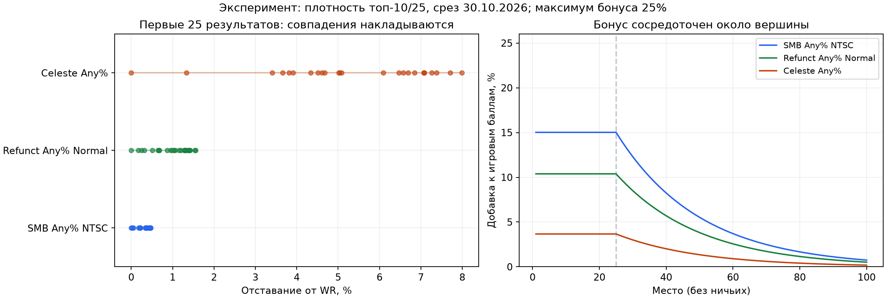

# Плотность топ-10 и топ-25: дополнение к эксперименту

**Статус: исследование, без изменения рабочего рейтинга.** Все вычисления
выполнены локально на прежней выгрузке. Нового обращения к PostgreSQL или источнику
не было. Предыдущие результаты сохранены отдельно:
[качество и количество](../ranking_quality_20261127/README.md).

Проверено 10 конфигураций на том же срезе 30 октября 2026: **135 022 раннера,
3 001 зачёт**. Полный топ-25 есть в **1 409** зачётах. Остальные имеют от 10 до
24 участников, и плотность топ-25 для них неизвестна.

## Какую характеристику добавили

Плотность вершины дополняет число участников: большой лидерборд не обязательно
имеет тесно расположенные лучшие результаты. Но текущий снимок показывает
**близость результатов**, а не активную борьбу именно сейчас. Для активности
нужны даты улучшений, число разных авторов и смены позиций за выбранный период.
В этом эксперименте динамика не вычислялась.

Для первых десяти и первых двадцати пяти участников отдельно считаются:

- относительный разрыв между лучшим и последним результатом окна;
- число различных значений результата;
- медианный промежуток между соседями;
- аналогичные показатели без лидера, чтобы видеть плотную группу за оторвавшимся WR;
- отдельно разрыв первого и второго.

Число участников и базовая сила места из предыдущего эксперимента сохраняются.
Плотность добавляет **ограниченный бонус к игровым баллам**, а не заменяет их.

## Формула исследовательского бонуса

Для окна из K участников, где K=10 или 25:

```text
spread_K = abs(ln(value_K / value_1))
U_K = (число различных значений в окне - 1) / (K - 1)
D_K = U_K × τ / (τ + spread_K)
τ = ln(1,01)
D = (D_10 + D_25) / 2
```

Малый разрыв даёт высокую плотность. `U_K` ослабляет свидетельство плотности
при совпадениях: нулевой разрыв не должен автоматически давать максимальный
бонус. Это эвристика неопределённости, а не измеренная вероятность конкуренции.
При полном совпадении результатов `D_K=0`; базовые баллы за достижение остаются.
Реальная конкуренция за точный кадр тоже может породить ничьи, поэтому эта
эвристика способна недооценивать такие категории и требует отдельной проверки.

Если участников меньше K, показатель окна хранится как отсутствующий. В бонус
он вносит ноль; знаменатель среднего остаётся равным двум. Поэтому поле из
10–24 участников может получить максимум половину общей надбавки. Неполное
окно не выдаётся за полноценный топ-25.

Окна задаются первыми K строками отсортированного PB каждого участника.
Ничьи на границе окна обрезаются только для подсчёта его статистик; выбор
конкретных игроков с одинаковым результатом не меняет эти статистики.
В оценке игрока используется средняя позиция группы ничьих, поэтому все
участники одной ничьей получают одинаковые баллы.

```text
m = место RANK + (размер группы ничьих - 1) / 2
L(m) = exp(-max(0, m - 25) / 25)
игровые баллы = прежние игровые баллы × (1 + α × D × L(m))
α = 0,25 в основном варианте
```

Максимальная надбавка — **25% к игровому вкладу**. В топ-25 она учитывается
полностью, дальше плавно ослабевает. Для 100-го места её абсолютный максимум
около 1,245%, для 1000-го практически ноль. Благодаря этому дальний результат
не получает существенную премию лишь за тесное соперничество лидеров.

После добавки снова выбирается **один лучший зачёт каждой игры**. Все игровые
вклады сортируются заново и складываются с весами 1; 0,9; 0,81; …, без ограничения
числа игр. Поэтому бонус может изменить и выбранную категорию, и порядок игр.
Теоретическая граница итоговой суммы теперь 1250 вместо 1000 у предшествующего
кандидата. Это не шкала релиза.

Все параметры — `τ`, максимум бонуса, граница 25 и скорость убывания — выбранные
настройки эксперимента. Они пока не калиброваны на независимых оценках сложности.

## Что видно в реальных зачётах

Разрывы указаны от WR, по сопоставимым таймерам данного зачёта. Надбавка — для
позиции в топ-25, до взвешивания игрового вклада в общем портфеле.

| Зачёт | Участников | Разрыв 10-го | Разрыв 25-го | Надбавка |
|---|---:|---:|---:|---:|
| Super Mario Bros. Any%, NTSC, time | 1933 | 0,339% | 0,469% | 15,02% |
| Refunct Any%, Normal, IGT | 1658 | 0,952% | 1,556% | 10,39% |
| Celeste Any%, IGT | 7041 | 4,680% | 7,992% | 3,67% |

У Celeste существенно больше участников, но плотность этой вершины ниже.
Формула теперь различает два наблюдаемых свойства. Из этого **не следует**, что
спидран Celeste проще: на относительные разрывы влияют механики, маршруты,
случайность, неуправляемое время и другие свойства категории.



[SVG для экспорта](evidence/density.svg).

В **13** полях весь топ-10 совпадает по значению. Компонента `D_10` для них
нулевая. У трёх из этих полей топ-25 уже содержит разные значения и даёт
ненулевую добавку через `D_25`. Фактическую точность таймера из количества
десятичных знаков не выводили; без неё близость разных значений тоже может
переоценивать наличие борьбы.

## Что изменилось в общем топе

Сравнение — с кандидатом предыдущего эксперимента, **не с действующим релизом**.

| Раннер | Без плотности | С плотностью | Баллы до | Баллы после |
|---|---:|---:|---:|---:|
| Nolyswag | 1 | 1 | 201,656 | 216,718 |
| Niftski | 3 | 2 | 183,704 | 203,388 |
| Odme | 2 | 3 | 187,527 | 192,842 |
| Majoog | 4 | 4 | 181,693 | 187,316 |
| SlothLord | 5 | 5 | 176,985 | 180,515 |
| mucktro | 6 | 6 | 176,444 | 177,451 |
| smythe | 9 | 7 | 163,371 | 175,069 |
| Cads | 13 | 8 | 159,192 | 171,668 |
| BigCheese | 10 | 9 | 163,075 | 171,485 |
| JesseKola | 8 | 10 | 166,200 | 169,910 |

В топ-100 сохранились **93** раннера. Niftski получает 15,02% надбавки к
игровым баллам за SMB, 2,63% за выбранный зачёт Red Ball и 11,81% за SMB3.
Для трёх ведущих вкладов Odme надбавки составляют 3,78%, 3,06% и 2,47%.
Это объясняет перемещение; узнаваемость имён не использовалась как проверка
справедливости результата.

## Устойчивость и контрпримеры

| Вариант | Общих с предыдущим топ-100 | Общих с основным вариантом плотности |
|---|---:|---:|
| Без надбавки | 100 | 93 |
| Только топ-10 | 93 | 100 |
| Только топ-25 | 94 | 99 |
| Среднее топ-10/25, максимум 25% | 93 | 100 |
| Плотность группы без лидера: 2–10 и 2–25 | 93 | 100 |
| Максимум 10% | 98 | 95 |
| Максимум 50% | 91 | 97 |
| Масштаб относительного разрыва 0,5% | 95 | 98 |
| Масштаб относительного разрыва 2% | 93 | 100 |
| Бонус только для направления «меньше — лучше» | 93 | 100 |

Совпадение состава сотни не означает совпадение порядка или независимое
подтверждение модели. Для обратных категорий логарифм отношения положительных
значений математически применим, но физический смысл очков и времени разный;
отключение бонуса в них проверено как отдельная конфигурация.

Искусственные поля из 25 участников дают:

- времена 100; 100,01; …; 100,24 — надбавку **21,54%**;
- времена 100; 101; …; 124 — **1,85%**;
- 25 совпадающих результатов — **0%**;
- лидер 80, остальные 100; 100,001; …; 100,023 — **1,07%**.

Последний случай принципиален: плотная группа за лидером не означает тесную
борьбу с самим WR. Диагностика `inner10/inner25` показывает эту группу отдельно,
а альтернативная конфигурация позволяет увидеть эффект её включения в бонус.
Основной вариант использует разрывы от первого места и остаётся консервативным
в таком случае. Отдельная высокая оценка выдающегося лидера уже присутствует
в базовом компоненте места.

Проверены границы бонуса, одинаковые оценки при ничьих, монотонность баллов
внутри каждого поля, полнота полей, сохранение охвата и воспроизведение первых
20 мест предыдущего эксперимента с точностью 1e-6. Проверки на искусственных
полях включают единицы измерения, обратное направление, вырожденные окна,
изолированный WR и убывание бонуса вдали от вершины. Расчёт занял **13,407 с**.

## Следующий вопрос методики

Плотность полезна как отдельный ограниченный компонент, но не заменяет оценку
силы соперников и истории их результатов. Для утверждения «борьба идёт сейчас»
следует отдельно посчитать за 30/90 дней число разных игроков, улучшивших PB
около вершины, и реальные смены позиций. Старые плотно расположенные результаты
не должны автоматически считаться текущей активностью. Такой временной бонус
изменил бы смысл рейтинга в сторону текущей формы; его здесь не добавляли.

## Файлы и воспроизведение

```powershell
python docs/research/ranking_density_20261127/experiment.py --output exports/ranking-density-new
```

Вход по умолчанию — неизменённый `exports/ranking-quality-20261127/`. SHA-256
входного CSV проверяется до расчёта. Скрипт откажется писать в существующую
папку вывода. Для другой исходной выгрузки есть `--input`, но сравниваемый
предыдущий эксперимент должен соответствовать ей.

- [experiment.py](experiment.py) — стандартный Python, доступ к БД не нужен;
  импортирует только формулу и ранжирование предыдущего исследовательского скрипта.
- [render.py](render.py) — Matplotlib, подготовка компактных результатов и графика
  из исходных датированных папок; повторный запуск обновляет артефакты этой папки.
- [evidence/results.json](evidence/results.json) — параметры, проверки, 10 топов,
  подробные вклады выбранных раннеров, реальные примеры и искусственные поля.
- [evidence/top20_comparison.csv](evidence/top20_comparison.csv) — первые 20 мест
  всех конфигураций.
- `exports/ranking-density-20261127/all_rankings.csv` — полные рейтинги, вне Git.
- `exports/ranking-density-20261127/fields.json` — статистики всех 3 001 полей,
  вне Git. В компактные материалы включены только выбранные примеры.

Предыдущие исследовательские результаты и release-файлы не переписывались.
Commit/push для этого дополнения не выполнялись.
