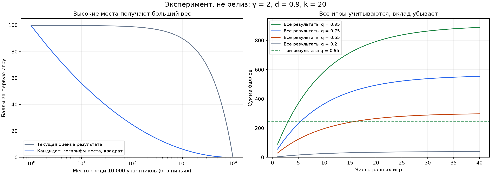

# Качество и количество достижений: эксперимент 27 ноября 2026

**Статус: исследование, в рабочий рейтинг не внедрено.** SQL Superset, DAG,
витрины, образы и опубликованные материалы приёмки не изменялись. Запрос к
PostgreSQL выполнен в `REPEATABLE READ, READ ONLY`; расчёт вариантов — локально.
Сбор источника не запускался. Commit/push для этого эксперимента не выполнялись.

## Что проверяли

Пользователь хочет учитывать качество и количество достижений, причём все
доступные игры, а не жёстко обрезанный список из десяти. Несколько выдающихся
достижений должны цениться выше большого числа слабых.

Сравнили **15 вариантов**: разные оценки результата, сумма десяти или всех игр,
усиление качества степенью, убывающий вклад игр, чувствительность коэффициентов
и экспериментальная добавка за близость времени к вершине.

Главное наблюдение: простая отмена ограничения десяти игр усиливает прежний
перекос. Лучше работает сочетание **выделения высоких мест, нелинейной оценки
качества и убывающего вклада всех игр**. Это кандидат для дальнейшего исследования,
а не доказанный рейтинг мастерства.

## Данные и сопоставимость

- Сборка `cef0cb6d0c3ec3fa535d95228cd8f1960028ec5c0759e5f124fe4b0111306e0d`.
- Срез: **30 октября 2026, 21:28:36 UTC**, дата эксперимента не является датой данных.
- **254 692 текущих сольных PB, 135 022 раннера, 3 001 сопоставимый зачёт, 121 игра.**
- Учитываются поля от 10 участников; изолированные маленькие категории по-прежнему
  не получают оценки. «Все игры» означает все подходящие игры имеющегося среза.
- Один лучший зачёт на игру, один PB на участника в зачёте. Дополнительные копии
  «по платформе» исключены; платформенные переменные исходных правил сохранены.
- **396 полей** имеют направление «больше — лучше». Место вычислено по исходному
  направлению; содержащиеся в таймере очки не объявляются длительностью.
- Медиана числа подходящих игр — **1**, максимум — **22**. Более десяти игр имеют
  **79 раннеров**. Поэтому отмена лимита сама по себе затрагивает небольшую группу.
- Выборка ограничена собранными играми и завершёнными цепочками; это не мировой
  рейтинг всех участников сайта и не полная биография каждого раннера.

Контроль: локально воспроизведены численность оценённых раннеров и **все первые
20 мест действующего рейтинга**, баллы совпали с точностью `1e-6`.
Выгрузка заняла 4,657 с; последний расчёт 15 вариантов — 14,891 с на текущем ПК.
Это измерения исследовательского расчёта, не SLA будущего SQL дашборда.

## Кандидат: все игры, сильнее ценится качество

Для каждого результата:

```text
N = количество сопоставимых сольных участников
r = место RANK, T = количество участников с таким же результатом, включая самого игрока
m = r + (T - 1) / 2                     # средняя позиция группы ничьих
C = (N - 1) / (N - 1 + k)               # поправка за размер поля
P = 1 - ln(m) / ln(N)                   # выделение высоких мест
q = C × P                              # условное качество от 0 до 1
```

В каждой игре выбираем максимальное `q`, затем сортируем игровые вклады по
убыванию. Число разных игр `G` не ограничиваем:

```text
S = 100 × Σ(j=1…G) d^(j-1) × q_j^γ
Рабочая точка эксперимента: k = 20, γ = 2, d = 0,9.
```

`γ` отвечает за приоритет качества, `d` — за ценность широты. При `d=0,9`
веса игр: 100%, 90%, 81%, …; одиннадцатая получает 34,87%, двадцатая — 13,51%
вклада игры такого же качества на первой позиции. Игра с нулевой оценкой
не добавляет баллов. Улучшение результата не уменьшает сумму, сильная новая игра
попадает выше в списке. Расчёт не зависит от порядка загрузки игр.

Все коэффициенты выбраны для эксперимента, а не обучены на независимой разметке.
`C` не является вероятностью или доказательством сложности. Возведение `q` в
квадрат усиливает и различие мест, и штраф малого поля; чувствительность `k`
поэтому проверяется отдельно.

При этой конфигурации сумма меньше **1000** даже при неограниченном числе игр.
Это верхняя граница геометрического ряда, не нормировка на текущего лидера.
Варианты с другим `d` или простой суммой имеют другую шкалу; их баллы напрямую
между собой не сравниваем, сравниваем места и состав топа.



[Векторный график для экспорта](evidence/formula_tradeoffs.svg).

## Изменения на реальных данных

«Игры» — число подходящих игр в срезе, а не число игр, известных человеку.
Каждое место ниже относится к **конкретному зачёту**, не ко всей игре целиком.

| Раннер | Текущий рейтинг | Кандидат | Игры | Баллы кандидата |
|---|---:|---:|---:|---:|
| Nolyswag | 207 | 1 | 5 | 201,656 |
| Odme | 4 | 2 | 15 | 187,527 |
| Niftski | 787 | 3 | 3 | 183,704 |
| Majoog | 35 | 4 | 8 | 181,693 |
| SlothLord | 270 | 5 | 5 | 176,985 |
| mucktro | 841 | 6 | 3 | 176,444 |
| ThinkLater | 8 | 7 | 11 | 167,690 |
| JesseKola | 154 | 8 | 5 | 166,200 |
| smythe | 5 | 9 | 10 | 163,371 |
| BigCheese | 22 | 10 | 10 | 163,075 |

**Niftski:** 1/1933 в Super Mario Bros. Any% NTSC, 4/1164 в Red Ball 12 Levels,
11/594 в Super Mario Bros. 3 Any% (No Wrong Warp). Вклады: 97,96 + 56,18 + 29,57.
Три сильных достижения перестают теряться среди длинных портфелей.

**Odme:** остаётся вторым с 15 играми. Среди ведущих вкладов 2/207 в Super Mario 64
120 Star VC (ничья двух участников) и 3/177 в Super Mario Galaxy 2 242 Stars 1P
Original. Игры после десятой добавляют ещё 1,08 балла: учитываются, но не решают
исход сами по себе.

**Zennan:** 1 → 65, 17 игр. Сильнейший выбранный вклад кандидата — 11/354 в одном
из зачётов Wii Sports Resort. После десятой игры добавляется 5,21 балла. Падение
означает изменение приоритета методики, а не доказательство, что игрок «слабый».

В топ-100 кандидата осталось **24** человека из действующего топ-100. Это крупное
изменение смысла оценки; успешное вычисление не доказывает его справедливость.
Полные названия зачётов, направления, ничьи и run ID доступны в профилях JSON.

## Что именно влияет на топ

| Вариант | Общих с текущим топ-100 | Общих с кандидатом | Среднее число игр у топ-20 |
|---|---:|---:|---:|
| Текущая оценка, десять игр | 100 | 24 | 12,25 |
| Текущая оценка, все игры | 94 | 24 | 13,35 |
| Логарифм места, десять игр, линейная сумма | 60 | 54 | 10,55 |
| Логарифм места, все игры, линейная сумма | 62 | 54 | 11,05 |
| Квадрат качества, все игры, без убывания | 28 | 93 | 7,90 |
| Квадрат качества, все игры, убывание 0,9 | 24 | 100 | 6,05 |
| То же + 30% компоненты близости к вершине | 25 | 94 | 6,75 |

Даже переход к квадрату без убывания уже заметно выделяет качество. Убывание
дополнительно снижает преимущество количества и устраняет жёсткую границу десяти.

## Проверка компромисса на искусственных портфелях

Здесь `q` задано специально, это не оценки конкретных людей. Слова «выдающийся»,
«умеренный» и «слабый» — условные обозначения значений 0,95, 0,55 и 0,20.
В большом поле даже `q=0,55` может соответствовать очень высокому месту; это
не «средний игрок сообщества».

| Портфель | Простая сумма 100q | Квадрат без убывания | Кандидат |
|---|---:|---:|---:|
| 3 × 0,95 | 285,00 | 270,75 | **244,58** |
| 10 × 0,55 | 550,00 | 302,50 | **197,03** |
| 30 × 0,55 | 1650,00 | 907,50 | **289,68** |
| 10 × 0,95 | 950,00 | 902,50 | **587,82** |
| 1 × 0,95 | 95,00 | 90,25 | **90,25** |
| 10 × 0,20 | 200,00 | 40,00 | **26,05** |

Кандидат выполняет полезное требование: **сколько угодно игр с q≤0,20 дадут
не больше 40 баллов**, то есть не обойдут даже одну игру с q=0,95 (90,25 балла).
При этом десять выдающихся результатов существенно лучше трёх.

Но три результата 0,95 уступят уже шестнадцати результатам 0,55. Это оставляет
заметную ценность широте. При `γ=3` такой исход исключается: три результата 0,95
дают 232,35 балла, а бесконечное число результатов 0,55 — не больше 166,38.
Выбор между этими условиями — содержательная политика рейтинга, не вопрос
вычислительной точности. На реальных данных `γ=3` сильнее приближает топ к
рейтингу специалистов и оставляет лишь 58 из 100 лидеров кандидата.

## Чувствительность: почему это ещё не релиз

| Изменение от кандидата | Общих в топ-100 с кандидатом |
|---|---:|
| γ = 1,5 | 85 |
| γ = 3 | 58 |
| d = 0,8 | 92 |
| d = 0,95 | 96 |
| k = 5 | 76 |
| k = 50 | 83 |

Среди этих семи конфигураций, включая кандидата, Nolyswag занимает 1–2 места,
Odme — 1–20, Niftski — 2–14. Это диапазон чувствительности к политике, **не
статистический доверительный интервал**. Таблица всех семи мест первых двадцати
раннеров находится в `results.json → sensitivity`.

## Время, плотность и сложность

Дополнительная исследовательская компонента:

```text
gap = abs(ln(value / WR_value))
scale = 10-й перцентиль gap по текущим PB этого зачёта
Q = exp(-gap / max(scale, 0,001))
q_gap = C × ((1-w)P + wQ)
```

Проверены `w=0,1 / 0,3 / 0,5`: общих с кандидатом в топ-100 соответственно
98 / 94 / 91. При вырожденном масштабе берётся только компонент места;
таких полей **55**. Нижний предел 0,001 — экспериментальная константа,
не измеренная точность таймера. Отношение инвариантно к смене единиц и развороту
направления для положительных значений; это не доказывает содержательную
сопоставимость очков и длительности между играми.

Близость времени пока **не включена в основной кандидат**: исключительный новый
WR может поменять оценки всех остальных, плотность зависит от округления,
маршрута и правил, а не только от навыка. Хорошая близость к рекорду сама по себе
не является основанием считать маленькое поле сильным.

Остаются нерешённые вопросы:

1. **Сила соперников.** Размер поля не доказывает уровень его участников.
   При неизменном десятом месте добавление слабого хвоста до 10 000 вместо 1 000
   участников повышает первый игровой вклад с 42,72 до 56,03. Эта зависимость
   сознательно присутствует, и её нельзя выдавать за измеренную сложность.
2. **Малые элитные поля.** WR среди 100 получает 69,21 балла, среди 10 000 — 99,60.
   Сотое место среди 10 000 получает около 24,90. При иной оценке соперников
   порядок может быть другим; сейчас независимой калибровки нет.
3. **Продолжительность и цена попытки.** Шестичасовое прохождение не измеряет
   суммарные тренировки и сбросы. Бонус за часы не добавлялся.
4. **Количество категорий.** Дубли одной категории не дают дополнительных
   вкладов. Но много действительно разных зачётов всё ещё даёт больше шансов
   найти удачный максимум; один максимум на игру не полностью устраняет это.
5. **Универсальность навыков.** Разные издания и игры одной серии считаются разными
   играми по ID. Жанровое разнообразие и независимость навыков не измерены.
6. **Неопределённость выборки.** Вне сохранённых игр достижения неизвестны.
   Полный топ из 135 тысяч строк использует float; воспроизведение первых 20
   проверено с точностью 1e-6, но пограничные равенства всего топа не сверялись
   побитово с PostgreSQL numeric. Для релиза потребуется определённая политика
   численной точности и отдельные SQL-тесты новой формулы.

Следующий содержательный шаг — заранее выбрать пары портфелей, которые методика
должна упорядочивать определённым образом, включая противоположные примеры, и
проверить на них несколько близких конфигураций. Независимая экспертная оценка
конкретных зачётов полезнее подгонки коэффициентов под знакомые имена.
Модель соперников по достижениям в других играх — отдельный следующий эксперимент;
её нельзя считать реализованной здесь.

## Воспроизведение и файлы

Из корня репозитория, пока доступен существующий worker:

```powershell
python docs/research/ranking_quality_20261127/experiment.py extract --output exports/ranking-quality-new
python docs/research/ranking_quality_20261127/experiment.py analyze --output exports/ranking-quality-new
python docs/research/ranking_quality_20261127/render.py --input exports/ranking-quality-new
```

Первые две операции требуют стандартный Python 3.11; внутри существующего
worker используются уже установленные psycopg и подключение проекта. Секреты
не передаются в аргументах команд и не выводятся. `render.py` использует локальный
Matplotlib (установлен в среде автора); зависимость production не менялась.
`extract` откажется перезаписывать существующий `input.csv`. `render` обновляет
только артефакты этого исследования; для нового датированного эксперимента
сохраните их в новой папке, не перезаписывая этот исторический результат.

`analyze` намеренно проверяет совпадение с опубликованным срезом и первой двадцаткой
из приёмки. Для другой сборки нужно явно обновить ожидаемую базу сравнения в новой
копии эксперимента, а не отключать проверку молча.

| Файл | Содержимое |
|---|---|
| [extract.sql](extract.sql) | Только SELECT текущих сольных PB и статистик полей |
| [experiment.py](experiment.py) | Выгрузка, 15 вариантов, проверки, подробные локальные таблицы |
| [render.py](render.py) | Воспроизводимая подготовка компактных CSV/JSON и графика |
| [evidence/results.json](evidence/results.json) | Срез, SHA-256 входа, проверки, топы, профили, чувствительность |
| [evidence/comparison.csv](evidence/comparison.csv) | Первые 20 раннеров каждого варианта |
| `exports/ranking-quality-20261127/input.csv` | Локальная исходная выгрузка, около 78 МБ, вне Git |
| `exports/ranking-quality-20261127/all_rankings.csv` | Все 135 022 раннера во всех 15 вариантах, вне Git |
| `exports/ranking-quality-20261127/candidate_contributions.csv` | Все игровые вклады кандидата, вне Git |

Проверены монотонность места, штраф ничьих, геометрическая граница, вклад
одиннадцатой игры, инвариантность логарифмического разрыва к единицам и направлению,
вырожденный разброс, поведение искусственных портфелей. На фактическом результате
все баллы конечны и неотрицательны, игровые вклады уникальны, сумма всех игр не
меньше суммы десяти, охват и базовый топ воспроизведены.

[Действующая методика](../../analytics/RUNNER_RANKING.md).
