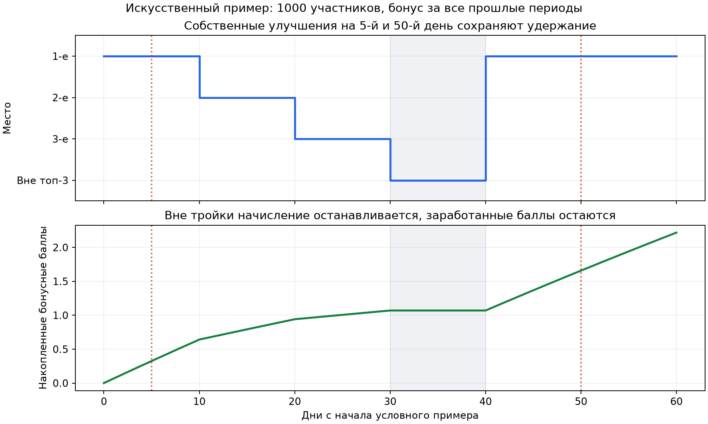

# Накопленный бонус за удержание топ-3

**Эксперимент, без выпуска в рабочий рейтинг.** Пользователь выбрал сохранение
бонуса за уже закончившиеся периоды. Предыдущие эксперименты:
[качество и количество](../ranking_quality_20261127/README.md),
[плотность топ-10/25](../ranking_density_20261127/README.md).

## Принятая семантика

- Время на первом, втором и третьем местах приносит дополнительный вклад.
- Улучшение собственного PB при сохранении места **не обнуляет срок** и не
  создаёт второй параллельный счётчик. Само количество публикаций бонуса не даёт.
- При переходе с первого места на второе накопленное остаётся, новые дни
  начисляются по весу второго места. Аналогично для третьего.
- При выходе из топ-3 начисление прекращается, прошлые заслуги сохраняются.
- При возвращении в тройку накопление возобновляется.
- Ничья не считается поражением. Участники делят веса занятых призовых позиций.
- Начисление начинается только при **10 разных участниках в поле в тот момент
  истории**, а не задним числом после роста популярности игры.

Сохраняется компонент исторических заслуг. Текущие баллы, порядок игровых
вкладов и итоговое место раннера могут изменяться по другим причинам. По-прежнему
берётся один максимальный суммарный вклад на игру, а не сумма всех категорий;
все подходящие игры учитываются с весами 1; 0,9; 0,81; … .

## Почему бонус отдельный, а не множитель текущего места

Если просто умножать текущую оценку на коэффициент за прошлое удержание,
ценность заслуги уменьшится при ухудшении текущего места. Здесь исторические
баллы прибавляются отдельно и сохраняются даже у раннера, уже вышедшего из тройки.
Это реализует выбранное пользователем правило.

Для каждого интервала между историческими событиями:

```text
q(t) = (N(t)-1)/(N(t)-1+20) × (1 - ln(m(t))/ln(N(t)))
m(t) = средняя позиция группы ничьих
w(t) = 1 для первого, 0,6 для второго, 0,3 для третьего места
dE = длительность интервала в днях × w(t) × q(t)^2
E = сумма dE по всем прошлым и текущему периодам в топ-3
B = 25 × E / (E + 365)
```

При ничьей на местах `r…r+T-1` вес каждого равен сумме весов призовых слотов
в этом диапазоне, делённой на T. Например, двое на первом делят `1+0,6`,
по 0,8 каждому; десять одинаковых первых результатов делят `1+0,6+0,3`.
Для результата ниже тройки вес нулевой.

`E` — **условные дни с учётом качества**, не обычные календарные дни. Качество
вычисляется по историческому размеру поля и месту. Текущая плотность топ-10/25
не приписывается прошлым годам. В небольшом поле или на третьем месте E растёт
медленнее. Сумма E никогда не уменьшается при добавлении последующего времени
в неизменённой истории; вне тройки она постоянна.

Бонус плавно растёт: 365 условных дней дают 12,5 балла, 730 — 16,67,
1825 — 20,83. Максимум — 25 баллов на зачёт. Предел, веса мест и масштаб 365
выбраны для эксперимента, это не обученные коэффициенты и не олимпийский стандарт.

```text
Баллы зачёта = прежние баллы качества с плотностью + B
Баллы игры = максимум по её зачётам
Итог раннера = сумма всех игровых вкладов с весами 0,9^(j-1)
```

Общий теоретический предел при этих настройках — 1500: до 125 баллов текущего
достижения с плотностью и до 25 исторических, затем геометрическая сумма.
Это шкала исследования; опубликованная шкала релиза не менялась.



График — искусственный проверочный пример, не история конкретного игрока.
Серый интервал означает выход из тройки; пунктиры — собственные улучшения.
[SVG для экспорта](evidence/retained_bonus.svg).

## Из какой истории это посчитано

Выгружены **606 324 подтверждённых на дату среза сольных рана**, включая
`obsolete`, в тех же 3001 зачётах. PostgreSQL читался в одной транзакции
`REPEATABLE READ, READ ONLY`. Срез остаётся **30 октября 2026, 21:28:36 UTC**,
сборка `cef0cb6d0c3ec3fa535d95228cd8f1960028ec5c0759e5f124fe4b0111306e0d`.
До 27 ноября удержание не продлевается: новых данных за этот промежуток нет.

Основная временная шкала — `verified_at`, сохранённая дата подтверждения.
Альтернатива — `submitted_at`, дата подачи. Их нельзя смешивать в одном
лидерборде или подставлять одну вместо отсутствующей другой. `performed_at`
не использовалась: давно выполненный, но поздно опубликованный ран не должен
задним числом считаться публичным лидером.

События с одинаковым временем применяются одним пакетом. Для каждого игрока
поддерживается исторический PB; из него вычисляются `RANK`, ничьи и число
участников. Даже новый игрок за пределами тройки меняет размер поля и скорость
дальнейшего начисления. Первоначальные времена достижения и повторные
улучшения одного раннера не создают нескольких участников.

Поле допускается к начислению только если:

1. У всех входящих в реконструкцию ранов известна выбранная дата, нет будущих дат.
2. Восстановленные на конец среза участники и их лучшие значения **полностью**
   совпадают с текущими сольными PB. Лишние исторические участники также
   считаются расхождением.

| Проверка | По подтверждению | По подаче |
|---|---:|---:|
| Полей, прошедших проверки | 2841 | 2929 |
| Полей с неизвестным бонусом | 160 | 72 |
| Полей с пропусками даты | 149 | 61 |
| Полей с расхождением конечного состояния | 136 | 67 |
| Ранов без выбранной даты | 6202 | 3177 |
| Текущих PB в прошедших проверку полях | 197654 | 214970 |
| Раннеров с ненулевым историческим вкладом | 10225 | 10580 |

Причины пересекаются, их числа нельзя складывать. Будущих дат в этом входе
не обнаружено. По основной шкале пригодная для эксперимента история покрывает
**77,61% текущих PB**, хотя доля прошедших проверку полей выше: проблемы
затрагивают в том числе большие категории.

Для неизвестной истории **дополнительные баллы пока не начисляются**, базовые
баллы сохраняются, а статус остаётся «неизвестно». Это не доказательство
отсутствия достижений и создаёт существенное ограничение сравнения раннеров.

Проверка конечного состояния необходима, но не доказывает полноту всех
промежуточных состояний. Это ретроспективная реконструкция из ранов,
подтверждённых в сохранённом архиве, **не архив официальных ежедневных таблиц**.
Удалённые или позже отклонённые результаты, повторные проверки, изменения правил
и неполная история могут изменить настоящие периоды удержания. Сохранённая
дата подтверждения не доказывает, что известна вся история модерации.

## Пример сохранённого достижения

**Niftski, Red Ball, 12 Levels:** текущее место — 4-е из 1164. По шкале
подтверждения восстановлено примерно:

- 469,1 дня на первом месте;
- 899,6 дня на втором;
- 44,0 дня на третьем;
- четыре собственных улучшения во время нахождения в тройке.

После учёта исторического размера поля, мест и ничьих получается **E=880,9**.
Начислено **17,68 исторического балла**, хотя сейчас игрок вне топ-3.
Это вторая игра в его итоговом портфеле: после веса 0,9 она добавляет около
15,91 балла к общему результату.

По SMB и SMB3 у этого раннера бонус в данном эксперименте неизвестен: поля
не прошли проверку истории. Поэтому это не оценка всей его исторической карьеры.

**Nolyswag, выбранный зачёт ROBLOX: Speed Run 4:** около 795,1 дня на первом
и 5,0 на втором, одно собственное улучшение в период тройки. Накопленный
исторический бонус — 17,11 балла. В выбранном зачёте Eternal Towers of Hell
суммируются **три отдельных периода** пребывания в тройке — выход и возвращение
не уничтожают предыдущий вклад.

## Изменения общего экспериментального рейтинга

Сравнение с предыдущим **экспериментом плотности**, не с релизом. Эти места
зависят также от доступности истории: недоступный бонус не является нулевой
исторической заслугой. Например, у Odme три ведущих вклада имеют неизвестный
бонус, поэтому его перемещение нельзя объяснять только мастерством или стажем.

| Раннер | До удержания | С историческим бонусом | Баллы до | Баллы после |
|---|---:|---:|---:|---:|
| Nolyswag | 1 | 1 | 216,718 | 250,354 |
| Niftski | 2 | 2 | 203,388 | 219,296 |
| Majoog | 4 | 3 | 187,316 | 207,660 |
| Cads | 8 | 4 | 171,668 | 201,740 |
| SlothLord | 5 | 5 | 180,515 | 200,170 |
| ThinkLater | 11 | 6 | 168,675 | 199,768 |
| Odme | 3 | 7 | 192,842 | 199,049 |
| Katie4 | 25 | 8 | 154,885 | 195,655 |
| smythe | 7 | 9 | 175,069 | 195,251 |
| 777haveoursinsbeenforgiven | 17 | 10 | 161,255 | 192,502 |

## Проверенные варианты

| Вариант | Общих с прежним топ-100 | Общих с накопительным вариантом |
|---|---:|---:|
| Без удержания | 100 | 82 |
| Все прошлые периоды, максимум 25 баллов | 82 | 100 |
| Только текущее непрерывное пребывание в тройке | 84 | 94 |
| Только непрерывное удержание текущего конкретного места | 83 | 93 |
| Половина максимума за 1095 условных дней вместо 365 | 90 | 90 |
| Максимум 10 баллов | 93 | 89 |
| Максимум 50 баллов | 69 | 86 |
| Та же накопительная формула по дате подачи | 84 | 94 |

Основной вариант выбран по ответу пользователя: **все прошлые периоды
сохраняются**. Остальные оставлены для сравнения. Дата подачи имеет иную
семантику и иное покрытие; различия между двумя шкалами не являются чистой
оценкой влияния задержки модерации.

Бонус не утверждает, что игрок активно защищал позицию каждый день: рекорд
в неактивном поле тоже продолжает удерживаться. Исторический размер поля,
качество и предел бонуса ограничивают преимущество давности, но полностью
не устраняют его. Отдельная проверка активности соперников потребовала бы
ещё одного явно сформулированного правила.

## Проверки и воспроизведение

Проверены собственные улучшения без сброса срока, переход 1→2, выход из
тройки и возвращение, сохранение баллов вне тройки, одновременные события,
ничьи, порог десяти участников, обратное направление, граница бонуса.
Реконструкция обрабатывает целые исходные значения score, а не округлённые
секунды. Все первые 20 мест предыдущего эксперимента воспроизведены с
точностью 1e-6; численность раннеров сохранена. Выгрузка — 4,125 с,
последний полный расчёт восьми вариантов — 21,890 с на текущем ПК.

```powershell
python docs/research/ranking_tenure_20261127/replay.py
python docs/research/ranking_tenure_20261127/extract.py --output exports/tenure-new/input
python docs/research/ranking_tenure_20261127/analyze.py --input exports/tenure-new/input --output exports/tenure-new/analysis
```

Анализ сверяет новую выгрузку с исходными `exports/ranking-quality-20261127/`
и `exports/ranking-density-20261127/`; это один и тот же срез. Для новой сборки
нужен отдельный согласованный набор базовых экспериментов. Выгрузка и анализ
отказываются перезаписывать существующие папки вывода.

| Файл | Содержимое |
|---|---|
| [extract.sql](extract.sql), [extract.py](extract.py) | Только чтение исторического входа |
| [replay.py](replay.py) | Реконструкция и проверки поведения |
| [analyze.py](analyze.py) | Проверки покрытия, восемь формул, полные локальные таблицы |
| [render.py](render.py) | Компактные артефакты и рисунок; Matplotlib |
| [evidence/results.json](evidence/results.json) | Покрытие, топы, игровые вклады и накопленные сроки |
| [evidence/top20_comparison.csv](evidence/top20_comparison.csv) | Первые 20 мест восьми вариантов |
| `exports/ranking-tenure-20261127/input/` | История и SHA-256, вне Git |
| `exports/ranking-tenure-20261127/analysis_lifetime/` | Итоговые полные рейтинги, сроки и аудит каждого поля, вне Git |

Стандартный Python достаточен для анализа; выгрузка использует существующий
worker и его подключение, не выводя секреты. Рабочие SQL, DAG, Superset,
данные ODS/DDS и предыдущие доказательства не менялись. Commit/push не выполнялись.
