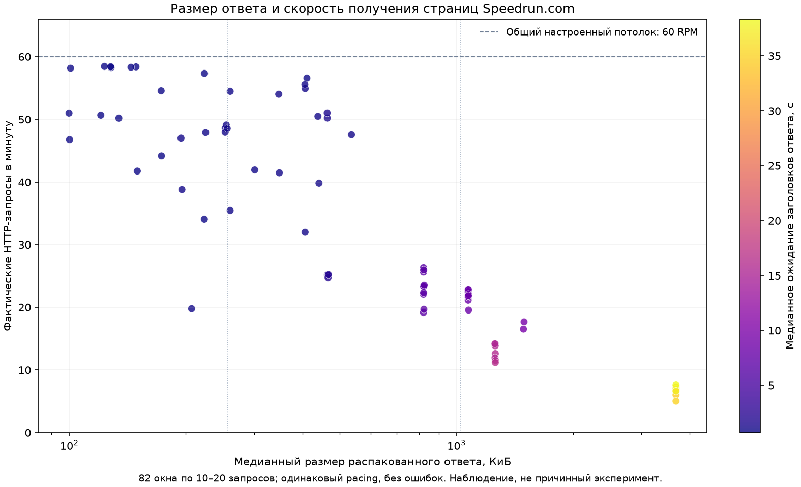

# ЛР1: сбор исходных данных Speedrun.com

## 28 октября: исправления перед продолжением контрольного сбора

Добавлен проверяемый fallback date-large: при стабильном недоборе выполняется
обычная пагинация всего проблемного раздела с проверкой границ. Исходная
диагностика дат и raw остаются; ошибки фильтров/бюджета не игнорируются.
Игры без full-game категорий дают not_applicable и не останавливают очередь
после подтверждения трёх ODS. Неизвестная классификация остаётся ошибкой.

Защита диска теперь учитывает измерение хоста: infra/host_disk_watch.py,
резерв 20 ГиБ, обновление каждые 30 с, stale после 120 с. --all требует монитор;
новые HTTP останавливаются при нарушении условий, начатые ответы сохраняются.
Виртуальная проверка места остаётся дополнительной. Default потолка — 40 RPM,
что не является обещанным лимитом сервиса.

Большие повторяющиеся playerList разделяют общий сжатый блок в ODS. Точные
ответы, порядок массива, все версии профилей и история A→B→A восстанавливаются.
На одинаковых 20 сохранённых ответах SM64 обработка профилей: 148940→22341
посещений; логические записи: 19,15→14,89 МБ; время диагностической упаковки
13,765→11,449 с. Проверена семантическая эквивалентность. Это последовательный
замер при активном сборе, не сравнение трёх хранилищ и не доказанный коэффициент
ускорения всего ETL. Сетевой ответ и исходный journal остаются полными.
[Параметры и результаты](player_list_compaction_20261028.json).

110 тестов с ETL_INTEGRATION=1 прошли без ошибок/пропусков, включая shared
roundtrip/replay в PG/Mongo/Garage. Точечный repair SM64 запущен; полный fresh
top10 и готовность к full пока не заявляются. Вайп/удаление бэкапов не выполнялись.

Источник repair SM64 завершён: 246 страниц, 24503 уникальных ID, границы
прошли проверку, 251 HTTP200 без429. Все24413 ID датированного прохода входят
в обычный; у дополнительных90 performedAt=null. Это объясняет недобор;
поля не заполнены вымышленными датами. Загрузка/финальный аудит ещё выполняются.
[Диагностика по сохранённым ответам](sm64_date_gap_20261028.json).

Repair завершён 09:36:58 UTC: все3DAG success, подтверждения всех трёх ODS
совпадают, независимый аудит1015ответов/истории/контрольныхточек прошёл.
Итоговые15разделов ранов проверены, прежние ограничения5WRстраниц сохранены.
Очередь продолжена с Subway:1complete/1running/8pending на09:41UTC.
[Итоговые подтверждения](sm64_standard_repair_20261028.json).

## 28 октября: проверка готовности перед предложенным wipe/full

Выполнен аудит текущих пакетов, подтверждений ODS, очереди, исходников и дисков;
новых запросов к Speedrun.com, удаления и запуска full не было. Пользователь
требует отдельного подтверждения перед запуском; до него данные/бэкапы сохраняются.
[Артефакт проверки](full_readiness_20261028.json).

**Свежий top10 пока не воспроизведён:** 07:22UTC очередь сама остановилась на
SM64 с partial; остальные 9 игр pending. Все три DAG SM64 success, подтверждения
трёх хранилищ по digest совпадают. В категории 16 Star verified при count=24503
до/после 45 диапазонов дат дали 24413 уникальных ID без пересечений. Разница 90
относительно счётчика ещё не объяснена; причина отсутствующих/недоступных дат
не доказана. 14 из 15 разделов проверены, один имеет date_partition_coverage_mismatch.
continue-on-drift эту неизвестную для него диагностику не обходит. Все 5 WR
страниц partial, что отдельно отражает ограничения endpoint, а не сбой записи.

Перед unattended full необходимы fallback/проверка недобора при date-large,
переход очереди через игры без full-game категорий с явной диагностикой и
контроль свободного места на физическом диске. Docker VHDX находится наC:
(свободно≈63,3 ГиБ), тогда как guard проверяет виртуальную ФС с≈946,5 ГиБ свободно.
Полной оценки объёма/длительности нет; repeated playerList остаётся затратой.
Свежий каталог содержит 52215 карточек, в области ранов 51396 основных игр; 819 CE
исключены. Только по 1 metadata HTTP / игру при 40 RPM — минимум 21,4 ч без ранов/WR,
повторов и загрузки. Это нижняя граница части работ, не прогноз полного обхода.

| Требование задания ЛР1 | Подтверждённое состояние |
|---|---|
| Airflow и хранилища в Compose | Реализованы, 6 постоянных сервисов healthy |
| Не менее 3 различных ETL | games_metadata/runs/players, текущая цепочка SM64 success |
| Сырые данные в 3 хранилищах | PG/Mongo/Garage; 5 пакетов текущего испытания с равными подтверждениями |
| Сравнение и выбор хранилища | Финальный entity-v2 benchmark и вывод ещё предстоят; прежний CSV исторический |
| Отчёт, код, Compose, демонстрация | Артефакты есть; итоговые отчёт/графики/демо требуют завершения, последние изменения локальны |

Задание не требует выгрузить весь сайт. --all означает каталог и доступные
full-game раны/WR/профили основных игр в согласованной области; IL и CE в обход
ранов не входят. Глобальный сбор не должен задерживать обязательное сравнение
хранилищ и подготовку защиты. Предложенный wipe данных/бэкапов пока не выполнен;
точные цели и исключения перечислены в актуальном начале docs/HANDOFF.md.

## 28 октября: резервная копия и настоящий запуск с пустых volumes

По явному запросу пользователя сохранено всё состояние6volumes speedrun-lab1
(около16,6ГБ до сжатия). Архивы занимают5547054320байт (5,17ГиБ); вне Docker:
exports/backups/pre-fresh-top10-20261028T061701Z. Сохранены также код/настройки,
старые метрики и исторические множества ID для последующего сравнения. ZIP
настроек содержит секреты и исключён из Git вместе с exports/.

После остановки сервисов с exit0 архивы проверены SHA-256/gzip CRC, восстановлены
в6отдельныхvolumes и сверены побайтово tar --compare. Из копий реально запущены
PostgreSQL/Mongo/Garage (network=none, без host-портов). Совпали все8ODSсчётчиков,
321контрольное подтверждение,10complete очереди и metadata Airflow. Garage вернул
те же2663ключа/размера/ETag с тем же digest; проверены3индекса снимков Subway
и3образца чанков по SHA-256. Только после этого удалены6исходных volumes и
пересоздан стенд --no-build. Временные volumes проверки убраны, архивы сохранены.
[Подтверждение восстановления/сброса](backup_reset_fresh_20261028.json).

До нового сбора подтверждены нули PG/Mongo/S3, receipts/DAG runs и отсутствие
старых snapshots/collections/batches. Init завершился0, сервисы healthy.
[Проверка пустого стенда](cold_start_empty_20261028.json).

Запущен lab1-top10-fresh-20261028: свежий каталог/рейтинг, топ10, date-large,
общий cap40RPM и окно4,5000HTTP/игру, continue-on-drift. Источник сначала30RPM,
поднимается к40. Старые HTTP/staging/пакеты не используются; baseline ID находятся
в отдельном comparison-input и читаются контроллером только после ETL. Первые
новые ответы GetGameList получены, сетевая ошибка повторилась автоматически.
Свежий каталог52215игр (ранее52207) уже подтверждён3ODS, рейтинг построен;
состав10игр совпал с прежним, стартовали раныSM64 с готовой3ODSmetadata.
[Начальное состояние запуска](fresh_top10_launch_20261028.json).

Контроллер сохраняет прогресс и после обхода создаёт comparison.json: совпадения
и различия состава топ10/ID/покрытия, подтверждения трёх копий. Свежие данные
могут отличаться из-за изменений источника и отсутствия прежней истории; разница
не доказывает удаление. Итоговая успешность нового топ10 пока не утверждается.

## 28 октября: известная игра, повтор с нуля и цена разбиения

Зафиксирован порядок запуска: batch/top-N/all получает каталог один раз перед
очередью; конкретная известная игра — только собственный GetGameData. Добавлен
CLI start-game с --game либо --game-id. --metadata-only сохраняет карточку и
метаданные в трёх ODS и не создаёт дочерние DAG; без флага — все три DAG.

Стратегия --runs-strategy date-large доступна и свежим single_game/batch без
старого repair snapshot. Default=standard, пороги count>10000 и playerList>=5000
и наличие release year. Иначе обычная пагинация; первый ответ используется повторно
локально, не перезапрашивается. Это эвристика, не обещание ускорения каждой игры.
Конфигурация фиксируется и сохраняется при resume, старые запуски не меняются.

Результаты проверки:96тестов с ETL_INTEGRATION=1, включая новый пустой staging,
новые отдельные namespace PostgreSQL/Mongo/Garage, свежий путь всех трёх статусов,
WR/профилей и date-партиций без base. Реальный Airflow: одиночная карточка —
1HTTP/GetGameData,3ODSready, runs/players отсутствуют; полный новый малый сбор —
10HTTP,11leaderboardID,8профилей,3DAGsuccess/3ODSready, без каталога/repair.
Малый раздел оставлен без дат. [Подтверждения](single_modes_evidence_20261028.json).
Это не полный свежий top10/date-large и не проверка удаления/развёртывания всех
volumes. Существующие данные не удалялись. Свежий HTTP меняет времена/response ID
и может содержание; утраченную собственную историю предыдущих состояний API
не восстанавливает. Retry/загрузка того же пакета — отдельный идемпотентный случай.

Число HTTP само по себе не характеризует скорость сбора. Журналы Subway No Coins:

| Раздел | Без дат: страницы + 2 проверки | Фактически с датами, probes/checks/retries | Трафик без дат, оценка, МБ | Фактический трафик, МБ | Время источника с датами, мин |
|---|---:|---:|---:|---:|---:|
| verified40 678 | 409 | 583 | 240,63 | 18,78 | 15,06 |
| rejected49 767 | 500 | 711 | 320,45 | 20,85 | 38,47 |

Оценка байтов без дат — размер образца первой страницы × число страниц, без
дополнительных границ; страницы могут отличаться. Фактические байты включают
ошибки. Число запросов выросло на42%, оценочный трафик снизился примерно в14раз,
поскольку playerList ограничен датами и меньше повторяется. Полный repair занял
66,86мин с429, прежними данными, загрузками/аудитом. Полного успешного старого
прохода для A/B нет, точный коэффициент ускорения всего ETL не измерен.

Контрпример: тот же набор53ID за2020год получен одним запросом за1,687с или
двумя полугодиями за4,781с, включая pacing. Мелкое разбиение замедлило этот
раздел; place/obsolete изменяются с контекстом фильтра. Поэтому обычные малые
разделы не делятся. [Стоимость и ограничения замера](runs_split_cost_20261028.json).
Основные метрики — полученные run ID/с, весь wall-time, байты и429; пик RPM
не заменяет их. Для полного свежего оптимизированного набора нужен отдельный
крупный пилот, текущая база для него не должна удаляться.

## 28 октября: размеры ответов, диапазоны дат и ремонт Subway

**Итог: очередь10complete/0partial, driver завершён28октября02:48МСК.**
Два раздела No Coins закрыты:40678verified и49767rejected, count до/после,
суммы листьев и уникальные ID совпали, пересечений нет. Все45разделов ранов
Subway проверены;43унаследованы с прежними временами. Три DAG success,
девять receipts ODS согласованы с exact digest, аудит1934ответов/47checkpoints
прошёл. Пакет содержит107736исторически наблюдавшихся leaderboard ID,
132534версии ранов,54823версии профилей участников (включая гостевые объекты)
и15сохранённых страниц WR. Бюджет1297/2500:1289HTTP200,5HTTP429,3сетевых ошибки.
Прежний бюджет639не изменился. [Итоговые подтверждения](subway_date_repair_20261028.json).

Queue complete относится к45разделам ранов. Общий manifest.coverage=partial
сохраняет ограничения исходной WR-истории без доказанной пагинации. Полнота
всего сайта/WR и полностью свежий цикл всех разделов этим не утверждаются.

Во время полного repair verified уже проверен:40678 ID, count до/после тот же,
57 листьев/440 страниц. На rejected после22302 ID и919 успешных ответов возникло
5 последовательных HTTP429 на одной странице (23:05:35..23:09:38UTC).
Следовательно55–58RPM не является доказанным устойчивым лимитом. Общая пауза
однократно продлена до23:19:38UTC под source.lock, прогресс/счётчики сохранены.
Одна явно учтённая дополнительная попытка этой страницы после паузы далаHTTP200;
это ручной разбор исчерпания5авто-попыток, не обнуление или бесконечные retries.
Клиент исправлен на увеличивающийся429 backoff60/120/240/480/900с плюс Retry-After.
После паузы сбор продолжился с checkpoint; конечный результат приведён выше.
Перед первым429журнал содержит57запросов за1мин,589за15мин,944за60мин.
Один эпизод не определяет точную квоту/область IP или аккаунта.
[Проверка окон](first_429_window_audit_20261028.json),
[пауза](subway_throttle_pause_20261028.json),
[одна учтённая дополнительная попытка](subway_reviewed_retry_20261028.json).

Проверено предположение о повторном каталоге: во всех 10 отдельных metadata
снимках ровно один GetGameData, без GetGameList. Общий каталог собирался один
раз на batch, затем повторялся его полный текст в progress. Вывод готовых
каталога/рейтинга сокращён до ready/shared snapshot reused.
[Журнал проверки](catalog_reuse_audit_20261028.json).

Для ускорения исследованы minRunDate/maxRunDate основного GetGameLeaderboard2.
Форма параметров найдена в [исходнике клиента v2](https://github.com/ManicJamie/speedruncompy/blob/master/src/speedruncompy/endpoints.py),
поведение проверено реальными ограниченными запросами через общий limiter.
Subway Surfers, No Coins n2y350ed, все старые раны и видео/эмуляторы:

| Статус и диапазон | Count API | Профили в ответе | JSON до gzip, байт | HTTP, с |
|---|---:|---:|---:|---:|
| verified, без дат | 40 678 | 27 348 | 3 783 169 | 33,206 |
| verified, 2025 | 1 260 | 699 | 151 198 | 1,771 |
| rejected, без дат | 49 767 | 30 165 | 4 134 835 | 57,276 |
| rejected, 2025 | 2 785 | 1 083 | 199 049 | 1,150 |
| verified, 2020 | 53 | 29 | 34 031 | 1,687 |

Это последовательные образцы при разных состояниях кеша, не парный benchmark
полного игрового снимка. Суммы разбиений совпали с исходными 40678/49767.
Полный 2020 проверен по ID: 17+36=53 для полугодий и 0+1+52=53 для диапазонов
до/в/после 11 января. Пропусков/повторов ID нет. Фильтр будущего2099 дал пусто.
Но 39 place и 2 obsolete изменились, остальные поля 53 объектов совпали.
Следовательно эти атрибуты контекстны; date-проекции не подменяют общий лидерборд.

[Полные параметры, времена, ошибки и сравнения](subway_date_split_study_20261028.json).
Всего24попытки:17HTTP200,6HTTP400 из-за неверно переданного values=list[str],
1 timeout60с для большого rejected диапазона. Корректный VarValues здесь не
проверен. Все попытки учитывались общим pacing/бюджетом, массовые профили и v1
не использовались. Неудачный полный диапазон rejected заменён тремя меньшими
для проверки суммы счётчиков, а не скрыт как успешный ответ.

Внедрён явный repair неполных category/status с date_subdivision_v1. Годы
делятся с целью до1500ранов на лист, минимальный лист — день и может быть больше. Сохраняются
все исходные поля, фильтры и отдельные проекции leaderboard_run_date:<hash>.
Есть leaf checkpoints/resume, проверки дат/страниц/границ/ID и сравнение общего
count до/после с суммой/уникальными ID. Незавершённое покрытие остаётся partial;
совпадение не является доказательством атомарности сайта.

Запущен lab1-subway-repair-20261028, бюджет2500, только No Coins verified/rejected.
43 готовых раздела/WR из исходного снимка сохраняются без повторного HTTP.
Новый пакет объединяет прежние immutable raw/версии и новые запросы, сохраняя
исходные ID/времена и A→B→A. Это интервал с унаследованными частями, не полностью
свежая игра. Подтверждение очереди — после трёх DAG/трёх ODS и независимого аудита.
Итог подтверждён в начале раздела; прежние raw/наблюдения остаются неизменными.
Обычный batch пока не переключён на даты автоматически.

PlayerList внутри одного диапазона всё ещё повторяется. Отдельное совместное
хранение его фрагментов и устранение повторной обработки целого списка пока
не внедрены. Здесь уменьшен сам ответ API, а прежний raw/история сохранены.
В упаковку добавлены сообщения фаз проверки JSON/версий/checksum. Builder/audit
кешируют только hash набора полей профиля, не его значения: отличающиеся состояния
и полный raw остаются. Последние5targeted tests entity_ods прошли после этой правки.

Во время repair измерены 11 диапазонов минимум по8 обычных страниц (page>=2,
без probe/end/error). Медиана по диапазонам:49,529запр/мин, HTTP1,832с,
882профиля,180148байт JSON. Прежние8окон той же No Coins verified давали
5,033..7,600запр/мин и HTTP34,6..38,9с при27338профилях. Это наблюдение на
разных интервалах/кеше, не финальный wall-time всего repair: запросы определения
крупных границ ещё медленные. [Промежуточный замер](date_repair_speed_snapshot_20261028.json),
[исходные прежние окна](source_speed_windows_20261028.csv).

Проверки реализации:88unittest прошли с ETL_INTEGRATION=1, включая реальные
storage integration. Включены сохранение base/raw ID/происхождения, replay/history, три ODS,
players без HTTP, отрицательные даты/пропуски/дрейф и запрет завершения очереди
при отсутствии подтверждения хранилища. Итоговый артефакт размещён выше.

## Итог топ-10 и кандидат v2 verified-only — 28 октября

Рабочая очередь lab1-top10-20261027 завершила обход с фазой complete_with_gaps:
9 игр имеют queue state complete, Subway — partial с двумя сохранёнными
разделами n2y350ed verified/rejected для повторной проверки. Подтверждены
success всех 30 DAG runs и 90 receipts: для каждого games_metadata/runs/players
три ODS согласованы с digest неизменяемого extracted reference. Это проверка
существующих подтверждений и состояний, а не новый полный readback данных.
Исследования не переключали источник или конфигурацию рабочего ETL.
[Итоговый артефакт](top10_completion_20261028.json). Queue complete не означает
доказанную полноту всей истории сайта/WR; пробелы и исходные манифесты сохранены.

Вторичный GetGameLeaderboard проверен в отдельной серии: бюджет12, использовано9
HTTP-попыток с общим limiter, без API-ключей и загрузки в production ODS.
[Исходные результаты и отрицательные проверки](v2_secondary_validation_20261028.json).

| Half-Life, категория 824pg8m2, параметр verified | GetGameLeaderboard2 | GetGameLeaderboard |
|---|---|---|
| 0 / new | пусто | 26 verified-ранов |
| 1 / verified | 26 verified-ранов | те же 26 полных объектов |
| 2 / rejected | 2 rejected-рана | снова 26 verified-ранов |

Таким образом, проверенный secondary endpoint игнорирует данный фильтр статуса.
Валидатор поймал нарушение; он **не подходит для общей замены** текущего endpoint.
Для verified совпали все исходные поля объектов. В Half-Life присутствуют
4 obsolete-рана, то есть это не только текущие PB.

Отдельно исследован узкий verified-only вариант для Minecraft mkeyl926:
две primary-страницы по100 и одна secondary-страница по200. Совпали все
200 ID в том же порядке, полные объекты всех 200 ранов и полный набор значений
профилей; count25977 одинаков, per100/pages260 против per200/pages130.
В совпавшем verified-примере92 obsolete-рана. Исходные wrappers отличаются,
поэтому будущий адаптер обязан сохранять их целиком и корректно извлекать
вложенные leaderboard.runs/players; простой заменой URL текущий builder
не получает правильные предметные записи.

| Получение этих 200 ранов | Сетевые байты | Сумма времени последовательных HTTP |
|---|---:|---:|
| Две страницы GetGameLeaderboard2 | 425 750 | 30,515 с |
| Одна страница GetGameLeaderboard | 236 460 | 15,208 с |

В этом образце на44,46% меньше сетевых байт и примерно вдвое меньше суммы
времени последовательных запросов. Это не измеренное ускорение полного DAG
с окном4: запросы выполнены последовательно, кеш/состояние сервера могут
меняться, вся категория ещё не обойдена через secondary. playerList по-прежнему
содержит8288профилей на страницу — его передача не отключена, повторов меньше
за счёт удвоения числа ранов. Мелкий verified Half-Life, наоборот, на secondary
содержал больше метаданных и отвечал дольше, поэтому глобальная замена не нужна.

Кандидат следующего этапа — проверять secondary **только для крупных verified
разделов**, new/rejected сохранять на GetGameLeaderboard2, WR — без изменений.
До включения нужны полный контрольный раздел/границы/история, фильтры и
восстановление исходных ответов, затем три ODS/replay в отдельной области.
Текущие снимки и очереди не переписывать. В
[клиенте speedruncompy](https://github.com/ManicJamie/speedruncompy/blob/master/src/speedruncompy/endpoints.py)
endpoint также обозначен как вторичный и неиспользуемый сайтом; это дополнительный
повод сохранять основной путь и проверки совместимости. Это сторонний клиент,
не официальная гарантия API. Обратимая локальная оптимизация playerList остаётся
отдельной обязательной работой; результат verified-only её полностью не закрывает.

## RPM, размер ответа и полный examiner-раздел — продолжение 28 октября

Проверено замечание пользователя о высоком RPM у малых игр. Из 9 завершённых
или partial снимков выделена 51 группа game/category/status/pass. Первые
страницы, boundary и resume-запросы исключены. Из групп выбраны 82 непересекающихся
окна по 10–20 успешных запросов (всего 1497), в каждом pacing неизменен: 1000 мс,
то есть настроенный потолок 60 RPM. Окна с ошибками, изменением pacing или
паузой между стартами свыше 180 с не входят в сравнение. Данные читаются из
закрытых пакетов с nice=19, без обращения к источнику и изменения рабочих ODS.

| Медианный распакованный ответ | Число окон | Медиана фактического RPM | Весь HTTP-ответ | До заголовков | Чтение тела |
|---|---:|---:|---:|---:|---:|
| меньше 256 КиБ | 23 | 49,12 | 0,831 с | 0,758 с | 0,070 с |
| 256 КиБ — 1 МиБ | 30 | 26,14 | 2,283 с | 2,134 с | 0,138 с |
| от 1 МиБ | 29 | 14,18 | 15,582 с | 15,320 с | 0,216 с |

В таблице медианы между окнами, а не суммы фаз одного среднего запроса.
Окна одного раздела/игры не независимы. Это наблюдательная связь: кеш сервиса,
общее ожидание source.lock, исследования и нагрузка стенда также влияют на
скорость. Конкретную причину задержки внутри сервера так не установить.
Раздел может быть быстрым даже у популярной игры: важен конкретный ответ и
его задержка, а не только общий счётчик игры. Для больших ответов явно
доминирует ожидание заголовков, а не передача тела или маленький JSON-парсер.

[Полные измерения](source_speed_correlation_20261028.json),
[82 окна CSV](source_speed_windows_20261028.csv).
График воспроизводится `python reports/lab1/plot_source_speed.py` с локальным
matplotlib; зависимости/образ работающего Airflow не менялись. При четырёх
занятых HTTP-слотах и длительности каждого ответа 35 с идеальный верхний
предел около 4×60/35=6,9 RPM даже при настроенном потолке 60. Это оценка,
не прогноз с учётом всех накладных расходов; увеличение одного потолка её
не устраняет. Рабочее окно из четырёх запросов и pacing не менялись.

Отдельная новая серия до 24 попыток проверила целиком крупнейший известный
examiner-раздел Minecraft. Получены **3304 уникальных рана за 17 страниц**,
дублей между страницами нет, первые/последние ID повторно совпали. Набор ID
точно равен соответствующему разделу закрытого v2-снимка. На 17 страниц и
2 проверки границ пришлось 576 211 сетевых байт, медиана HTTP — 850 мс,
суммарное время самих HTTP — 14,499 с. Wall time около 107,12 с включает
исследовательский pacing 20 RPM и ожидание общего lock рядом с рабочим сбором;
это не изолированный сравнительный benchmark. С ещё двумя запросами обнаружения
использована 21 из 24 попыток. [Доказательство](v1_full_partition_20261028.json).

Проверено и обнаружение examiner для первого запуска: метаданные содержат
20 записей модераторов, из них 19 встречаются среди 94 известных проверяющих
данной категории. Если добавить четыре краевые v1-страницы по 200 ранов
(offset 0/9800, asc/desc), объединение даёт 42 ID, но только 41 из известного
набора 94. Остаются 53 известных проверяющих и **6602 рана** вне этих seed-ID.
Следовательно, стратегия «метаданные + несколько краевых страниц → обход
найденных проверяющих» на этом примере не обеспечивает полного архива.
Это конкретный контрпример для данной стратегии, а не доказательство, что
никакой другой полный v1-алгоритм невозможен. Чтение всех первых/последних
10 000 для обнаружения ещё не проверялось и также требует проверки покрытия.

Ограничение 10 000 для всех /runs-запросов описывала и
[команда Speedrun.com](https://www.speedrun.com/forums/the_site/qo9ji);
поскольку обсуждение старое, актуальность подтверждена нашими свежими HTTP 400
из предыдущей серии. Полный известный examiner-раздел получить можно; полный
перечень таких разделов без предварительного v2 пока не подтверждён.
Основные DAG остаются на v2. Следующая независимая проверка — вторичный v2
endpoint с 200 ранами на странице и сопоставление всех статусов/полей. Обратимая
оптимизация больших playerList остаётся обязательной, пока не внедрена.

## Малые игры и возможность полного архива через v1 — 28 октября

Пользователь просит исследовать выбор способа сбора по размеру игры. Рабочая
очередь продолжила использовать v2, без переключения DAG/настроек или записи
исследовательских данных в ODS. Выполнены 24 запроса основного исследования
и 6 запросов уточнения examiner-разбиений, включая ожидаемые HTTP 400.
Все запросы шли через существующие source.lock/limiter.json, с pacing 3,1 с
у исследовательского клиента и без API-ключа. Минимальный промежуток между
стартами основного исследования — 4,127 с; сторонний сборщик не запускался.
Журнал сохраняет source_api=v1/v2, реальные параметры и исходные ответы.
Время в журнале — UTC 27 октября, локальная дата исследования — 28 октября.

Артефакты: [основное сравнение](api_routing_study_20261028.json),
[разбиение по проверяющему](v1_examiner_study_20261028.json),
[распределение счётчика каталога](catalog_run_count_histogram_20261028.json).
Модуль v1_research — только ограниченный исследовательский транспорт для
публичного /runs, не новая стартовая команда ETL. Два теста транспорта и
валидации фильтров прошли; они не обращаются к реальному источнику.

По 52 207 свежим карточкам 45 191 (86,56%) имеют runCount от 0 до 100,
51 253 (98,17%) — от 0 до 1000, только 43 карточки — больше 10 000.
Это именно счётчик карточки, а не независимый подсчёт всех full-game ранов
трёх статусов с obsolete. Нулевой счётчик не доказывает отсутствие rejected/new.
Карточки включают более широкую область, чем основной обход ранов.

Малый контроль — Indiana Jones and the Last Crusade Ubisoft, yd4eow6e:
одна полная категория, 11 ранов, 7 зарегистрированных участников и гостевая
запись. Полный v1-список и v2 по всем трём статусам дали одинаковые 11 ID;
new/rejected пустые в обоих источниках. Это один проверенный малый пример.

| Ответ малого контроля | Первый запрос | Повторный свежий HTTP | Сетевой размер |
|---|---:|---:|---:|
| v1 /runs без embed, 11 ранов | 1 691 мс | 344 мс | около 2 КБ |
| v2 verified, 11 ранов + 8 кратких профилей | 600 мс | 313 мс | 1 816 байт |

Запросы выполнены в разное время на обычном стенде, повтор может использовать
серверный кеш. Это не изолированный benchmark. v1 с embed=players вернул полные
публичные объекты участников, но в малом примере занял 7,8 с; на 200 ранах
Minecraft такой запрос занял 1,135 с. Объявлять одну версию всегда быстрее нельзя.
Локальный диагностический разбор 6 879 байт JSON малого ответа — медиана 0,032 мс,
каноническая сериализация — 0,321 мс. Для 1 224 063 байт большого ответа —
9,884 / 96,165 мс. Замер в памяти на занятом стенде, не полная стоимость ETL.
Специальный ускоритель парсинга для маленьких ответов сейчас не приоритет.

V1 действительно может отдавать исторические и отклонённые результаты через
/runs. В полученной verified-странице Minecraft 111 из 200 ID относятся к
obsolete=True в сохранённом v2; v1 их отдаёт, но явного obsolete в этих ответах
нет. Представления и набор полей отличаются; submittedById и некоторые признаки
v2 нельзя молча выдумать при преобразовании v1. Идентичность ID не означает
полную эквивалентность исходных JSON. Документация различает архив
[/runs](https://github.com/speedruncomorg/api/blob/master/version1/runs.md)
и таблицу без obsolete
[/leaderboards](https://github.com/speedruncomorg/api/blob/master/version1/leaderboards.md).
Обычная страница v1 ограничена 200 элементами:
[пагинация](https://github.com/speedruncomorg/api/blob/master/version1/pagination.md).

Свежая проверка прямого обхода крупных разделов:

| Запрос v1 /runs, verified | Результат |
|---|---|
| Minecraft mkeyl926, offset=9800, max=200 | 200 ранов, HTTP 200 |
| Minecraft mkeyl926, offset=10000, max=200 | HTTP 400, Invalid pagination values |
| Minecraft mkeyl926, offset=9999, max=1 | 1 ран, HTTP 200 |
| Minecraft mkeyl926, offset=10000, max=1 | HTTP 400 |
| Subway n2y350ed, offset=10000, max=200 | HTTP 400 |
| Minecraft + PC, offset=9800 / 10000 | 200 ранов / HTTP 400 |

В имеющемся Minecraft v2-снимке 25 977 verified-ранов этой категории,
из них 25 975 PC и 2 без платформы. Одно разбиение по платформе проблему
не решает. Чтение начала и конца в разных направлениях не даёт гарантии
полного архива, когда между окнами остаётся середина. Next-ссылка v1 может
вести на offset=10000, который уже не принимается; при ровно 200 элементах
next также может вести на пустую страницу. Самой ссылки недостаточно для
подтверждения полноты или существования дополнительных записей.

При этом **большие игры через v1 не признаны невозможными**. В сохранённой
категории Minecraft обнаружены 94 проверяющих, максимальный раздел — 3 304
рана, нулевых verifiedById нет. Публичный фильтр examiner реально сработал:
разделы из 182 и 200 ранов получены полностью, ID совпали с v2; для второго
потребовалась пустая страница offset=200. Для крупнейшего раздела проверены
200 первых и 4 последних рана на offset=3300; середина не собиралась.
Это подтверждает механизм разбиения, а не полный сбор всех 25 977 ранов.

Главное ограничение — надёжное обнаружение всех исторических проверяющих
на новом компьютере без уже полного v2-снимка. Текущие модераторы не обязательно
включают бывших/удалённых; в других разделах возможны null и недоступные фильтры.
Нельзя разбиением по заранее известным ID молча объявить полный охват v1.
В образцах разных времён также найдено отличие статуса одного ID; это нормальная
диагностика интервала наблюдений, не доказательство ошибки одного источника.

Вывод для последующей реализации: малые ответы оставить простыми inline,
сокращать лишние обращения, не вводить сложную факторизацию ради нескольких КБ.
Возможную v1-ветку выбирать по доказанной полноте разделов и достаточности полей,
с отдельным происхождением, а не только по популярности/счётчику карточки.
Для крупных игр продолжить проверку examiner-разбиения и его обнаружения;
где полнота не доказана, сохранять v2. Также отдельно проверить совместимость
вторичного v2 endpoint на 200 ранов (прежний опыт пока не доказал все статусы)
и внедрять обратимое общее хранение playerList именно на больших повторяющихся
ответах. Локальная факторизация остаётся отдельной задачей, не сетевым ускорением.

## Исследование оптимизации runs без изменения текущего процесса

По запросу пользователя выполнено только чтение завершённых SQLite-пакетов,
Airflow и логов, плюс эксперимент в памяти с шестью сохранёнными ответами.
Процессы исследования работали с nice=19. Рабочие исходники, DAG, настройки,
пакеты и ODS не менялись, новых обращений к Speedrun API не было.
[Измерения и контрольные суммы](runs_load_analysis_20261027.json).

Свежий Minecraft этой очереди уже завершился. Время collect — 2 814,65 с
(46 мин 55 с), из них упаковка пакета — 257,24 с (4 мин 17 с). Остаток
включает HTTP, pacing, проверки, запись staging и прочую работу collect;
его нельзя объявлять чистым сетевым временем. Времена загрузчиков с обратным
чтением: PostgreSQL 37,35 с, MongoDB 43,72 с, Garage 25,53 с. Благодаря
перекрытию двух задач интервал от старта первого до конца последнего — 63,20 с.
Это наблюдение рабочего запуска, а не изолированный benchmark трёх хранилищ.
SM64 collect возобновлялся, а интервал загрузчиков Subway включает ручное
исправление MongoDB — их нельзя сравнивать как одинаковые свежие прогоны.

Логические канонические записи runs-role пакета Minecraft: runs 52,04 МБ,
checks 39,83 МБ, responses 120,96 МБ. responses уже содержат gzip тела в base64;
это не распакованный размер исходного JSON и не физический объём базы/индексов.
Кандидатные players и их checks исключены из этих цифр, как при реальной
загрузке runs-role. Для Subway runs — 33,10 МБ, responses — 228,33 МБ.

Главный повтор остаётся внутри полных responses: в выбранном первом ответе
Subway playerList занимает 3 521 400 из 3 580 933 байт канонического тела
(98,34%); 100 ранов — 59 166 байт. В выбранном Minecraft — 94,54% тела.
Самостоятельные players уже не загружаются веткой runs, но полный список
физически повторяется в response каждой страницы.

Важный результат: в двух выбранных ответах Subway набор полных объектов
профилей одинаков, однако порядок массива различен. Хешировать playerList
целиком и переиспользовать только одинаковый хеш недостаточно. Эксперимент
сохраняет один общий набор полных значений, а для каждой страницы — исходную
перестановку индексов. Сортировка учитывает весь канонический объект, а не
только ID; повторяющиеся элементы сохраняются как отдельные позиции.
Оболочка ответа содержит все прочие поля; дескрипторы вынесены за пределы
исходного JSON, поэтому не конфликтуют с неизвестными полями API.

| Два сохранённых ответа | Два полных gzip-тела | Общие значения + оболочки с порядком | Экономия |
|---|---:|---:|---:|
| SM64 | 364 651 байт | 205 091 байт | 43,76% |
| Subway | 1 097 417 байт | 626 263 байт | 42,93% |
| Minecraft | 399 332 байт | 234 425 байт | 41,30% |

Во всех шести ответах после восстановления совпали SHA-256 канонического
полного тела. Это доказательство сохранности и размера маленького примера,
не замер полного снимка, физического размера ODS или скорости API. Для SM64
и Minecraft простой общий упорядоченный список оказался ещё компактнее;
формат следует выбирать по фактическим повторам. Для Subway он почти не
дал экономии из-за перестановки. Изменение полей профиля должно создавать
новое состояние, A→B→A и исходные времена сохраняются.

Предлагаемый порядок доработок, **пока не внедрено**:

1. Отделить повторяемые profile-значения от оболочек responses и сохранять
   исходный порядок. Тот же подход применить к staging. Формат должен иметь
   обратимый decoder, версию и совместимость с прежними неизменяемыми пакетами.
2. В runs готовить раны и ссылки на общие исходные профили. Материализацию
   предметных players и их истории выполнять в players по уникальным ID
   участников, учитывая все наблюдавшиеся состояния/проекции. Сейчас builder
   повторно обходит большой playerList каждой страницы для кандидатов,
   которые runs-loader всё равно исключает из предметной загрузки.
3. Один раз формировать проверенный канонический пакет и summary **для роли
   загрузки**. Сейчас три loader отдельно вычисляют package.summary до запуска
   своего таймера, а PostgreSQL дополнительно сериализует уже подготовленные
   строки ещё раз. Повторные чтения/сериализацию уменьшить, сохранив проверку
   содержимого/ссылок и подтверждение каждого ODS. Итоговый readback не отменять.
4. После этого отдельно измерить COPY во временную таблицу PostgreSQL с
   INSERT ... ON CONFLICT в целевую. Это кандидат, не измеренное ускорение:
   [PostgreSQL 16](https://www.postgresql.org/docs/16/populate.html),
   [Psycopg COPY](https://www.psycopg.org/psycopg3/docs/basic/copy.html).
   executemany уже использует pipeline в Psycopg 3.1+, поэтому добавление
   внешнего pipeline само по себе не новая оптимизация:
   [документация](https://www.psycopg.org/psycopg3/docs/advanced/pipeline.html).

Переход всех трёх loader в одновременное исполнение при неизменных временах
задач сократил бы данный интервал примерно с 63 до 44 с; при конкуренции за
CPU/диск времена могут измениться. Это небольшой выигрыш на фоне collect,
поэтому первым шагом не выбран. Отдельно остаётся обязательное исследование
облегчённого API-ответа: локальная факторизация сама по себе не уменьшает
передачу playerList сервером. Проверка нового формата — в отдельном пакете
и test_* namespaces на сохранённых данных; текущие снимки не перезаписывать.

## Продолжение после дрейфа пагинации — 27 октября

Раньше малое изменение count немедленно начинало новый проход раздела.
На живом Subway это дважды оборвало verified/rejected ещё до конца списка.
Теперь при корректных фильтрах и постоянном размере страницы обход продолжается
с уточнением границы, а дрейф и повторы ID дают partial. Исходные ответы и
различающиеся состояния сохраняются; при дрейфе полнота не объявляется.

Очередь возобновлена в явном режиме --continue-on-drift. Два раздела Subway
сохранены для повторной проверки в control DB, три ODS готовы. HTTP-бюджет
Subway остался 639/5000, исходный пакет не изменился. Следующим начался свежий
Minecraft. Пробелы не скрываются: монитор показывает processed/complete/partial,
фаза конца обхода с пробелами — complete_with_gaps. Сбои ODS/фильтров/бюджета
этот режим не пропускает. [Доказательство продолжения](drift_queue_resume_20261027.json).

70 тестов прошли; после уточнения сокращения хвостовых страниц повторно
прошли 12 тестов пагинации. Сетевой e2e всего Minecraft в этой очереди ещё
не завершён. Отдельная обязательная следующая задача — оптимизация повторного
playerList; её сетевой выигрыш этим изменением не заявляется.

## Восстановление загрузки Subway Surfers 27 октября

Runs завершил сбор, но MongoDB отклонила Decimal в служебном backoff_seconds.
Исправлен точный JSON fallback для BSON-несовместимых записей с обратным чтением;
обычные и ранее загруженные документы сохраняют представление. Повторены только
load_mongo и downstream. Три целевых теста прошли, включая реальный частичный
сбой, повтор без дублей и чтение одинакового содержимого из трёх сервисов.

После восстановления games_metadata/runs/players имеют success, пакеты готовы
во всех трёх ODS. HTTP-бюджет остался 639/5000, digest входного runs-пакета
не изменился. Источник при восстановлении не опрашивался. Сохранены 33 128
уникальных leaderboard ID, 33 273 версии runs и 17 154 версии профилей участников.
Последнее число включает прежнюю обработку гостевых записей и не является
доказанным числом зарегистрированных аккаунтов.

Coverage остаётся partial: два раздела одной категории изменились при обоих
проходах. Драйвер штатно приостановился после завершения players; технический
успех и ограничения полноты не смешиваются. [Подтверждение восстановления](subway_mongo_recovery_20261027.json).

## Ускорение HTTP — измерения 27 октября

Проверены 34 реальных ответа на том же v2 endpoint и с полными фильтрами.
GET с keep-alive сам по себе не устранил задержку: новая страница занимала
10–12 с, повтор той же страницы — 0,2–0,6 с у обоих клиентов. Это наблюдение
согласуется с кешированием на стороне сервиса; его устройство не доказано.
POST вернул те же JSON/ID, но занял около 10 с и не выбран для рабочего сбора.
Повторное соединение поддерживается urllib3, тогда как urllib.request
использует Connection:close ([Python 3.11](https://docs.python.org/3.11/library/urllib.request.html),
[urllib3](https://urllib3.readthedocs.io/en/stable/advanced-usage.html));
это не означает, что оно устраняет обработку нового запроса на стороне сайта.

| Сравнение новых медленных страниц | Последовательно, сумма времени ответов | Реальное окно с pacing 3,1 с | Отношение |
|---|---:|---:|---:|
| 2 страницы, два повтора | 21,7 с | 14,1 с | около 1,54× |
| 4 страницы, один повтор | 44,1 с | 20,1 с | около 2,19× |

Последовательные запросы чередовались с основным сборщиком, поэтому для
базы сравнения исключено ожидание чужих запросов: используется сумма
измеренного времени ответов, а не завышенный wall time. Окна 2/4 удерживали
общий source.lock на весь пакет и сохраняли общий интервал стартов 3,1 с;
лимит RPM не умножается на число потоков. Все ответы HTTP 200, фильтры/страницы
проверены; replay совпал без новых HTTP. Это небольшой эксперимент одной игры,
не подтверждение допустимого лимита v2 или гарантии ускорения всех игр.
Первый тест окна на уже прогретых страницах сохранён, но исключён из вывода.

Артефакты: [GET/keep-alive/POST](http_transport_comparison_20261027.json),
[окно 2](http_window2_cold_20261027.json), [окно 4](http_window4_cold_20261027.json),
[все измерения CSV](http_speed_20261027.csv), [пакеты CSV](http_windows_20261027.csv).
Отдельная [сверка 34 исходных ответов](http_study_audit_20261027.json)
подтвердила digest полных тел, фильтры, отсутствие повторов ID внутри групп
и фактические интервалы стартов не менее 3,1 с.

В DAG runs внедрена ограниченная предвыборка до четырёх страниц. Исходные
поля, ID запросов, проверка пагинации и history не сокращены. У каждой
попытки прежний общий бюджет/журнал; успешные ответы сохраняются до checkpoint.
Быстрый 429 останавливает новые старты, уже начатые ответы сохраняются;
поздний 200 не отменяет общий Retry-After. После 420/429: минимум 60 с и
Retry-After, потолок 20; после 5 минут и 20 чистых ответов проба 25, затем
+5 не чаще чем через 2 минуты и 20 чистых ответов, до ETL_MAX_RPM.
Повторный 429 снова сбрасывает к 20. Все **59 тестов прошли**, включая
несколько процессов, окно 4, retry/budget, сохранность ответов и три ODS.

Текущий collect Super Mario 64 продолжен через Airflow после сохранения
текущего HTTP-ответа. Семь завершённых checkpoints не изменились, проход
незавершённого раздела остался 0, страницы продвинулись с 185 до 229.
На измеренном отрезке фактическая скорость выросла примерно с 5–6 до
13,7 запросов/мин, потолок автоматически поднялся с 20 до 25. Доказательство —
[состояние после продолжения](sm64_window4_resume_20261027.json).
Завершение топ-10 и финальный benchmark хранилищ пока не заявляются.

Первая игра очереди после ускорения завершилась полностью: Super Mario 64 —
61 013 уникальных leaderboard ID, 15 проверенных разделов, 11 205 профилей
участников без unresolved, 5 WR-категорий, 657 HTTP-попыток. Три DAG success,
данные трёх ODS совпали; независимый аудит всех 656 runs-ответов также прошёл.
Доказательства: [загрузки](top10_sm64_completed_20261027.json),
[аудит](top10_sm64_audit_20261027.json). Очередь перешла ко второй игре,
Subway Surfers; на быстрых запросах наблюдалось около 44/мин при потолке 45.

## Возобновление 27 октября: проверка перед топ-10

Стенд поднят с сохранёнными volumes, шесть сервисов healthy. Полный Minecraft
от 16 октября фактически завершён: три DAG success, 546 HTTP-попыток,
46 256 уникальных leaderboard ID в 33 разделах, 19 195 доступных профилей,
исходная история WR по 11 категориям. Два WR-ответа недоступны; отсутствие
пагинации остальных ограничивает coverage. Подтверждение —
[entity_v2_minecraft_completed_evidence.json](entity_v2_minecraft_completed_evidence.json).
Аудит всех 545 исходных runs-ответов, 33 checkpoints и сохранённых версий
тоже прошёл: [результат](entity_v2_minecraft_completed_audit.json).

Свежий `debug-portal-20261027-001` проверил цепочку после простоя: 14 HTTP,
406 уникальных leaderboard ID, 183 профиля. Три DAG и три хранилища готовы;
повторная загрузка во все сервисы сохранила контрольные суммы без новых HTTP.
Независимый аудит исходных ответов/истории прошёл; ограничение двумя страницами
на статус сохраняется в coverage. Доказательства —
[e2e_portal_20261027.json](e2e_portal_20261027.json) и
[аудит](e2e_portal_20261027_audit.json). Все 49 тестов прошли с реальными ODS.

Запущена последовательная очередь `lab1-top10-20261027`: свежий каталог,
рейтинг по verified full-game счётчику сайта, затем раны/WR/профили десяти игр.
Прогресс читается командой `speedrun_etl.progress --batch ID --watch 30`:
этап, живой драйвер, игры, страницы, разделы, бюджет и HTTP-скорость.
Неполное покрытие/ошибка приостанавливают очередь. Завершение топ-10 пока
не заявляется; финальный benchmark entity-v2 и вывод о выборе ODS предстоят.
Исторические измерения ниже не заменяют этот эксперимент.

При первом реальном отборе обнаружена ошибка прежнего type-only фильтра:
Minecraft CE имела type=game. Рейтинг пересчитан в отдельный снимок по
политике gameTypeIds=8; начатый SM64 не перезапрашивался, заменены только
ожидающие игры, исключённая запись сохранена. Итог —
[top10_selection_20261027.json](top10_selection_20261027.json).
Каталог: 52 207 карточек, 264 HTTP-попытки, три ODS ready. Исправленный
рейтинг: 20 запросов, три ODS ready. Первая полная игровая цепочка ещё работает.

## Проверка передачи и Minecraft smoke

Финальная проверка кода перед передачей: **38 тестов успешно**, включая
реальные три ODS, сохранение/resume очереди в control PG, gzip/точные числа,
общий limiter и 90/мин pacing на фикстурах, повторный дрейф пагинации.
Все три DAG импортируются без ошибок. Вышеупомянутые 90/мин не измерены
как допустимая частота живого v2: это тест нашего ограничителя.

Новый формат дополнительно проверен на реальном Minecraft поднаборе: 7 ответов,
400 уникальных leaderboard run ID, 8468 ID профилей и WR-ответы двух категорий,
включая `{}`. В набор включены new/verified/rejected. Полные ответы/сущности
сверены с оригиналами, затем загружены и повторно загружены во все три ODS;
digest одинаков, версии/WR/checks читаются одинаково. Первые загрузки с readback:
PG 3,798 с, Mongo 3,198 с, Garage 3,395 с. Это smoke, а не полный Minecraft
и не финальный benchmark. Доказательства — entity_v2_minecraft_smoke_*.json.
Полный свежий Minecraft всё ещё собирается.

Для коллеги реализован сохраняемый batch-драйвер, самостоятельно собирающий
каталог и top-N по свежим stats.totalRunsFG, затем три DAG на игру. Режим --all
предоставляет очередь доступных карточек type=game. Полный top-10 на стенде автора
не запускался: обработчик выбора и управление очередью проверены тестами,
включая настоящий control PostgreSQL с имитацией Airflow API. Инструкция запуска
без исходных данных автора — [TEAM_HANDOFF.md](../../docs/TEAM_HANDOFF.md).

В логи collect добавлены страницы/статусы/категории, WR, прогресс упаковки и
профилей. HTTP gzip фактически уменьшил страницу с 1288351 до 213161 байт,
но запрос занял 16004 мс. Окно 20 запросов показало 3,7/мин при pacing 1 с;
повышение pacing ceiling не устраняет эту задержку ответа. Проба limit=200
вернула per=100, размер страницы не увеличивается. Новый ceiling настраивается
ETL_MAX_RPM (default 60, до 90 экспериментально), а не выдаётся за лимит v2.

## Свежая проверка после очистки — Half-Life entity-v2

`half-life-v2-fresh-20261016-001`: все три DAG завершились успешно
2026-10-16 в 18:13 UTC. Израсходовано 73 HTTP-попытки, получены 4 247
уникальных ранов, 941 доступный профиль, 4 исходных WR-ответа. Все 12
разделов category × status проверены; исходные JSON, метаданные и версии
прошли readback в трёх сервисах. В прежнем снимке было 4 243 рана;
новый сбор действительно выполнялся с HTTP после удаления staging.

Профили отдельно загружает players DAG, в runs они остаются только внутри
исходных ответов и локальной подготовки. Coverage WR остаётся ограниченным:
ответы без пагинации не доказывают полную историю сайта. Поэтому общий runs
coverage partial при техническом успехе всех загрузок. Доказательство —
[entity_v2_fresh_half_life_evidence.json](entity_v2_fresh_half_life_evidence.json).
Свежий каталог уже запущен; после него запланирован новый Minecraft.

## Полный сброс после успешной проверки Half-Life — 18:08 UTC

Новые загрузчики entity-v2 проверены на полном сохранённом Half-Life: все
логические записи прочитаны обратно и совпали в PostgreSQL/MongoDB/Garage,
повторная загрузка сохранила digest и набор ключей, чтение версий и WR совпало.
Однократные времена загрузки с readback: PG 2,017 с, Mongo 2,540 с, Garage 2,136 с;
повтор: 2,060 / 1,557 / 1,469 с. Это проверка работоспособности, не итоговый
benchmark. Доказательство — [entity_v2_half_life_stores.json](entity_v2_half_life_stores.json).
Все 30 тестов с реальными хранилищами прошли; импорт трёх DAG без ошибок.

Пользователь после этого подтвердил удаление данных, включая Docker volumes.
Удалены и заново созданы ровно шесть volumes speedrun-lab1: ODS/метаданные PG,
Mongo, данные и метаданные Garage, staging, логи. Архив data.zip, исходники,
настройки и доказательства в этом отчёте сохранены. Объём всех локальных Docker
volumes снизился с 17,9 ГБ до ~296 МБ; это не измерение физического сжатия VHDX.

Запущен новый `half-life-v2-fresh-20261016-001`, с реальными HTTP-запросами
после очистки. Автоматическая последовательность после его проверки:
`catalog-v2-fresh-20261016-001`, затем `minecraft-v2-fresh-20261016-001`.
Новые DAG используют entity-v2; прежние наборы и замеры ниже — исторические.
История WR собирается по всем full-game категориям с явными фильтрами;
полнота всей истории сайта не обещается. Финальный сравнительный эксперимент
нужно повторить на свежих entity-v2 данных.

## Пересмотр ODS и реальная проверка Minecraft

Прежний сбор остановлен по запросу пользователя, данные сохранены. Новая
упаковка `entity-v2` организована вокруг игр, ранов, профилей и WR-истории;
отдельные записи на повторные появления неизменных профилей не создаются.
Сохраняются полные исходные JSON и компактная история проверок/изменений.
Новое сетевое получение не выполнялось: вход — сохранённый журнал текущего ETL,
времена/response ID сохранены, происхождение явно обозначено как переупаковка.

Новая упаковка проверена на **полном сохранённом Minecraft**, а не только Half-Life:

| Проверка | Фактический результат |
|---|---:|
| Исходные ответы и метаданные, восстановлены и сверены | 545 |
| Разделы category × status, сверены с checkpoints | 33 |
| Уникальные ID ранов лидербордов | 46 247 |
| ID встроенных профилей | 19 193 |
| Категории с сохранённым WR-ответом, сверены с metadata | 11 из 11 |
| WR-ответы `{}` с диагностикой unavailable | 2 |
| Записи нового пакета, включая версии и служебные данные | 131 947 |
| Размер новой промежуточной SQLite | 421,46 МиБ |
| Локальная упаковка с проверкой | 251,515 с |

Прежний пакет содержал 3 776 627 записей и занимал около 3,27 ГиБ в SQLite.
Новые 46 495 версий ранов включают отдельные проекции из WR-ответов;
это не число уникальных ранов. Новые checks — первое/последнее получение
и переходы состояний одной сущности/проекции в снимке. Неизвестные поля,
все таймеры и исходные даты сохранены, A→A и A→B→A проверены тестами.

Доказательства: [пакет Minecraft](entity_v2_minecraft_package.json),
[независимая сверка](entity_v2_minecraft_audit.json),
[пакет Half-Life](entity_v2_half_life_package.json). Общий запуск тестов:
28 успешно, один opt-in интеграционный тест пропущен.

**Граница готовности:** это локальная проверка формата. Загрузка нового
формата в три сервиса, замеры и интеграция DAG ещё не выполнены. Прежние
benchmark CSV относятся к старой реализации. Наличие WR-ответа каждой категории
не доказывает полную историю сайта; без пагинации охват остаётся ограниченным.

## Текущий этап — 16 октября 2026

После проверенных Portal и Half-Life пользователь разрешил глобальный каталог,
Minecraft Java Edition и, после их успешной проверки, топ-5 по числу
верифицированных full-game ранов. Срок подготовки ЛР1 — 17 октября 05:00 МСК;
полный обход ранов всех игр не требуется. Ниже сохранены результаты ранних этапов.

Каталог `catalog-20261016-001`: извлечены 52 102 карточки на 261 странице,
263 HTTP-ответа с кодом 200, включая проверки границ; загрузка в три ODS
ещё выполняется. Упаковано 52 591 payload, 263 responses, 70 679 observations.
Minecraft ожидает окончания каталога. Эти состояния не означают готовность
всей лабораторной: сравнительный эксперимент пока только подготовлен,
см. [методику](BENCHMARK_METHOD.md).

Общий ограничитель испытывает 30/45/60 запросов в минуту, а после 420/429
снижает скорость до 20 с соблюдением Retry-After. В каталоге фактически получено
23,53 запроса/мин, ограничений от источника не было. Это не доказательство
допустимого лимита API v2. Следующие задачи используют интервал между началами
запросов; их фактическую скорость нужно измерить отдельно.

Дополнительный сбор топ-5 ограничен диском и временем: новые игры не запускаются
после 16 октября 20:00 UTC. Docker-диск расположен на C:, свободно около 53 ГиБ,
ниже согласованного резерва 20%. При таком состоянии очередь дополнительных
игр остановится после Minecraft и определения рейтинга, сохранив результаты.

## Исторический результат малого e2e

Статус: малый e2e завершён 2026-10-15 UTC. Образ Airflow собран одной целью
`init`; сборка заняла секунды после того, как Docker продолжил загрузку с
сохранённых 446,69 МБ. Все сервисы запущены, Airflow UI ответил HTTP 200.
Зарегистрированы три DAG без ошибок импорта.

Утверждённый план — [LAB1_PLAN.md](../../docs/LAB1_PLAN.md).
PostgreSQL/MongoDB/Garage, Airflow 3.3.2/LocalExecutor, три логически разных DAG.
Новый сбор ограничен Portal/Inbounds, двумя страницами каждого статуса,
stats до/после и первой страницей WR history, максимум 30 HTTP-попыток.
Старые raw не используются. После e2e — остановка; полная Portal и глобальный
сбор ещё не разрешены для запуска. Вся ЛР1 на этом этапе не объявляется готовой.

## Проверки

- Compose прошёл `config --quiet`.
- В контейнере прошли все 16 тестов: история/точность JSON, пагинация и resume,
  общий Linux limiter между процессами, частичная загрузка и повтор в трёх ODS.
- `portal-e2e-001`: все три DAG и все три загрузки завершились успешно.
  Израсходовано 14 из 30 разрешённых HTTP-попыток.
- PostgreSQL/MongoDB/Garage содержат одинаковые ключи и digest; ответы
  восстановлены из payload-ссылок. Для runs: 13 responses, 2 107 payloads,
  8 730 observations. Players: 1 125 исходных наблюдений профилей.
- Inbounds: new — все 9 записей (1 страница); verified — 200 из 4 351
  (2 из 44 страниц); rejected — 200 из 736 (2 из 8 страниц). Границы
  проверены; verified/rejected отмечены `partial` по заданному ограничению.
  WR: первая страница сохранена, coverage остаётся partial.
- Полная Portal и глобальный обход не запускались. Остановиться для просмотра
  e2e пользователем до их запуска.

## Новое указание пользователя

Разрешён полный сбор Half-Life как проверка, в отдельном collection ID с
пределом 300 HTTP-попыток. Это не запуск глобального обхода. Для новой свежей
проверки ожидаются новые observations с сохранённым временем/происхождением;
payload дедуплицируется по SHA-256. Повтор загрузки уже извлечённого пакета
идемпотентен. Результат Half-Life будет записан ниже после фактического запуска.

## Данные и границы

ODS: четыре набора payloads/responses/observations/manifests. Payload адресуется
json-v1/SHA-256. Responses восстанавливаются из оболочки/ссылок. Все исходные
поля, null, порядок массивов и точные числа сохраняются. Наблюдения не удаляются
при retry/404. PG/Mongo имеют индексы истории/снимка, S3 — префиксы сущностей.
Players выбирает профили участников входного runs, сохраняя исходные время и
response ID; собственный manifest задаёт членство. Это не новая HTTP-проверка.

Staging/checkpoints/limiter — новый named volume. Подтверждение загрузки — после
чтения обратно и сверки digest. Частичные загрузки возобновляются по ключам.
Секреты/полные raw в отчёт не включаются. `data/` и архивы не изменялись.

## Следующие этапы после просмотра e2e

Полная Portal и проверка всех разделов; свежий глобальный каталог, пилот до 20
игр и прогноз ресурсов; сохраняемая глобальная очередь; три повтора замеров
в изолированных namespaces, CSV и два графика, окончательный выбор ODS.
Сейчас нет фактических сравнительных замеров и итогового выбора. Гипотеза
PostgreSQL как основного ODS не является результатом эксперимента.

## Полный сбор Half-Life — `half-life-full-001`

Пользователь разрешил полный сбор одной игры в пределах 300 HTTP-попыток.
Все три DAG завершились успешно; потрачено 73 попытки. Свежая метаинформация
определила игру `n268nk6p` и четыре full-game категории. В каждом статусе
`new`, `verified`, `rejected` обработаны все страницы, повторно проверены
границы разделов; собрано 4 243 уникальных рана. По категориям: WON — 4 078,
Steam — 130, PS2 — 8, WON Third Person — 27. Для WR history взята первая
доступная страница каждой категории; API-результаты не позволили подтвердить
полную пагинацию, поэтому WR и общий runs snapshot имеют coverage `partial`.

Пакет runs: 5 244 payload, 72 responses, 34 484 observations. Пакет players
использовал только встроенные профили: 941 участник и доступный профиль,
29 662 profile observations, без дополнительных HTTP-запросов. Все DAG
зафиксировали `ready`; для всех четырёх наборов в PostgreSQL, MongoDB и Garage
совпали количества и digest. Контрольные digest и подробная разбивка находятся
в `E2E_RESULTS.md`. Это подтверждает техническую согласованность выбранной
области, но не полноту данных сайта вне доступного v2 API.

Повторная загрузка всех трёх локальных пакетов во все три ODS завершилась без
сетевых обращений. Все девять повторных digest совпали с первичной загрузкой;
уникальные ключи не размножились. Это подтверждает идемпотентность повторной
загрузки тех же пакетов. Новая свежая проверка источника создаст новое
наблюдение с новым response ID, но использует тот же payload при совпавшем
содержимом.
