# Лабораторная работа № 1. Сбор и хранение данных Speedrun.com

**Тема:** ETL публичных данных о спидранах с сохранением исходных полей и истории.
**Оркестрация:** Apache Airflow в Docker Compose.
**Хранилища:** PostgreSQL, MongoDB и Garage S3.
**Дата результатов:** 31 октября 2026 года.
**Исходники:** [Big-Data-Storage-and-Management](https://github.com/UrranQx/Big-Data-Storage-and-Management).

## 1. Цель и требования

Разработан процесс получения карточек игр, забегов, публичных профилей участников
и исходной истории мировых рекордов Speedrun.com. Полученные значения загружаются
в три различных сервиса хранения. На одинаковых фиксированных входах измерены
загрузка, чтение, изменение и аналитическая обработка; по результатам выбран
основной сервис для дальнейшей работы.

Требования взяты из [задания ЛР1](../../Лабораторные_работы_Технологии_хранения_больших_данных_-1.md).
Полный сбор сайта заданием не требуется. Нормализация DDS, SCD и Data Quality
относятся к ЛР2, витрины и Superset/OpenMetadata — к ЛР3.

| Требование ЛР1 | Реализация и подтверждение |
|---|---|
| Airflow в Docker Compose | [compose.yaml](../../compose.yaml), [Dockerfile](../../infra/Dockerfile), постоянные volumes и healthchecks |
| Три различных сервиса хранения | PostgreSQL 16, MongoDB 8.0, Garage 2.4.1 |
| Минимум три различных ETL | Четыре DAG: `games_metadata`, `runs`, `wr_history`, `players` |
| Сырые данные в ODS | Полные предметные состояния, наблюдения и восстановимые исходные ответы; пример Portal в разделе 5 |
| Сравнение и обоснование выбора | Две независимые серии, CSV, таблицы, Matplotlib PNG/SVG; разделы 7–8 |
| Демонстрация | [Сценарий защиты](DEMO.md): UI Airflow, чтение трёх ODS, история и графики |

## 2. Источник и область сбора

Источник — открытые ответы Speedrun.com API v2. Сохраняются доступные исходные
поля, включая неизвестные сборщику атрибуты. Исходные ID связывают игру, категорию,
ран и одного или нескольких участников. Имена не используются вместо ID.

| Данные | Получение | Что сохраняется |
|---|---|---|
| Каталог | `GetGameList` | Карточки, идентификаторы и исходный счётчик `runCount` |
| Метаданные игры | `GetGameData` | Карточка, правила игры и категорий, категории, переменные, значения, платформы |
| Раны | `GetGameLeaderboard2` | Все поля рана, участники, таймеры, даты, модерация, комментарии, переменные и контекст ответа |
| Сводка источника | `GetGameSummary` до и после обхода | Наблюдаемые счётчики и диагностический контекст |
| История WR | `GetGameRecordHistory` | События источника, ссылки на раны, исходный ответ и coverage |
| Профили | Встроенные публичные объекты полученных ответов | Доступные атрибуты участников обычных ранов и WR, включая наблюдавшиеся изменения |

Каталог собирается один раз перед пакетным проходом. Очередь ограничена
500 играми, упорядоченными по свежему каталожному `runCount DESC`, затем по ID.
Этот счётчик используется для порядка обхода; он не объявляется суммой всех
статусов и типов ранов. Для отдельно указанной игры запрашиваются её метаданные,
без повторного обхода каталога.

Для выбранной основной игры обрабатываются доступные full-game категории,
включая архивные, и три отдельных статуса: `new`, `verified`, `rejected`.
Базовые фильтры: `obsolete=1`, `video=0`, `emulator=1`, без выбора подкатегории.
Level runs, challenges и отдельные Category Extensions не входят в основной
обход ранов. Полученные orphaned-записи не удаляются.

Текущий проход использует **обычную пагинацию**. Разрезы по датам отключены;
их включение требует отдельного флага. Исходный `place` не пересчитывается.
Для WR обходятся full-game категории с сохранёнными базовыми фильтрами;
комбинации переменных отдельно не перебираются.

Профиль в ODS содержит доступный публичный объект API, а не обещание всех полей
веб-страницы. Отсутствие страны допустимо. Гость определяется внутри рана и позиции
участника; гости с одинаковым именем не объединяются. В текущем журнале нет
отдельного HTTP-запроса на каждый профиль: этап `players` использует полученные
встроенные данные. Подробный контракт — [SOURCE_CONTRACT.md](../../SOURCE_CONTRACT.md).

## 3. Архитектура стенда

Используется Airflow 3.3.2 / Python 3.11 с `LocalExecutor`. Задачи выполняются
процессами scheduler; Redis, Celery и отдельные workers не нужны. Сервисы
`api-server`, `scheduler`, `dag-processor` разделены, одноразовый `init`
готовит стенд. Образы закреплены digest, зависимости образа — constraints.


Офлайн: [схема PNG](figures/architecture.png), [SVG](figures/architecture.svg).

В одном сервисе PostgreSQL разделены базы/пользователи `airflow`, `speedrun_ods`
и `speedrun_control`. Первая хранит состояние оркестратора, вторая — ODS,
третья — очередь и подтверждения загрузки. Служебные базы не включаются
в показатели объёма ODS. Garage работает на одном узле с replication factor 1;
MongoDB — standalone, без replica set.

Шесть постоянных volumes содержат PostgreSQL, MongoDB, данные и метаданные Garage,
staging/checkpoints и логи Airflow. UI публикуется на `127.0.0.1:8080`.
Секреты находятся в локальных `.env` и Garage-конфигурации и не входят в Git.
Параллелизм Airflow ограничен двумя задачами, pool `ods_load` — двумя слотами.

## 4. Четыре ETL-процесса

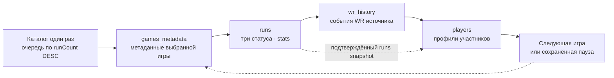

| DAG | Вход | Самостоятельный результат |
|---|---|---|
| `games_metadata` | Каталог либо ID/slug конкретной игры | Карточки, полные метаданные, категории и правила |
| `runs` | Конкретный подтверждённый metadata snapshot | Обычные раны, stats до/после, покрытие разделов |
| `wr_history` | Подтверждённые метаданные и runs snapshot | Отдельные исходные WR-события и диагностика доступности |
| `players` | Подтверждённые runs и WR snapshots | Профили полученных участников и диагностика неразрешённых ID |

У DAG `schedule=None`, `catchup=False`, `max_active_runs=1`. Дочерние запуски
связаны конкретными snapshot ID, а детерминированный run ID предотвращает
повторное создание того же запуска. В имени запуска видны ID и название игры.
XCom передаёт ссылки, digest, конфигурацию и небольшие счётчики; данные остаются
в staging и хранилищах. Импорт DAG не обращается к источнику.

Типовая структура DAG с дочерним этапом:

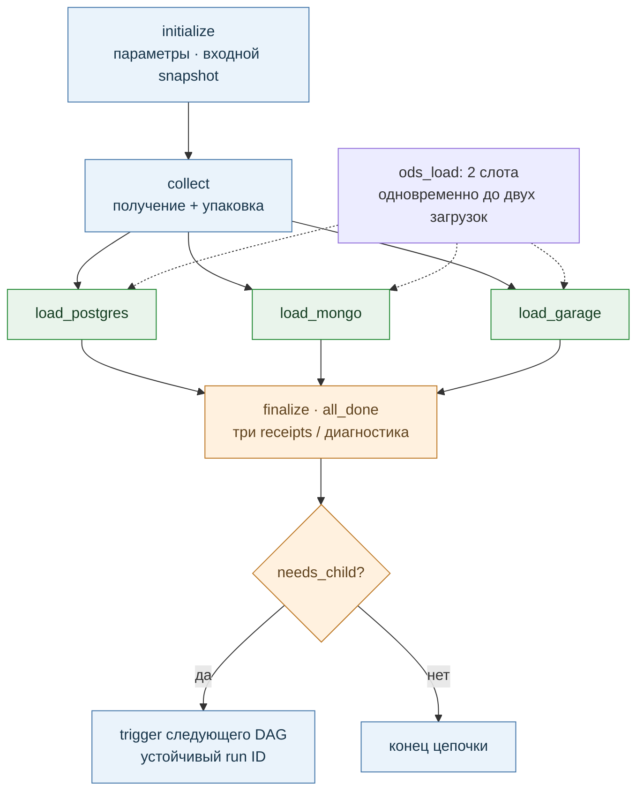

Офлайн: [граф задач PNG](figures/dag_tasks.png), [SVG](figures/dag_tasks.svg).
У `players` цепочка заканчивается на `finalize`. Каталог и metadata-only
намеренно не запускают дочерний сбор. В графе три отдельных ветви загрузки;
одновременно исполняются не более двух, третья ждёт свободного слота.
Фактические настройки проверены через `airflow pools list`: `source_api=1`,
`ods_load=2`.

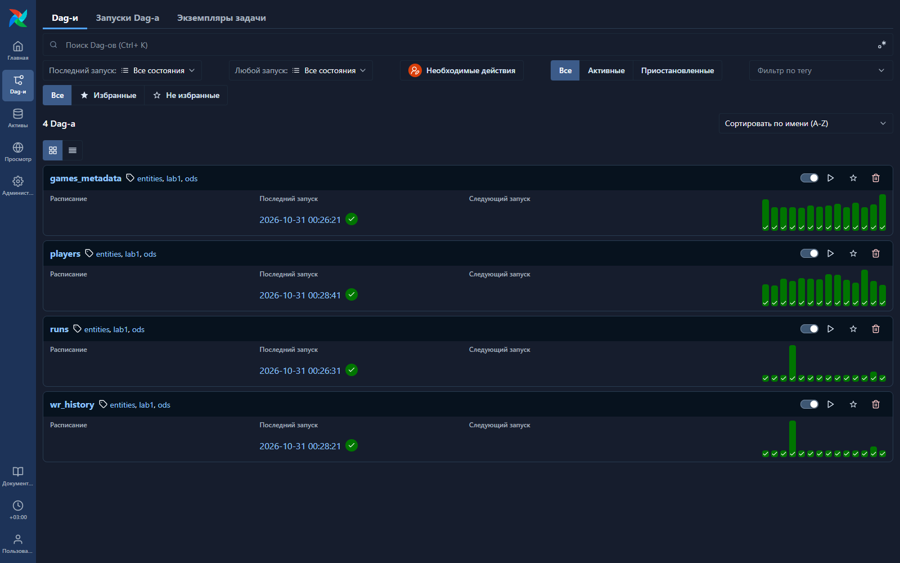

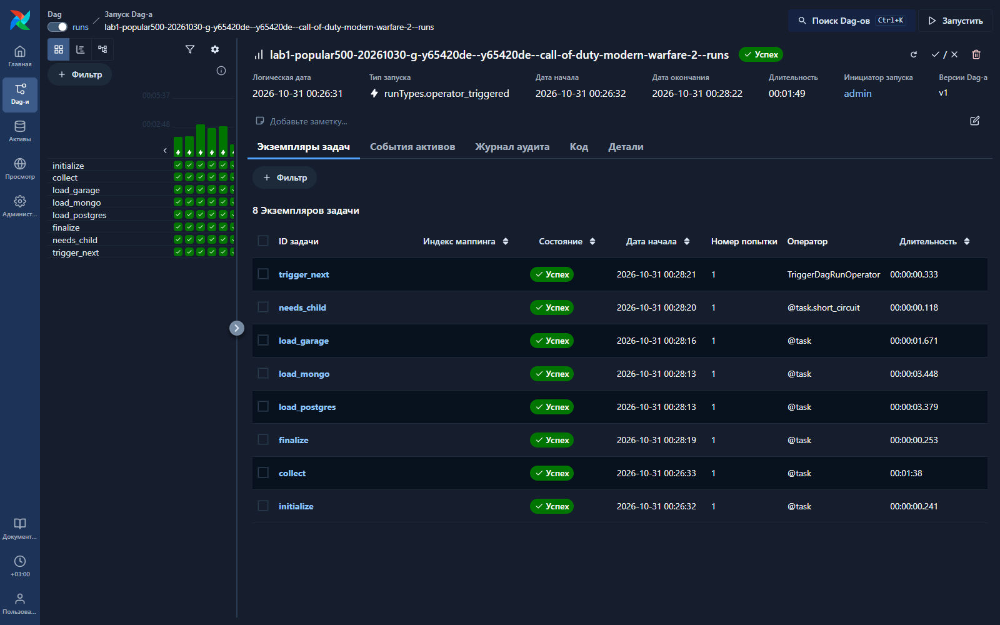

Снимки UI сделаны 31 октября после остановки очереди, без запуска задач:
[происхождение и SHA-256](evidence/ui_20261031.json).

## 5. Сырые данные ODS и история

### 5.1. Логические сущности

Основные наборы — игры, раны, профили игроков и WR-события. Категории, правила
и переменные остаются внутри полных метаданных игры. Следующая диаграмма
описывает связи по ID, а не объявленные SQL foreign keys:

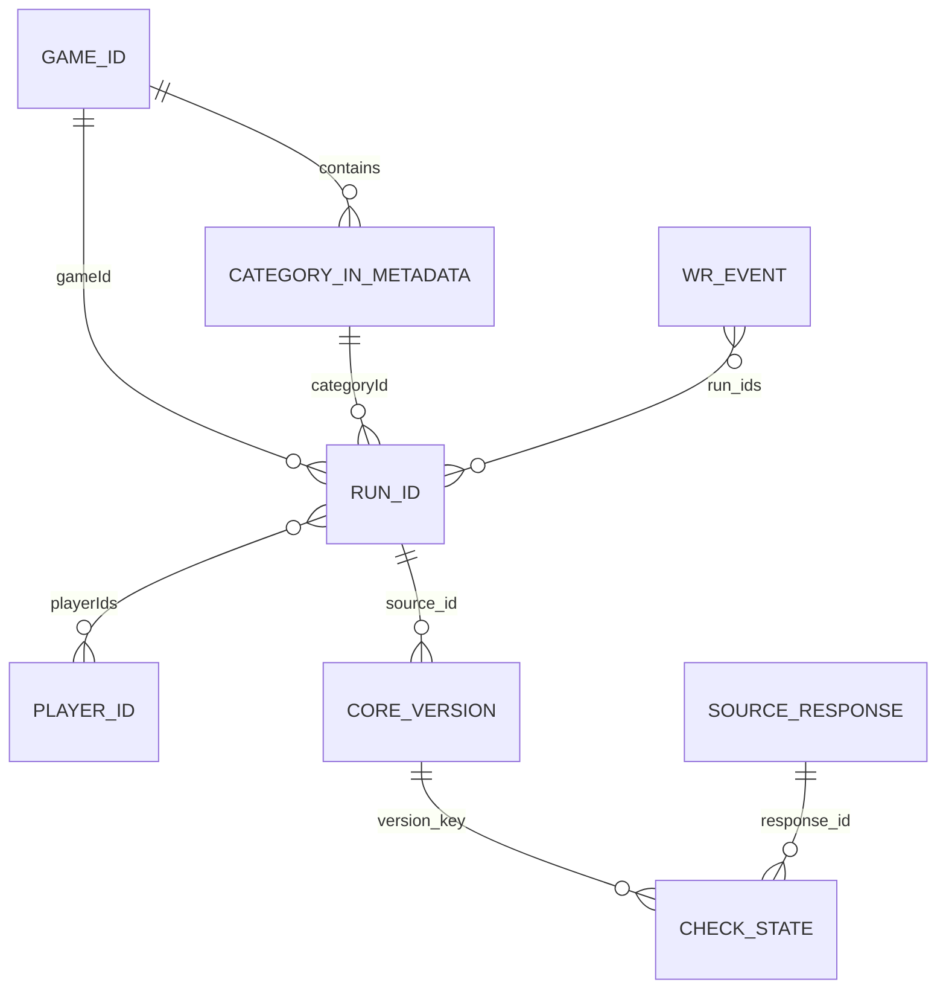

Идентичность сущности определяется системой источника, типом и source ID.
Версия содержимого имеет устойчивый hash-ключ. `checks` фиксирует наблюдение
в снимке: first/last, переходы, время, response ID и путь в ответе.
Изменившееся состояние сохраняется; повтор неизменного профиля на странице
не создаёт ещё одну полную предметную запись.

`place` и `obsolete` вынесены из hash ядра рана в контекст лидерборда. Общий
контекст без фильтров дат доступен отдельно, исходные значения любых ответов
сохраняются в восстановимом response. Неизвестный флаг не подменяется `false`.
`runs_current` соединяет последнюю core-версию и последний известный общий
контекст; их времена могут различаться. Это не история места до начала сбора.

### 5.2. Физическое представление

| Логический набор | PostgreSQL / MongoDB | Назначение |
|---|---|---|
| `games` | Версии карточки и полного `game_detail` | Исходные метаданные игры |
| `runs` | Единые `run_core` по source ID | Все собственные поля рана, включая несколько участников |
| `players` | Версии публичного профиля | Изменения профиля без копии на каждую страницу |
| `wr_history` | События/состояния источника со ссылками на run ID | История WR отдельно от обычных ранов |
| `checks` | Наблюдения версий и контекста | Происхождение и история получений |
| `responses` | Metadata и восстановимое тело | Исходный ответ, параметры, времена, HTTP-результат |
| `blocks` | Общие адресуемые блоки | Крупные фрагменты и повторяющийся `playerList` |
| `manifests` | Манифесты пакетов | Область, входные снимки, coverage и диагностика |

В PostgreSQL используется namespace `entity_v3`: PK `key`, индексируемые
атрибуты поиска и `document JSONB`. В MongoDB `_id=key`, атрибуты поиска
вынесены в обёртку, логическая запись находится в `document`. Garage хранит
gzip JSONL-чанки по наборам/шардам и индексы снимков со ссылками и SHA-256.
**В S3 нет отдельного объекта на каждый ран.**

Неподдерживаемые без потерь значения и большие фрагменты используют явный
codec и блоки. Восстановление сохраняет массивы, порядок, повторяющиеся элементы,
неизвестные поля и различие missing/null. Канонизация сортирует ключи объектов;
исходные пробелы и порядок этих ключей не считаются историей.

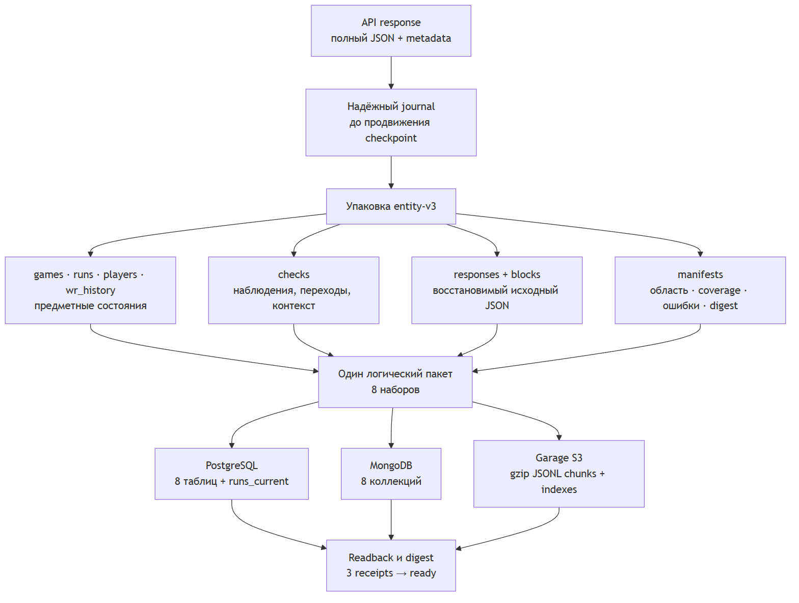

Восемь наборов не означают восемь записей на каждый ран. Число различных ID,
версий, наблюдений, ответов и физических объектов — разные показатели.
Полная схема и контракт хранения — [DATA_MODEL.md](../../DATA_MODEL.md).

### 5.3. Реальный пример: сайт → JSON → ODS

Ран [yv2r2oom](https://www.speedrun.com/portal/runs/yv2r2oom): Portal,
Glitchless, участник cosine. В сохранённом ответе время `1072.660s`
соответствует 17:52.660. Фрагмент исходного объекта:

```json
{
  "id": "yv2r2oom",
  "gameId": "4pd0n31e",
  "categoryId": "wk6pexd1",
  "playerIds": ["7j4739dj"],
  "time": "1072.660s",
  "verified": 1,
  "obsolete": true
}
```

Исходные даты: выполнен 16 февраля 2021 года, проверен 19 февраля.
Наше наблюдение — 30 октября 2026 года. Это разные времена. В этом объекте
`place` отсутствует; значение не вычислялось. Ссылка указывает на страницу
источника, но текущий вид сайта может отличаться от сохранённого ответа.

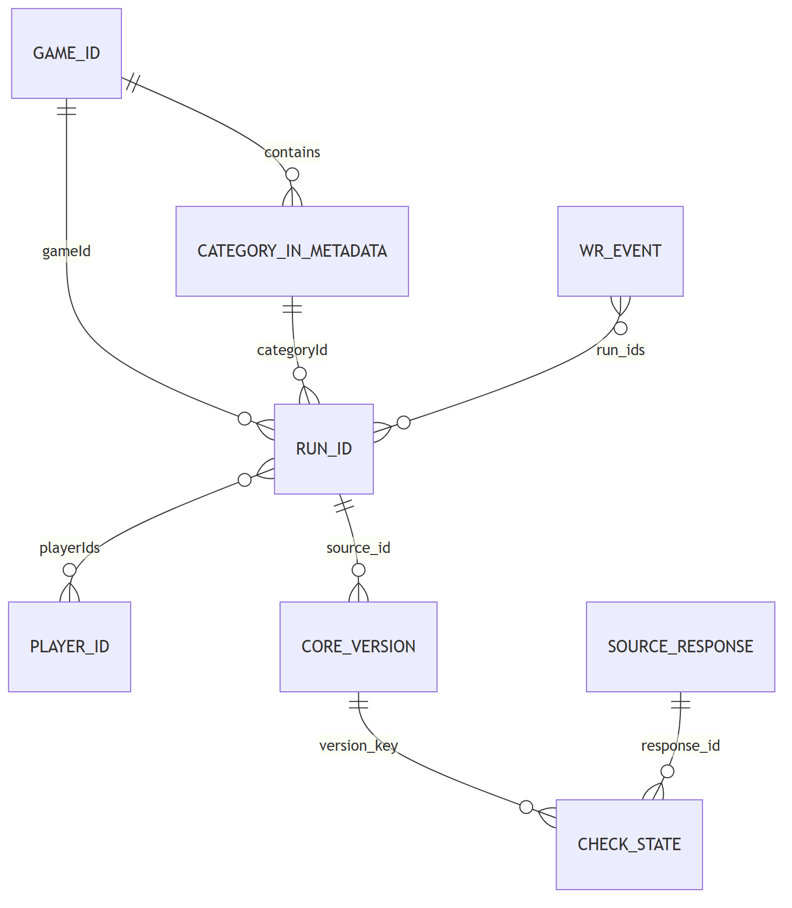

В [комплекте примера](ods_example_20261030/README.md) показаны полный исходный
ран, core, checks, профиль, физическая Mongo-обёртка и правила игры/категорий.
Исходный response восстановлен с проверкой hash; чтения рана из трёх ODS совпали.
Это чтение сохранённого снимка, без новых HTTP-запросов Speedrun.com.

## 6. Управление сбором и восстановление

Общий клиент использует файловую блокировку и сохранённое состояние limiter.
Текущий потолок — 40 запросов/мин, окно до четырёх страниц; старты разнесены
общим pacing, это не четыре независимых сборщика. Реальная скорость зависит
от размера ответа, задержек, retries и реакции источника. После 429/ошибок
применяются паузы и ограниченное восстановление скорости. Бюджеты попыток
сохраняются при перезапуске; task retry не обнуляет их.

Успешный ответ сначала надёжно записывается в journal. Checkpoint продвигается
после сохранения. Прогресс ведётся по игре, категории, статусу и странице;
при возобновлении завершённые разделы не собираются заново. Пагинация
проверяется по номерам/размерам страниц, ID, count и граничным страницам.
Обнаруженный дрейф даёт диагностику и неполное покрытие, а не доказанную полноту.

Протокол загрузки пакета:

1. Записать предметные состояния, блоки и служебные записи по устойчивым ключам.
2. Выполнить readback: проверить наборы ключей, количества, ссылки и digest.
3. Зафиксировать receipt данного сервиса в `speedrun_control`.
4. Считать snapshot готовым только при трёх согласованных подтверждениях.

Распределённой транзакции нет. При сбое одного загрузчика пакет остаётся
в staging и дозагружается по прежним ключам без нового обращения к API.
Повтор пакета идемпотентен. Свежий ответ источника — новое наблюдение,
даже при прежнем содержимом; для A → B → A нужны две версии и три наблюдения.
Ошибка, 404 или отсутствие в списке не доказывают удаление сущности.

Мягкая пауза фиксируется на диске и не допускает следующую цепочку игры.
Текущая допущенная цепочка может закончиться; затем driver и keep_running
останавливаются. Возобновление использует прежний collection ID и checkpoints.
Проверяются свободное место staging и свежий замер диска Docker на хосте.
Данные не очищаются ради продолжения.

## 7. Полученные данные и покрытие

Сводка снята **31 октября, 00:37 МСК**, с уже остановленного стенда.
Коллекция `lab1-popular500-20261030` обработала **135 из 500 игр**:
133 complete, 1 partial, 1 not_applicable. Активных DAG, задач и драйверов нет,
автоматическое продолжение выключено по указанию пользователя.

| Показатель | Значение | Что считается |
|---|---:|---|
| Каталог | 52 246 ID | Различные игры с карточками; не число полностью пройденных игр |
| Полные метаданные | 135 игр | `game_detail` выбранных игр |
| Full-game категории в области обхода | 1771 | Различные пары game/category из разделов ранов |
| Обычные раны | 981 582 ID | ID из входных снимков `runs`, без прибавления WR-only |
| Все run ID в ODS | 981 592 | Включая 10 ID, полученных только через WR |
| Версии ранов | 981 599 | Строки `run_core`; не число дополнительных независимых забегов |
| Игроки | 280 595 ID | Различные source ID профилей |
| Версии профилей | 280 600 | Различающиеся сохранённые состояния |
| WR | 20 570 записей | Полученные записи набора; не доказанная полная история сайта |
| Подтверждённые снимки | 541 | Каталог и четыре результата каждой из 135 цепочек |
| Подтверждения трёх сервисов | 1623 | По три согласованных receipt на снимок |

Числа логических записей PostgreSQL и MongoDB совпали по всем восьми наборам:

| Набор | Строки PG / документы Mongo |
|---|---:|
| games | 52 518 |
| runs | 981 599 |
| players | 280 600 |
| wr_history | 20 570 |
| checks | 1 377 017 |
| responses | 23 047 |
| blocks | 104 |
| manifests | 541 |
| **Всего** | **2 735 996** |

В Garage — 17 318 объектов, сумма тел 655,90 МиБ. Это не число предметных
сущностей и не полный физический размер volume/staging. При загрузке каждый
пакет проходил readback. Текущая инвентаризация дополнительно сверила counts,
receipt digest и выборочные чтения; это не новый полный обход всех байтов ODS.

**Coverage отдельно от технического успеха:** для ранов 5311 из 5313 разделов
проверены, два остаются partial у Subway Surfers. Для WR 1318 категорий partial,
453 unavailable; доступные события сохранены, полнота истории не заявляется.
Игры без full-game категорий отмечаются not_applicable. Пустая страна профиля
допустима; в манифестах профилей нет неразрешённых ID на этом срезе.

Три разных среза не смешиваются: **135 цепочек на ПК**, **128 во входе
расширенных замеров**, **116 в переносимой копии ноутбука**. У них разные
моменты фиксации; различие чисел ожидаемо.

Доказательства: [инвентаризация](evidence/inventory_20261031.json),
[запросы/coverage/подтверждения](evidence/details_20261031.json),
[CSV количества записей](evidence/ods_counts_20261031.csv),
[ручная пауза](comparison_20261030/analytics/evidence/manual_pause_20261031.json).

## 8. Сравнение хранилищ

### 8.1. Критерии и методика

Критерии выбраны по работе с нашим ODS и ожидаемым операциям ЛР2–ЛР3:
загрузка и повтор, объём/индексы, чтение истории и JSON, фильтры/сортировка,
JOIN/агрегаты/окна, CRUD и операции над наборами, конкурентное чтение,
материализация и обновление аналитики, память клиента и корректность результатов.
Сравниваются конкретные реализации одинаковых задач.

| Серия | Фиксированный вход | Измеряемые задачи |
|---|---|---|
| ODS и операции | Полный ODS Portal; проекции Portal/SM64/Minecraft 1k/10k/100k | Загрузка/replay, история, JSON/индексы, CRUD, копирование, JOIN/окна, четыре читателя, COPY |
| Аналитика всех игр входа | 128 подтверждённых цепочек; вложенные 1k/10k/100k/968 899 ранов со связанными данными | Полный JOIN, активность, лучшие результаты, ранги, признаки, баллы, рейтинг и обновление |

Тестовые сервисы имеют отдельные credentials, volumes и внутреннюю сеть.
PostgreSQL 16.15, MongoDB 8.0.34, Garage 2.4.1; backend — 2 CPU / 768 МиБ,
клиент аналитики — 2 CPU / 3 ГиБ. Это квоты, а не выделенные ядра.
Docker Desktop получил около 7,67 ГиБ RAM на одном Windows-ПК.
Источник на окно измерений paused; совпадение HTTP-бюджетов до/после проверено.

Три повтора выполняются в новых пространствах с чередованием сервисов.
Публикуются отдельные значения, медиана и min–max/IQR; это не доверительный
интервал. Кеши не сбрасывались, первый проход не называется холодным.
Время операции включает запись её результата; в ODS-серии также полную сверку.
В аналитической серии readback и независимый SQLite-эталон находятся вне таймера.
SQL и Mongo считают на сервере, S3 — клиентом Python, без SQL-движка.

Доступные показатели объёма различаются: PG — таблицы/TOAST и индексы,
Mongo — storageSize и индексы, S3 — тела объектов. Их нельзя выдавать за
тождественный физический учёт. CPU/RSS клиента не равны ресурсам всего стенда.

### 8.2. ODS, индексы и изменения

Исходный ODS Portal содержит 20 202 run ID, 6122 profile ID и 277 полученных
WR-событий: всего 53 498 логических записей, 65,23 МиБ канонической упаковки.
WR coverage остаётся partial. Серия содержит 2055 измерений и восемь рисунков;
они не объединяются в один статистический ряд с другой аналитической серией.

| Операция | PostgreSQL | MongoDB | Garage S3 |
|---|---:|---:|---:|
| Первая загрузка ODS + сверка, с | 30,17 | 30,36 | **18,32** |
| Повтор пакета + сверка, с | 30,04 | 27,30 | **17,52** |
| Последнее состояние 100 ранов ODS, мс | **48,86** | 107,03 | 5270,42 |
| Категория/статус ODS, мс | 140,79 | **80,08** | 413,52 |
| UPDATE 1000 строк/документов тестовой проекции, мс | 146,69 | **97,53** | 14 025,00 |

Значения — медианы, все min–max и точные условия находятся в
[таблицах первой серии](comparison_20261030/TABLES.md).
Например, индексированный фильтр top-100 на 100k ранов ускорился
с 22,66 до 0,83 мс у PostgreSQL и с 47,92 до 2,17 мс у MongoDB.
Массовая загрузка PostgreSQL через COPY: 7,50 с против 18,91 с executemany
на одной типизированной проекции. Это не измерение переключённого raw ODS loader.

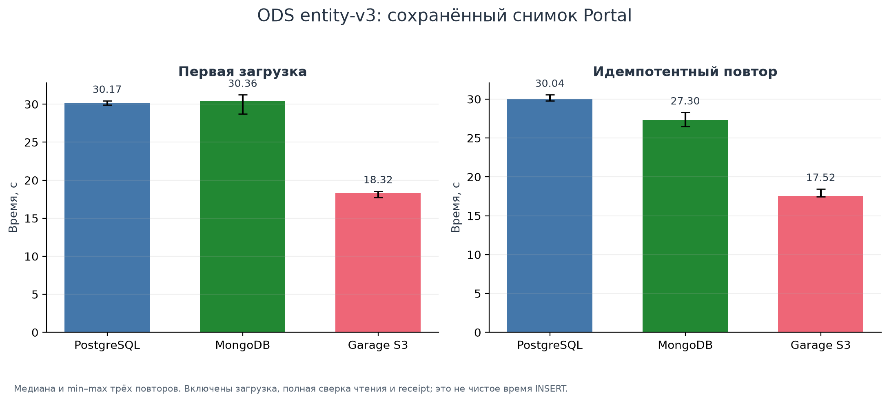

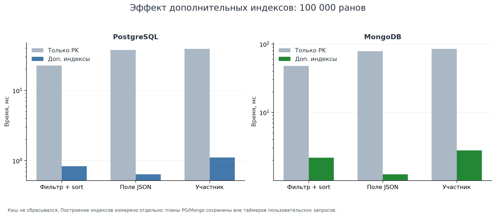

### 8.3. Полная аналитика и обновление рейтинга

Связанные тестовые наборы — games, categories, boards, players, runs, run_players.
На максимуме: 968 899 обычных ранов, 126 игр с ранами, 1252 категории,
56 632 технические группы, 278 415 профилей и 1 034 159 участий.
Это временные проекции, не production DDS и не доказательство 3НФ.

Рассчитываются активность всех игр, география через полный JOIN, лучший
подходящий результат участника, RANK с равенствами, признаки группы, баллы
и глобальный рейтинг. Для нагрузки заданы фиксированные веса по числу
участников, относительным разрывам и длительности; формула не объявляется
официальной или объективной оценкой мастерства. Итоговая модель относится к ЛР3.

Группы учитывают все valueIds, платформу, эмулятор и выбранное поле времени,
поэтому могут дробить официальный leaderboard. Правила таймеров, команд,
пропусков, округления и delta подробно приведены в
[методике аналитической серии](comparison_20261030/analytics/README.md).

Полный конвейер включает загрузку шести наборов, индексы, вычисление/запись
семи материализаций и подготовку быстрого чтения. Его время:

| Ранов | PostgreSQL, с | MongoDB, с | Garage + Python, с |
|---:|---:|---:|---:|
| 1000 | 0,159 | 0,600 | 0,339 |
| 10 000 | 0,490 | 2,611 | 1,966 |
| 100 000 | 3,297 | 22,786 | 15,283 |
| 968 899 | **24,673** | 237,444 | 113,257 |

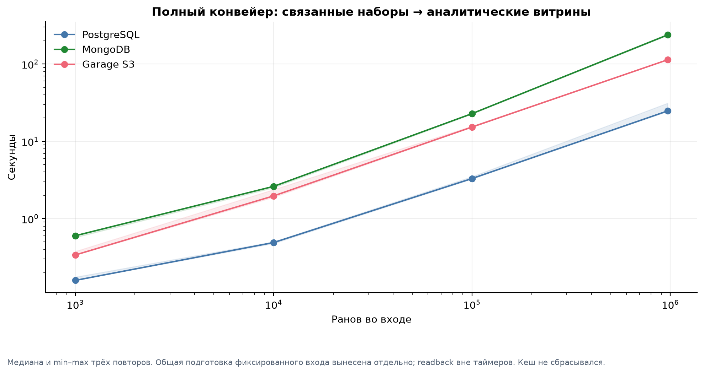

**Общая подготовка максимального входа — отдельные 582,16 с.** Она включает
отбор, разбор, дедупликацию, SQLite и проверки входа. Это стоимость конкретного
клиентского помощника, не сравнение нативных JSON-парсеров серверов.
Экспорт, эталон и readback также не входят в таблицу конвейера; её нельзя
интерпретировать как время всего production ETL.

| Задача на 968 899 ранах | PostgreSQL, с | MongoDB, с | Garage + Python, с |
|---|---:|---:|---:|
| Полный JOIN и география | **2,70** | 75,76 | 15,62 |
| Лучший результат участника | **1,35** | 45,49 | 16,49 |
| Полный пересчёт рейтинга после delta | **4,08** | 71,43 | 41,12 |
| Частичный пересчёт того же рейтинга | **3,73** | 15,76 | 48,64 |

После одинакового синтетического изменения до 128 ранов в восьми группах
и пяти профилей частичный результат совпал с полным. Mongo здесь выигрывает
от частичного пересчёта примерно в 4,5 раза; у PG выигрыш около 9%, у S3
частичный вариант медленнее полного примерно на 18%. Малый delta не гарантирует
малой работы: меняются веса/баллы, а глобальное ранжирование остаётся глобальным.
Обновление проверяет рейтинг, не объявляет остальные витрины обновлёнными.

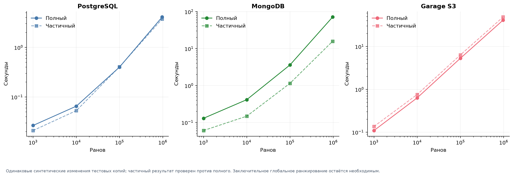

Готовый top-20 читается за 0,59 / 0,96 / 1,82 мс соответственно. Для S3
заранее опубликован небольшой объект, цена его подготовки измерена отдельно.
Это не скорость сырого сканирования. Доступные показатели объёма на максимуме:
PG 565,97 МиБ, Mongo 381,32 МиБ, S3 87,32 МиБ текущих тел; разные способы
учёта раскрыты в методике. Все сохранённые S3 тела занимают 159,61 МиБ.

Итог серии: **36 прогонов, 576 измерений, 180 групп статистики, шесть PNG/SVG**.
Входные отношения, материализации и результаты после delta совпали между
тремя реализациями и повторами. [Полные таблицы](comparison_20261030/analytics/TABLES.md),
[CSV](comparison_20261030/analytics/data/summary.csv),
[проверка результатов](comparison_20261030/analytics/evidence/acceptance.json).

### 8.4. Выбор для наших задач

| Задача | Предпочтительный вариант | Преимущества | Цена и ограничения |
|---|---|---|---|
| Основной ODS, история и связи | **PostgreSQL** | SQL/JSONB, ограничения ключей, транзакции; удобное исследование происхождения | Индексы занимают место, их нужно проектировать; JSON не заменяет DDS |
| Глобальный JOIN, окна, расчёт признаков/рейтинга | **PostgreSQL** | В нашем полном конвейере существенно быстрее; серверные расчёты | Общий разбор входа остаётся дорогим, результаты зависят от схемы и ресурсов |
| Вложенные карточки/профили, поиск ID, изменения документов | **MongoDB** | Естественная документная модель; конкурентное чтение и UPDATE выгодны в отдельных опытах | Для сложных связей нужен aggregation pipeline; standalone ограничивает транзакции |
| Raw-архив и повторная обработка пакетов | **Garage S3** | Быстрая измеренная загрузка пакета, неизменяемые чанки, переносимые экспорты | Нет серверного JOIN/FK; клиент оплачивает чтение, память и вычисление |
| Готовые сводки для последующей визуализации | SQL-расчёт + публикация в S3 | Небольшой подготовленный объект быстро читается | Построение и обновление нужно оплачивать отдельно; partial refresh не всегда быстрее |
| Переход ODS → DDS | Проектировать и измерять целиком | COPY и серверные преобразования дают полезные варианты | Текущий опыт не доказывает 3НФ и не выбирает окончательную DDS-схему |

Основной сервис выбран **PostgreSQL**: он подходит для истории и связей,
а расширенная серия подтвердила преимущество в наших аналитических задачах.
MongoDB и Garage остаются полными копиями ODS. Выбор не означает превосходства
PG во всех операциях: у Mongo есть более быстрые чтения/UPDATE, у Garage —
загрузка пакетов. Другой алгоритм, денормализованная Mongo-схема или ресурсы
могли бы изменить результаты; они не измерялись в этой серии.

## 9. Проверки реализации и ограничения

| Проверка | Подтверждение |
|---|---|
| История, идемпотентность, пагинация, limiter, очередь и три ODS | Перед внедрением рефакторинга 169 тестов с реальными изолированными сервисами, без ошибок/пропусков |
| Расширенная аналитика | Три новых теста: ручная фикстура, таймеры, реальные PG/Mongo/S3 и совпадение full/incremental |
| Результаты измерений | Независимый SQLite-эталон, readback/digest, все повторы и проверка CSV/графиков |
| ODS-пример | Восстановление полного response, равенство core и чтений трёх сервисов |
| Переносимость | Реальное восстановление шести файловых систем, сравнение baseline PG/Mongo/S3 и работоспособности UI; шесть целевых backup-тестов |
| Текущее состояние | Сохранённая ручная пауза, active DAG/tasks=0, driver/keep_running остановлены |

Числа относятся к разным наборам проверок и не суммируются в якобы один общий
тестовый запуск. Доказательства:
[внедрение/перенос](../../docs/research/evidence/refactor_portable_20261030.json),
[аналитические тесты](comparison_20261030/analytics/evidence/tests.txt),
[реальный ODS-пример](ods_example_20261030/verification.json),
[проверка отчётной подготовки без нового сбора](evidence/report_acceptance_20261031.json).

Ограничения: данные отражают интервал наблюдений, не атомарный снимок сайта;
история до начала сбора известна только по доступным исходным WR-ответам.
Полнота WR, всех игр и разделов не заявляется. Бенчмарк одного ПК с тремя
повторами не даёт SLA, доказательства холодного кеша, высокой доступности
или устойчивости к потере питания. Рейтинг эксперимента не является WR.

## 10. Демонстрация и перенос на ноутбук

Подготовлен [сценарий защиты](DEMO.md): открыть UI и завершённые четыре DAG,
прочитать одну сущность из всех хранилищ, показать provenance/правила,
сравнение и обоснование выбора. Сохранённые данные показываются офлайн;
свежий ограниченный сбор требует интернета и отдельного запуска.

Приватный комплект на сетевом диске содержит образы и согласованные volumes
на 116 играх. Для демонстрации его достаточно; новый многогигабайтный backup
ради отчёта не нужен. GitHub синхронизирует код, Markdown, CSV и рисунки,
но не базы, Docker volumes или локальные секреты. Точные команды обновления
и повторного запуска с переносимым override — [LAPTOP_DEMO.md](../../docs/LAPTOP_DEMO.md).

Проверка восстановления на ПК выполнена; ноутбук нужно один раз реально
запустить перед выездом. Это отдельная проверка его Docker/диска/портов,
а не повторный сбор сайта. Текущая очередь ПК остаётся paused до следующего
указания пользователя.

## 11. Результат ЛР1

Реализованы четыре логически различных ETL под Airflow в Docker Compose,
восстановимые сырые данные с историей и три согласованные копии ODS.
Проведено сравнение на одинаковых входах от 1k до 968 899 ранов, сохранены
измерения, графики и проверки. Основным сервисом для дальнейшей работы
выбран PostgreSQL, MongoDB полезна для документных операций, Garage —
для raw-архива и готовых экспортов.

Следующий этап курса — отдельное проектирование DDS и Data Quality,
позднее — окончательная формула аналитики и витрины. Хронология разработки
сохранена в Git и [HANDOFF](../../docs/HANDOFF.md); она не смешивается с
текущими итоговыми количествами и двумя фиксированными сериями сравнения.

## FAQ для подготовки к защите

Это предполагаемые вопросы по требованиям и нашей реализации, а не известный
список вопросов преподавателя. Числа и область конкретного опыта приведены
в соответствующих манифестах; результаты разных форматов не складываются.

### Что именно требовалось в ЛР1?

Airflow в Docker Compose, три различных сервиса хранения, минимум три
логически различных ETL, сырые данные в ODS, сравнительный анализ и выбор
хранилища. На защите нужны отчёт, исходники, Compose, UI Airflow, данные
в хранилищах и графики/таблицы сравнения. Число критериев и полный сбор сайта
заданием не установлены.

### Почему у нас четыре DAG, а не три?

У них разные результаты: карточки/метаданные игр, обычные раны, исходные события
WR и профили участников. WR отделён от обычных ранов, чтобы контекст истории
рекордов не превращался в лишнюю обычную версию рана. Зависимости связывают
конкретные снимки; players учитывает участников обычных ранов и WR.

### Это три разных хранилища или три одинаковых копии?

PostgreSQL — реляционный сервис с SQL/JSONB, MongoDB — документный,
Garage — объектный с S3 API. Логическое содержание совпадает, физическое
представление и способы чтения различаются. Именно три различных сервиса
требуются в задании; S3 не обязан быть реляционной СУБД.

### Почему не достаточно CSV и почему не оставили четыре колонки рана?

Четыре колонки теряют исходные переменные, несколько участников, модерацию,
правила, таймеры, изменения и происхождение. ODS сохраняет доступные поля.
Версии, наблюдения и исходные ответы имеют разное назначение; неизменный
профиль не копируется в предметную таблицу при каждом появлении на странице.

### Где находится 3НФ и почему JSON ещё не нормализован?

Production DDS, очистка, SCD и Data Quality относятся к ЛР2. В ЛР1 сохраняется
raw ODS. Связанные таблицы аналитического эксперимента — временные копии для
оценки будущей обработки. Наличие шести таблиц само по себе не доказывает 3НФ:
нужны ключи и функциональные зависимости. Полная модель DDS ещё проектируется.

### Чем история отличается от дубликатов?

У неизменного содержимого устойчивый ключ. Повтор пакета использует прежние
ключи. Новое наблюдение отличается временем/происхождением, даже если версия
не поменялась. Для A → B → A достаточно двух версий содержимого и трёх
последовательных наблюдений.
Отсутствие в списке и 404 не доказывают удаление сущности.

### Что произойдёт, если один загрузчик упадёт?

Пакет и checkpoint сохранены. Повтор дозагружает его по прежним ключам;
готовность снимка появляется после подтверждений всех трёх сервисов и readback.
Распределённой транзакции и exactly-once получения ответа от API нет.

### Где правила игры и категории?

В полном game_detail сохранён GetGameData: game.rules и правила каждой
категории внутри categories, вместе с переменными, платформами и другими
полями. Реальный пример Portal приложен рядом с отчётом.

### Почему place и obsolete выделены отдельно?

Они относятся к контексту ответа лидерборда и его фильтрам. Core-содержимое
рана хранится отдельно, а исходные значения, фильтры, время и response ID
остаются в checks и восстановимом response. Неизвестный флаг не становится
false. Мы не восстанавливаем прежние места задним числом по современным данным.

### Можно ли по этим данным назвать держателя WR в 2020 году?

Для этого нужны подходящие исходные события WR с верной категорией,
подкатегорией, таймером и датами, плюс достаточное покрытие истории. Сегодняшний
place и дата нашего наблюдения не отвечают на вопрос о месте в 2020 году.
Собственный рейтинг эксперимента не является исходной WR history.

### Почему сравнение не ограничивается INSERT и чтением одной записи?

Будущие задачи требуют полного JOIN участников/профилей/игр, группировок,
выбора лучших результатов, оконных рангов, расчёта признаков зачётов и
материализации/обновления витрин. Поэтому различаются простые операции,
аналитический конвейер и чтение уже подготовленного результата.

### Что означает partial, если DAG завершился успешно?

Технический успех означает, что полученный пакет сохранён и проверен.
Coverage отвечает на другой вопрос: какие разделы источника удалось проверить.
Ограничение WR endpoint, дрейф страниц или недоступный раздел остаются в
манифесте с диагностикой. Их нельзя скрывать общим числом записей или успехом
загрузчика; покрытие обычных ранов и WR оценивается отдельно.

### Что означает максимальный размер теста?

Весь вход, замороженный на конкретный момент из готовых подтверждённых
снимков. Указаны N, ID снимков, digest, coverage и связанные сущности. Это
не размер постоянно растущей live-таблицы, не число версий и не весь сайт.
Поднаборы 1k/10k/100k являются тестовыми; ранги на них не официальные места.

### Как обеспечена сопоставимость измерений?

Одинаковые фиксированные входы, параметры задач, ограничения ресурсов,
несколько повторов с чередованием сервисов и проверка результатов. Подготовка,
загрузка, индексы, вычисление, материализация, readback и чтение готовой витрины
разделяются. Сбор/копирование не должны конкурировать с окном замеров.

### Измеряли ли мы холодный кеш и надёжность при отключении питания?

Нет. Кеши ОС/сервисов не сбрасывались. Первый проход не объявляется холодным.
Проверки повторной/частичной загрузки и восстановления архивов не заменяют
тест отключения питания, высокой доступности или распределённого отказа.

### Почему показатели объёма PostgreSQL, MongoDB и S3 нельзя сравнивать без пояснений?

У PG учитываются таблицы/TOAST и индексы, у Mongo storageSize/indexSize,
у Garage сумма тел объектов. Это разные доступные метрики; в S3-метрику
не входит весь физический overhead volume. Логический вход зафиксирован отдельно.

### Откуда у S3 взялись JOIN и рейтинг?

Их выполняет наш клиент, читая объекты. SQL-движок в Garage не добавлялся.
Чтение, переданные байты, CPU/память клиента и запись производных объектов
входят в стоимость соответствующей операции. Готовый файл сводки можно читать
быстро, хотя его первоначальное построение было дорогим.

### Почему выбран PostgreSQL?

По измеренному набору он удобен для истории и связей, даёт SQL и ограничения
целостности. MongoDB сопоставима в некоторых чтениях и полезна для документов;
S3 подходит для неизменяемых пакетов и экспортов. Вывод привязан к задачам,
версиям и ресурсам стенда. Расширенная серия на 968 899 ранах также подтвердила
его преимущество в нашем полном аналитическом конвейере.
Все три копии сохраняются независимо от выбора основного сервиса.

### Как считается экспериментальный рейтинг и что означает его вес?

Один лучший подходящий результат на игрока и техническую группу, RANK с равными
местами, затем убывающие баллы за место с фиксированными тестовыми весами.
Признаки — участники, относительные разрывы и длительность. Это нагрузка для
сравнения способов вычисления, а не утверждённая формула справедливости.
Итоговая модель относится к ЛР3; длинный ран не доказывает сложность, а число
публикаций не означает число попыток или рестартов.

### Что делать с разными таймерами, командами, гостями и неизвестной страной?

Не смешивать разные поля времени в одной группе; выбор/альтернатива фиксируются.
Для теста команд все разрешённые участники получают одинаковое начисление —
это явно выбранная экспериментальная политика. Неизвестные участники остаются
неразрешёнными, гости не объединяются по имени, страна может быть unknown.
Используется наблюдаемый профиль; историческая страна на дату рана не выдумывается.

### Почему частичное обновление всё равно может быть дорогим?

Изменение одного зачёта меняет его веса и баллы других участников. Изменение
балла игрока может сдвинуть глобальные места. Поэтому часть групп пересчитывается
локально, но заключительное ранжирование может оставаться глобальным.
Корректность проверяется совпадением с полным пересчётом на тех же изменениях.

### Как повторить демонстрацию на другом компьютере?

Исходники находятся в Git. Приватный переносимый комплект содержит согласованные
volumes, образы и локальную конфигурацию; полное восстановление проверено.
Сохранённые данные и UI доступны офлайн, свежий сбор требует интернета.
Сам приватный комплект с .env не публикуется в GitHub. Ноутбук нужно реально
запустить до защиты; локальная репетиция на ПК не означает, что он уже настроен.
