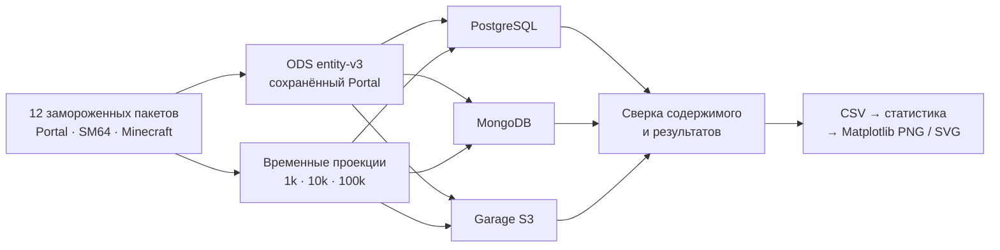
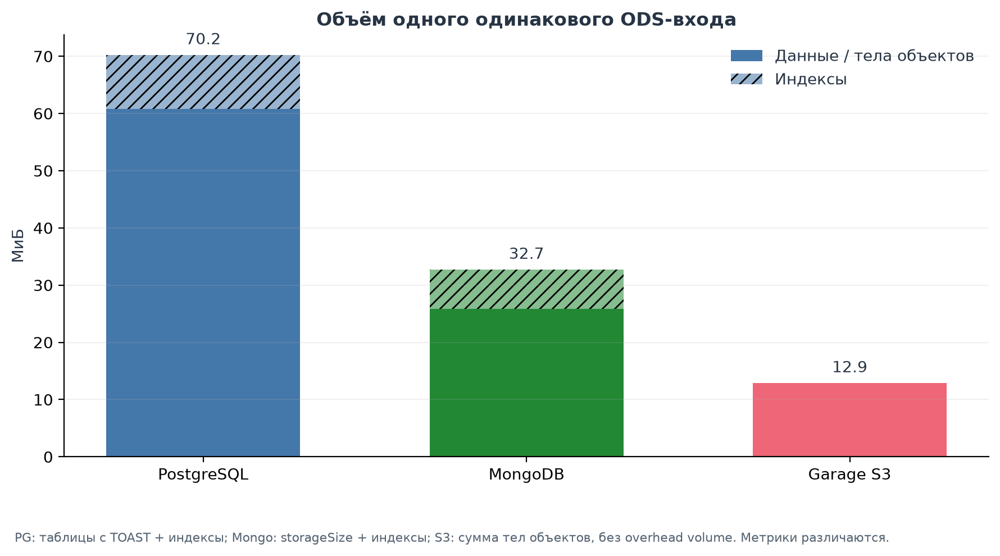
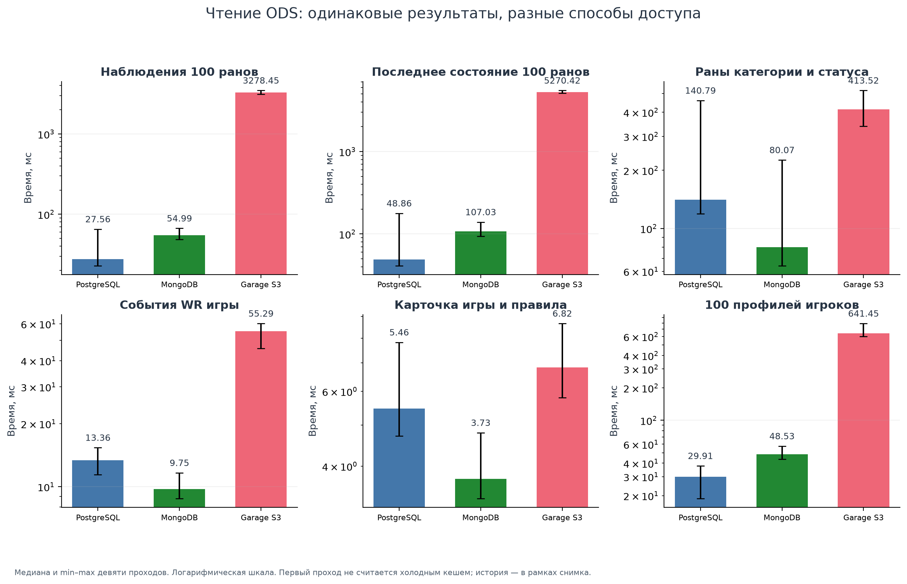
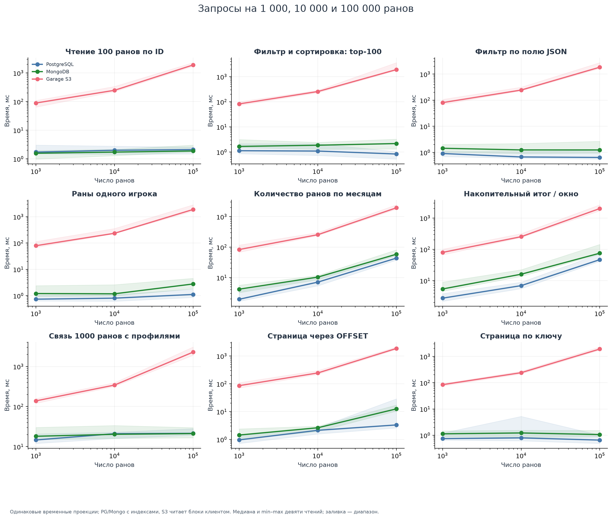
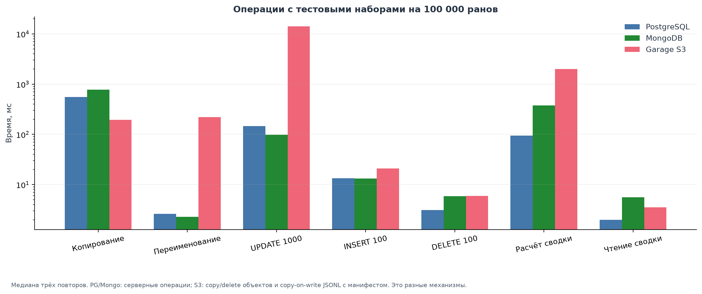
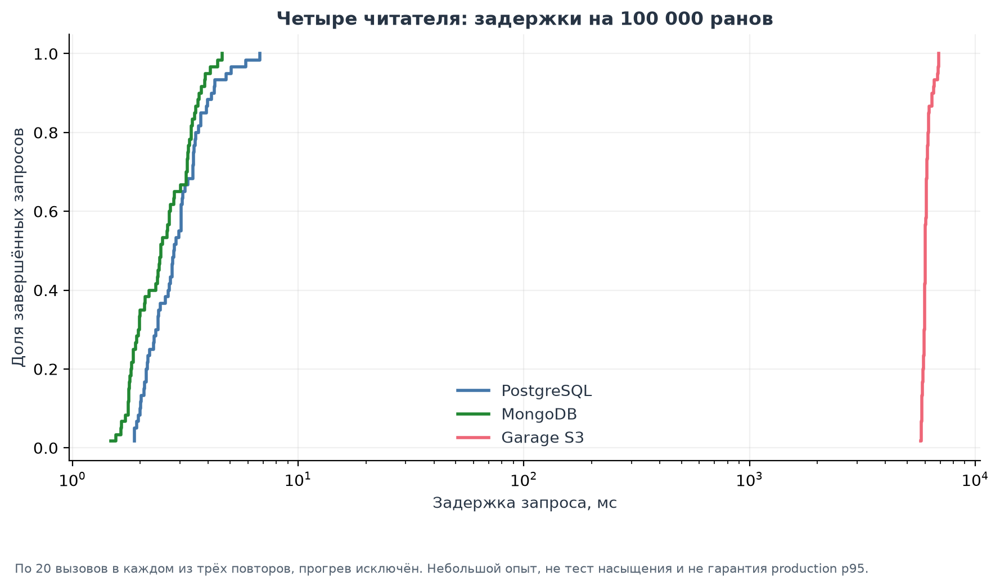
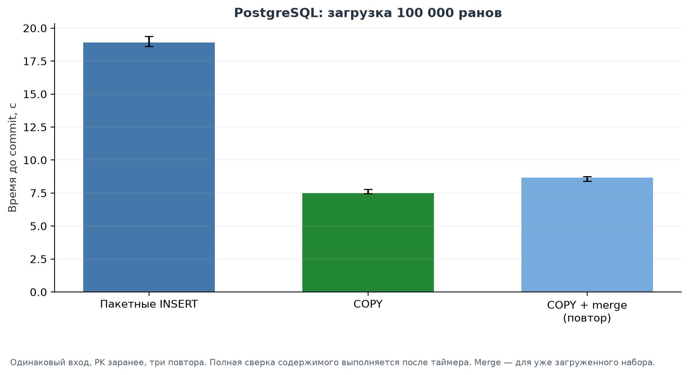

# PostgreSQL, MongoDB и Garage S3: сравнение для Speedrun ODS

Сравниваем наши реализации загрузки и чтения на одинаковых зафиксированных
данных. Исходные значения, результаты запросов и повторная запись проверяются
по содержимому и digest. Самостоятельные тестовые пространства не входят в
production ODS. Это одиночный стенд, а не универсальный рейтинг СУБД.



## Что измеряется

| Серия | Данные | Операции |
|---|---|---|
| Текущий ODS | Сохранённый комплект четырёх DAG Portal, entity-v3 | Первая и повторная загрузка с полной сверкой; объём; наблюдения и последнее состояние 100 ранов; категория/статус; WR; правила; 100 профилей |
| Запросы | Вложенные поднаборы 1 000 / 10 000 / 100 000 ранов Portal, SM64, Minecraft | Поиск по ID; фильтр и сортировка; JSON; участник; месячные агрегаты; окно; JOIN; OFFSET/keyset; до и после индексов |
| Изменение наборов | Те же временные проекции | Копирование/переименование; дополнительное поле; UPDATE/INSERT/DELETE; расчёт и чтение сводки |
| Конкурентное чтение | Те же три размера | Четыре читателя, по пять вызовов каждого, три повтора |
| PostgreSQL bulk | Поднабор 100 000 ранов со связанными данными | Пакетный INSERT, COPY, повторный COPY через staging + merge |

Временные проекции содержат исходный `raw_json`, поля для конкретных запросов
и происхождение. Они существуют только в `test_wl_*`; это эксперимент,
не внедрение DDS или изменение производственной модели.

## Дополнение пользователя: будущая аналитика по всему набору

Расширенная серия выполнена 30–31 октября: **968 899 ранов, 128 цепочек,
четыре масштаба, три повтора**. Её [методика и результаты](analytics/README.md),
[таблицы](analytics/TABLES.md) и CSV находятся в отдельной папке `analytics/`.
Ниже сохранён контракт расширения; фактические политики технических групп,
таймеров и синтетического delta уточнены в методике новой серии.
Исходные CSV этой папки измеряют прежний контракт: три игры, максимум 100k ранов,
`join_1000` соединяет выбранную тысячу. `monthly_counts` и `cumulative_counts`
уже агрегируют весь соответствующий поднабор, но полного конвейера рейтинга,
глобального JOIN, подготовки 3НФ и обновления сложной витрины в них нет.
Число критериев в задании не фиксировано; цель расширения — представительность
операций будущих ЛР2/ЛР3. Вывод об основном ODS относится к измеренному набору;
его следует перепроверить по новым результатам, а не подгонять опыт под него.

| Опыт | Что требуется вычислить | Будущее применение |
|---|---|---|
| Глобальная активность | Количества ранов/уникальных аккаунтов по игре, сопоставимому зачёту и месяцу; все выбранные игры | Обзор сайта и динамика сообщества |
| Полное соединение | Все выбранные раны → все участники → профили → игры/категории; группировка по наблюдаемой стране | География, универсалы, связи сообществ |
| Подготовка связанных наборов | Разбор JSON, дедупликация измерений, выделение runs/run_players/players/games/categories/значений переменных, проверка ссылок | Стоимость будущего перехода ODS → DDS |
| Лучший результат участника | Разворачивание участников, выбор лучшего сопоставимого результата, ранжирование с обработкой равенств | Основа статистики достижений |
| Конкурентность зачёта | Число участников, относительные отставания/разрывы топа, квантили длительности | Признаки конкуренции и длительности |
| Экспериментальный рейтинг | Признаки зачётов + место лучшего результата → тестовые баллы → сумма по глобальному account ID → ранжирование | Проверка стоимости будущей сложной формулы |
| Пакет витрин | Полная материализация «игра × месяц», «игрок × зачёт», признаков зачёта и рейтинга; отдельно чтение готового результата | Подготовка будущего дашборда |
| Обновление витрин | Одинаковые контролируемые изменения копии: время/допуск существующих ранов и area профиля; полный пересчёт против обновления затронутых групп | Стоимость обновления и проверка эквивалентности |

Выход и промежуточные строки сохраняются только в тестовых namespaces.
Эти опыты не создают production DDS, SCD или новые аналитические DAG.
Число таблиц и наличие JOIN сами по себе не доказывают 3НФ: отдельно описываются
ключи и функциональные зависимости. Время разбора/нормализации измеряется
отдельно от запросов по уже подготовленным наборам.

### Правила аналитического входа

- Одна выбранная наблюдавшаяся версия на run ID. История версий не считается
  дополнительными забегами. Политика выбора фиксируется в манифесте.
- «Один зачёт» определяется игрой, категорией и влияющими на сравнение
  подкатегориями/переменными, таймером и правилами. Один category ID не всегда
  задаёт сопоставимый leaderboard; неоднозначные группы диагностируются.
- Для теста достижений рассматриваются verified. `obsolete=false` берётся
  только из подходящего общего контекста; missing/null не приравниваются к false.
  Исключённые/неизвестные случаи подсчитываются. Исходные ODS не меняются.
- Для аккаунта учитывается один лучший результат в зачёте, а не каждая
  историческая отправка. Равные времена получают согласованное правило ранга;
  сортировка по ID обеспечивает воспроизводимый вывод, не меняя место при равенстве.
- Зарегистрированный игрок объединяется по исходному account ID между играми.
  Ключ старой проекции `(game_id, profile_id)` не является глобальным ID игрока.
  Гости остаются в контексте рана/позиции; командные результаты требуют явного
  правила распределения баллов. Отсутствующая страна сохраняется как unknown.
- Страна берётся из зафиксированного наблюдаемого профиля, не объявляется страной
  игрока в историческую дату рана. Политика выбора состояния профиля фиксируется.
- Ранги по тестовой выборке не объявляются официальными местами Speedrun.com.
  Опубликованные раны не отражают все попытки/рестарты; длительность не доказывает
  сложность. WR-события источника остаются самостоятельными данными с coverage.

Для нагрузки достаточно параметризованной схемы
`score(player) = SUM(weight(board) * decreasing_points(best_rank))`.
Конечная формула и коэффициенты выбираются позднее, в ЛР3. Простое умножение
на номер места при максимизации суммы поощряло бы худшие места. Для опыта
фиксируются тестовые веса/точность/правила, одинаковые для трёх реализаций.
Плотность сравнивается относительными разрывами внутри сопоставимого зачёта;
продолжительность входит отдельным признаком, без заявления об объективной сложности.

### Масштабы и измерения новой серии

1. Зафиксировать один вход из завершённых пакетов выбранных игр и записать его
   digest, время среза, coverage и **N** различных run ID. «Максимум» означает
   весь этот замороженный вход, а не меняющуюся живую таблицу и не весь сайт.
2. Подготовить вложенные детерминированные 1k / 10k / 100k / N, если N больше
   100k. Для каждого размера — связанные данные, числа игр/зачётов/участников,
   статусы, missing-поля и распределение размеров групп. Ранги на усечённом
   поднаборе используются только как тестовые; содержательные выводы требуют
   проверенного покрытия соответствующих зачётов.
3. Прежде чем утверждать доступность полного N, оценить временное место, память
   клиента и стоимость тяжёлого прохода. Большой вход читать потоково; сортировки,
   квантили и JOIN могут потребовать временного диска. Нехватка ресурсов —
   измеренный результат с диагностикой, а не повод незаметно уменьшать N.
4. Разделить таймеры: подготовка входа; загрузка; индексы; вычисление/запись
   витрины; выдача результата; обновление. Финальный top-N выдаётся после
   глобального расчёта, не заменяет его обработкой первой тысячи строк.
5. Сохранить время, throughput где осмысленен, числа входа/выхода, объём
   данных/индексов/временных результатов, наблюдаемый пик памяти, CPU и I/O
   клиента/сервиса, планы PG/Mongo и переданные байты/GET/PUT S3. Отсутствующие
   метрики обозначать как отсутствующие, не нулевые.
6. По три повтора, чередование сервисов, одинаковые лимиты. Отдельно результаты
   первых/повторных чтений без утверждения о холодном кеше. Если полный N
   выполним только один раз, явно пометить пилот и не рисовать разброс трёх повторов.
7. Сверить ключи, количества, содержимое и детерминированные результаты всех
   реализаций; инкрементальный результат должен совпасть с полным пересчётом.
   Для дробных весов заранее определить точность/округление и допустимую погрешность.

SQL и Mongo aggregation могут считать на сервере. В Garage расчёт выполняет
клиент с чтением/записью S3; его ресурсы входят в стоимость сценария. Это
сравнение способов решения одной задачи, а не заявление о нативном SQL в S3.
История получения raw остаётся общей; дополнительные аналитические индексы,
подготовка и материализация учитываются как отдельная цена.

Измерения проведены на самостоятельных копиях, без новых HTTP источника и
без конкурирующего активного сбора/копирования NAS. Полная новая серия и
её ограничения приведены отдельно; цифры двух серий не объединяются в один ряд.

## Вход и воспроизводимость

Снимки получены текущим свежим проходом `lab1-popular500-20261030`.
В отдельный volume через SQLite backup перенесены 12 завершённых пакетов,
без HTTP-журналов, секретов и очереди. Исходный volume был read-only.
Сверены role-aware summaries и подтверждения трёх исходных хранилищ.
Параметры и SHA-256 копий: [frozen-inputs.json](evidence/frozen-inputs.json).

| Portal: предметные наборы | Различных ID | Версий / событий |
|---|---:|---:|
| Игра | 1 | 2 проекции: карточка и полные метаданные |
| Раны | 20 202 | 20 202 |
| Профили | 6 122 | 6 122 |
| Полученные события WR | 277 | 277 |

В пакете также 26 643 checks, 244 исходных ответа, четыре manifest и четыре
блока: всего **53 498 логических записей**, **65,23 МиБ** канонического
представления этой упаковки. Это не объём развёрнутых HTTP-ответов.
Обычные разделы ранов прошли проверки; WR coverage остаётся **partial**.
Чтение WR здесь относится к сохранённым событиям, не доказывает полноту истории.

Для масштабирования выбирается одна последняя наблюдавшаяся версия обычного
рана на `(game_id, run_id)`; затем стабильный hash задаёт вложенные поднаборы.
Связанные карточки и доступные профили включаются в каждый поднабор.
`run_core` учитывается; `obsolete` берётся из исходного unfiltered-контекста
с отдельным происхождением. Неизвестное значение остаётся неизвестным.
Выбор таймера для сортировки ограничен исходным `time`, точно представимым
в наносекундах; пропуски не заполняются. Количества и параметры каждого
поднабора сохранены в `raw/workloads_*/input_*/input.json` и `parameters.json`.

Профили временного опыта имеют ключ `(game_id, profile_id)`: их количество
не следует выдавать за глобальное количество уникальных пользователей.
История в первой серии измеряется в рамках одного снимка; глубокая многолетняя
история множества циклов обновления здесь не моделировалась.
`scope_top_100` — сортировка сохранённой выборки по `time`, не расчёт
официальных WR/PB или общего места участника.

## Условия

- PostgreSQL **16.15**, MongoDB **8.0.34**, Garage **2.4.1** — те же pinned
  образы, что в проекте; [версии, digest и ресурсы](evidence/environment.json).
- Отдельные контейнеры, credentials и volumes; внутренняя сеть без host-портов.
- Каждому backend: 2 CPU и 768 МиБ. Клиент: 2 CPU; в серии ODS — 1536 МиБ,
  в окончательной серии проекций/COPY — 3072 МиБ, одинаково для трёх сервисов.
- MongoDB WiredTiger cache: 0,25 ГиБ. Garage: один узел, replication factor 1.
- Перед измерениями текущая цепочка игры завершена штатно; активных DAG/tasks
  и работающего драйвера сбора нет. После измерений очередь возобновлена
  с прежними настройками и checkpoints; код ETL не заменялся.
- По три повтора в новых namespaces. Порядок сервисов меняется по кругу.
  Для чтения — три прохода в каждом повторе, всего девять значений.
- Кеши ОС/сервисов не сбрасывались; первый проход не объявляется холодным.
- До первой серии прошли **162 теста с тремя реальными тестовыми ODS**;
  после добавления потокового клиента — **163 теста**, без ошибок и пропусков.
  После операций сравниваются данные и результаты.
- Времена — wall-clock клиента. Подготовка входа и создание исходной схемы
  выполняются вне таймера. Построение дополнительных индексов измерено отдельно.

В [журнале контроллера](evidence/session.json) зафиксированы отсутствие активных
задач, одинаковые бюджеты источника до/после опыта и отправка resume.
Вместе с [первым окном](evidence/session-memory-limited.json) это подтверждает
отсутствие запросов Speedrun.com во время измерений. Внутренний
`production_signature` драйвера workload проверяет базовые namespaces самого
изолированного стенда, а не содержимое всех production-данных.
[163 теста](evidence/validation.json) прошли с тремя отдельными реальными ODS.
[Проверка после возобновления](evidence/resumed.json) подтверждает работающие
драйвер и контроллер продолжения с прежним абсолютным сроком; три тестовых
сервиса остановлены, их volumes сохранены.

## Как читать результаты

**ODS:** время загрузки включает локальное чтение пакета, сериализацию, запись,
полную обратную сверку и receipt. **Временные проекции:** загрузка измеряется
до подтверждения записи/commit, полная сверка выполняется после таймера.
Эти две метрики нельзя смешивать как одинаковый INSERT benchmark.

В ODS SQL/Mongo используют существующие индексы; S3 читает JSONL/gzip-чанки
по индексу снимка и фильтрует клиентом. Последнее состояние и история по ID
измеряются через текущую обёртку, а не через специально оптимизированный DDS.
Вторая серия сравнивает серверные SQL/aggregation-запросы с клиентской обработкой
S3. GET/PUT/copy/delete и переданные байты S3 сохраняются; сетевые байты PG/Mongo
не инструментировались и не считаются нулевыми.
В native ODS история/состояние 100 ранов читаются отдельными вызовами по ID;
`batch_100` временной проекции использует пакетный запрос. Эти две строки
не являются измерением одной и той же реализации доступа.

Основная серия S3-запросов читает JSONL потоково: в памяти остаются нужные
результаты, агрегаты, ключи и выбранные участники JOIN. SQL-движок не добавлен;
нужные объекты всё равно загружаются по S3. Вывод каждого запроса сверяется
с независимым локальным эталоном и результатами SQL/Mongo.

### Отдельное наблюдение: память клиента

Первая попытка полной материализации S3 на 100 000 ранов упёрлась в 1536 МиБ:
`memory.current=1 610 539 008` при лимите `1 610 612 736`, swap cgroup —
`633 044 992` байт, OOM-kill не было. Чтения стали занимать десятки секунд.
Код завершения 137 относится к управляемой остановке контейнера;
счётчик `oom_kill` в зафиксированном наблюдении равен нулю.
Эта серия остановлена и сохранена отдельно в `resource_probe/`; её строки
не смешиваются с окончательными таблицами. Это точечное наблюдение, не замер
пиковой памяти всего опыта.

После перехода к потоковому чтению и увеличения общего лимита клиента до
3072 МиБ повторена ВСЯ серия размеров для ВСЕХ трёх сервисов. Таким образом,
влияние алгоритма и лимита памяти по отдельности не измерялось. Результат
показывает значение выбранного клиента и доступной памяти; исходную задержку
нельзя трактовать как самостоятельную характеристику сервера Garage.

Объём PG — `pg_table_size` с TOAST плюс индексы только тестовой схемы;
Mongo — `storageSize + indexSize` после fsync, отдельно доступен `dataSize`;
Garage — сумма тел объектов. В последнюю метрику не входят служебные данные
и выделенное место volume. Поэтому график показывает доступные метрики
выбранных реализаций, а не одинаково измеренный физический объём диска.

Copy/rename/update в S3 реализованы объектами, JSONL copy-on-write и манифестами;
в PG/Mongo — серверными операциями. Их атомарность и удобство различаются.
Время подтверждения и readback не заменяет тест аварийного восстановления
или отключения питания. HA/репликация и предельная конкурентная нагрузка
этим опытом не исследовались.

## Проверенные свойства операций

Это результаты намеренно некорректных записей в отдельных `probe`-наборах,
а не описание ограничений, уже включённых в production ODS.

| Проверка | PostgreSQL | MongoDB standalone | Garage 2.4.1 |
|---|---|---|---|
| Повтор уникального ключа | PK отклоняет, `23505` | `_id` отклоняет, `11000` | Обычный PUT существующего ключа перезаписывает объект |
| Отрицательное поле counter | CHECK отклоняет, `23514` | JSON Schema validator отклоняет, `121` | JSON принят как объект без серверной проверки поля |
| Ссылка на отсутствующую игру | Тестовый FK отклоняет, `23503` | Ссылка принята | Ссылка принята внутри JSON |
| Сбой между двумя записями | Транзакция откатилась: оба counter=0 | Без транзакции осталось `[1, 0]`; transaction в standalone отклонена, `20` | Между объектами осталось `[1, 0]` |
| Дополнительное необязательное поле | Измерен ALTER TABLE ADD COLUMN | DDL не требуется, при необходимости меняется validator | Поле кодирует и интерпретирует клиент |

В Garage также отправлены настоящий устаревший `If-Match` и `If-None-Match: *`
для существующего объекта. Оба запроса вернули **200 и заменили содержимое**.
Сохранены фактические условные заголовки и тела после записи. На этом стенде
эти PUT нельзя использовать как серверный CAS/create-only. Наблюдение относится
к проверенному Garage 2.4.1, не ко всем сервисам S3.

Идемпотентность нашего ODS обеспечивается устойчивыми ключами, проверками
содержимого и протоколом подтверждений; она не является распределённой
транзакцией трёх сервисов. MongoDB здесь работает без replica set;
вывод о транзакциях относится к этому режиму развёртывания.

Планы выполняются отдельно от пользовательских таймеров:
[`EXPLAIN ANALYZE` PG добавляет профилирование](https://www.postgresql.org/docs/16/sql-explain.html),
а [`explain` Mongo игнорирует plan cache](https://www.mongodb.com/docs/v8.0/reference/explain-results/).
Возможности S3 сверяются на фактическом Garage; сама
[таблица совместимости Garage](https://garagehq.deuxfleurs.fr/documentation/reference-manual/s3-compatibility/)
рекомендует проверять поведение важных операций.

## Таблицы и статистика

- [Готовые Markdown-таблицы](TABLES.md).
- [Все отдельные измерения CSV](data/measurements.csv).
- [Медиана, IQR, min–max, среднее, отклонение и n](data/summary.csv).
- [Сравнение девяти задач на 100 000 ранов](data/task_comparison.csv).
- [Метрики размера и способ учёта](data/storage_size.csv).
- [Все задержки конкурентного чтения](data/concurrent_latencies.csv),
  [p50 и наблюдаемый p95](data/concurrent_summary.csv).
- [Числа из планов PG/Mongo](data/query_plans.csv): actual stages, строки,
  examined docs/keys первичного Mongo cursor и буферы PG. Эти execution times
  являются диагностикой, не заменяют клиентское время и не включают одинаковый
  набор затрат. Для JOIN статистика первичного cursor не охватывает все lookup.
- [GET/PUT/copy/delete и байты S3](data/s3_io.csv).

IQR/min–max описывают полученную выборку, не являются доверительным интервалом.
Наблюдаемый p95 рассчитан nearest-rank по 60 вызовам на сервис/размер;
это не production SLA. Файл сравнения задач называет самый быстрый измеренный
вариант, а итоговый выбор учитывает также необходимые операции и гарантии.

## Рекомендации для наших задач

| Задача | Предпочтительный вариант | Основание и ограничение |
|---|---|---|
| Основной ODS для исследования истории и будущих связей | **PostgreSQL** | Наблюдения 100 ранов: 27,6 мс против 55,0 мс Mongo и 3278,5 мс S3; SQL, проверенные ограничения и rollback. Загрузка не самая быстрая, объём по принятой метрике больше |
| Поиск по ID и JOIN с профилями | **PostgreSQL или MongoDB** | На 100k поиск 100 ID: 2,10 / 1,88 мс; JOIN 1000: 21,46 / 21,17 мс. Диапазоны перекрываются; здесь нет основания объявлять существенную победу одной СУБД |
| Фильтр категории/статуса + сортировка, поле JSON, участник | **PostgreSQL с подходящими индексами** | 0,83 / 0,64 / 1,11 мс на 100k. Mongo тоже укладывается в 1–3 мс. При переходе от PK к дополнительным индексам наблюдалось улучшение примерно в 22–63 раза; цена построения/место сохранены в CSV |
| Агрегаты по месяцам, накопительные итоги | **PostgreSQL** | 43,5 / 46,7 мс против 58,4 / 75,1 мс Mongo и около 2 с S3; SQL удобен для комбинаций JOIN/GROUP BY/окон |
| Вложенные документы и частичные изменения рабочих коллекций | **MongoDB — полезный вариант** | UPDATE 1000 тестовых документов: 97,5 мс против 146,7 мс PG и 14,0 с S3. В standalone нет проверенной многодокументной транзакции и FK. Исторические raw-версии production при этом не следует обновлять на месте |
| Архив неизменяемых пакетов и восстановление целого снимка | **Garage S3** | Загрузка с полной сверкой 18,32 с против около 30 с PG/Mongo; сумма тел объектов 12,86 МиБ. Чтения требуют подходящего клиента; произвольные фильтры и точечные изменения дороже |
| Готовые сводки и файлы экспорта | **Вычислять в SQL, сохранять также в S3** | Готовая сводка читается за 1,99 мс PG / 3,51 мс S3 / 5,62 мс Mongo. Её построение на 100k: 94 мс PG / 1987 мс S3 / 376 мс Mongo |
| Массовая загрузка типизированных рабочих таблиц PG | **Проверить COPY для конкретной схемы** | На одинаковой проекции COPY около 7,5 с против 18,9 с executemany. Это не измерение переписанного native ODS loader; production-загрузчик не переключался |

**Основным ODS для проекта остаётся PostgreSQL; S3 — архивная копия,
MongoDB — самостоятельная документная копия. Все три сохраняются.**
Выбор учитывает наши операции и историю, а не только минимум времени загрузки.

PostgreSQL JSONB в нашем ODS также сохраняет новые вложенные поля без ALTER;
преимущество гибкости JSON не является исключительным свойством MongoDB.
Опыт с ADD COLUMN относится к отдельной типизированной проекции.
Результат Mongo по raw-фильтру Portal (80 мс против 141 мс PG) также показывает,
что вывод по одному запросу нельзя переносить на все способы доступа.

Копирование 100k в опыте: S3 194 мс, PG 552 мс, Mongo 775 мс. Переименование:
S3 220 мс, PG 2,62 мс, Mongo 2,28 мс. Это разные механизмы копирования объектов
и серверных наборов; проверялась одинаковая видимость содержимого.
S3 DELETE в этом опыте — новый манифест без добавленных записей, старые объекты
остаются. Эту задержку нельзя выдавать за физическое удаление всех старых байтов.

Численные различия на уровне долей миллисекунды и малые выборки трактуются
осторожно; полный разброс приведён в TABLES.md. Ни одна рекомендация не
обещает те же числа для другого оборудования, объёма или кластерного режима.

## Графики















Для каждого PNG в `figures/` сохранён SVG для вставки и редактирования.
Графики строит `speedrun_etl.plot_storage_comparison` непосредственно из CSV;
отсутствующие значения не заменяются придуманными результатами.

## Повторение

Исходники стенда: `infra/compose.comparison.yaml`, `configure_comparison.py`,
`freeze_comparison.py`, `run_storage_comparison.py`, `export_comparison.py`.
Драйверы опытов: `speedrun_etl.benchmark`, `speedrun_etl.storage_workloads`.
Ruff/Matplotlib закреплены в `requirements-dev.txt`, runtime lock не меняется.

Нужен этот замороженный вход либо собственные готовые пакеты с явно новым
digest. Полные данные и секреты не публикуются в Git; CSV, параметры,
контрольные суммы и графики достаточны для повторного построения визуализаций.
На другом компьютере численные результаты могут отличаться.

Для повторного построения всех графиков и таблиц из опубликованных CSV
в checkout ветки `codex/storage-compare-20261030` (PowerShell):

```powershell
python -m pip install -r requirements-dev.txt
$env:PYTHONPATH = (Resolve-Path src).Path
python -m speedrun_etl.plot_storage_comparison --results reports/lab1/comparison_20261030
```

Эта команда не подключается к источнику или хранилищам. Для повторения самих
замеров нужны полный замороженный вход и отдельные сервисы из
`infra/compose.comparison.yaml`; `freeze_comparison.py` проверяет исходные
подтверждения и копирует только завершённые пакеты. Вход другой коллекции
образует новый опыт: его результаты следует сохранять отдельно.
Контроллер опыта возобновляет batch-драйвер. Если до технической паузы работал
`keep_running`, его нужно также восстановить с сохранённым `--until` и проверить
оба lock через `progress`; продлевать срок при этом не следует.
