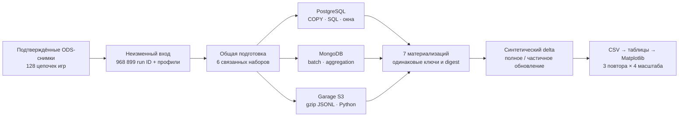

# Полная аналитика: все игры фиксированного входа

Серия дополняет исходное сравнение ODS и небольших запросов. Здесь измеряется
конвейер над связанными наборами, включая глобальные JOIN и ранги.
Серия 30–31 октября завершена: **36 прогонов, 576 измерений, 180 групп статистики**.
Материализации совпали с эталоном; результаты после delta совпали между
всеми сервисами и повторами. [Итог проверки](evidence/acceptance.json),
[журнал трёх новых тестов](evidence/tests.txt), [все таблицы](TABLES.md).

## Главные результаты

Медианы на 968 899 ранах, секунды; min–max и все масштабы — в [TABLES](TABLES.md).

| Этап | PostgreSQL | MongoDB | Garage S3 + Python |
|---|---:|---:|---:|
| Весь конвейер, включая загрузку, индексы и запись витрин | **24,67** | 237,44 | 113,26 |
| Полный JOIN и география | **2,70** | 75,76 | 15,62 |
| Полный пересчёт рейтинга после delta | **4,08** | 71,43 | 41,12 |
| Частичный пересчёт того же рейтинга | **3,73** | 15,76 | 48,64 |

Общая подготовка входа заняла **582,16 с один раз для максимального N**
и не включена в строку конвейера. Это не время полного production ETL:
исходный экспорт, эталон и readback тоже находятся вне этих таймеров.

PostgreSQL подтверждён как первый выбор для наших связанных вычислений.
На максимуме его конвейер в этом опыте примерно в 9,6 раза быстрее Mongo
и в 4,6 раза быстрее клиентского S3. Но общий подготовительный этап существенно
дороже всех трёх вариантов: будущий ODS → DDS нужно оценивать целиком.

Частичный пересчёт даёт Mongo выигрыш примерно в 4,5 раза, PostgreSQL —
лишь около 9%, а S3 здесь **медленнее полного примерно на 18%**.
Поэтому инкрементальность нельзя выбирать только по малому числу изменённых строк.
В S3 чтение/слияние и переписывание объектов остаются дорогими.

Готовый top-20 читается быстро во всех сервисах: медианы 0,59 / 0,96 / 1,82 мс.
Это локальная сеть и подготовленный результат, не задержка сырого сканирования
или гарантия внешнего S3. Цена подготовки индексов/объекта включена отдельно.

Доступные показатели объёма на максимуме: PG 565,97 МиБ, Mongo 381,32 МиБ,
S3 87,32 МиБ текущих тел объектов; все сохранённые S3 тела — 159,61 МиБ.
Это **разные способы учёта**, без общего физического overhead volumes;
из этих чисел нельзя выводить универсальный коэффициент экономии места.


Все шесть рисунков в [figures](figures/), PNG и SVG. CSV включают
отдельные повторы, медианы/min–max/IQR, CPU/RSS клиента, вход и размеры.



## Вход

Зафиксированы **968 899 различных обычных run ID** из **128 обработанных цепочек**
текущего прохода. Подтверждения каждого входного снимка трёх ODS проверены;
экспорт выполняет read-only транзакции PostgreSQL, без HTTP источника.
Вход включает полученные данные partial-цепочки с явным статусом, не доказывает
полноту сайта. WR-only проекции не прибавляются как новые обычные раны.
Игры без ранов входят в перечень цепочек, но не создают фактов.
Это уже обработанная часть очереди популярных игр; она не является случайной
репрезентативной выборкой всего сайта. Переносить её время на полный сайт
или считать min–max трёх повторов доверительным интервалом нельзя.
Этот срез позднее переносимой копии стенда на 116 обработанных играх:
различие чисел на ноутбуке ожидаемо. Для повторного построения рисунков
достаточно опубликованных CSV, для повторения самих измерений нужен
тот же полный замороженный вход либо явно новая серия с другим digest.

Одна наблюдавшаяся версия на run ID. Глобальный профиль выбирается по времени
наблюдения среди выбранных снимков, с детерминированным ключом при равенстве.
Страна/area относится к этому наблюдению, не к исторической дате рана.
SQLite сохраняет экспорт и независимый эталон; исходные БД не меняются.

Масштабы: вложенные стабильные hash-поднаборы **1k / 10k / 100k / 968 899**.
Связанные игры, категории, группы, профили и участия включаются в каждый вход.
Числа цепочек, игр с ранами, категорий и технических групп различаются.

## Сценарии

| Операция | Содержание |
|---|---|
| Связанные наборы | Общая клиентская подготовка шести наборов; отдельно native загрузка/PK и дополнительные индексы |
| Активность | Все игры/категории/месяцы/статусы, distinct runs и зарегистрированные участники |
| География | Полный JOIN runs → boards → categories → games и run_players → players; distinct по наблюдаемому areaId |
| Лучший результат | MIN времени на разрешённого участника и техническую группу |
| Ранги | RANK для равных времён, детерминированная нумерация, число участников группы |
| Признаки | Лучшее/медианное время, граница топ-100, число игроков, тестовый вес |
| Баллы и рейтинг | JOIN признаков, сумма баллов по глобальному ID, оконный глобальный RANK |
| Публикация/чтение | Индексы SQL/Mongo или отдельный S3 top-20; отдельно цена подготовки и чтения |
| Обновление | До 128 синтетических изменений ранов в восьми группах и пяти профилей; полный рейтинг против частичного пересчёта |

Эти шесть наборов — **тестовые связанные проекции**, не production DDS.
Само число таблиц не доказывает 3НФ. Общая подготовка включает отбор, разбор,
дедупликацию, SQLite и проверку входа. Она измерена отдельно и не является
сравнением нативных JSON-парсеров PostgreSQL/MongoDB. Загрузка использует COPY,
batch insert и gzip JSONL соответственно; это другой формат, чем исходный ODS.
Текущий помощник подготовки для каждого N читает справочники профилей и игр
всего замороженного входа, затем отбирает связанные записи. Поэтому у малого
N есть существенная постоянная работа; это время конкретной подготовки,
а не оптимальная оценка стоимости будущего production ODS → DDS.

Частичное обновление проверяет **рейтинг**, а не объявляет остальные витрины
обновлёнными. После изменения весов затронутых групп пересчитываются баллы их
участников, затем глобальные места. В S3 слияние заменяет объекты; запись
переписанных данных входит в время и I/O. Тестовые изменения не являются
новыми состояниями источника и не поступают в production.
Точный delta: у выбранных подходящих ранов время уменьшается на 1 мс
(минимум 1 нс), каждый третий исключается через тестовый `eligible`;
у пяти разрешённых профилей area заменяется на `benchmark-test-region`.
Поле исходного статуса в проекции не меняется. Это конкретная контрольная
нагрузка, а не измерение всех видов изменения источника.

## Что означает экспериментальный рейтинг

Для измерения нагрузки выбирается verified, `obsolete=false` из общего
контекста, положительное доступное время и зарегистрированный участник.
Неизвестные значения не становятся false. Команды получают полное тестовое
начисление каждому разрешённому участнику; гости/неразрешённые участники
остаются вне рейтинга. Один игрок учитывается один раз на группу.

Группа **техническая**: game/category, все valueIds, платформа, эмулятор,
defaultTimer и фактически использованное поле времени. Такой ключ может
разбивать официальный leaderboard; это не утверждение о семантике всех
переменных Speedrun.com и не официальный рейтинг.

Тестовая политика таймера: defaultTimer 0 → time, 1 → timeWithLoads, 2 → igt;
если предпочтительное поле отсутствует, берётся доступное поле в фиксированном
порядке. Факт альтернативы подсчитывается, а группы разных полей не смешиваются.
Все исходные поля остаются в raw. На максимуме альтернативный таймер использован
для 50 917 записей; отсутствующих/нераспознанных времён после выбора нет.

Вес — произведение трёх целочисленных ступеней:

- участники: до 20 → 1, до 100 → 2, больше → 3;
- разрыв между лучшим и последним в топ-100: до 1% → 3, до 10% → 2, иначе → 1;
  при одном участнике плотность не вознаграждается;
- медианная длительность: меньше минуты → 1, меньше 30 минут → 2, иначе → 3.

Баллы за группу: `floor(1 000 000 × weight / rank)`. Медиана — точная нижняя
центральная порядковая статистика, а не приближённый percentile.
Это фиксированная проверяемая нагрузка. Плотность и длительность не доказывают
объективную сложность; окончательная формула относится к ЛР3.

## Условия и проверка

Три повтора в новых test_wl_an_* namespaces, порядок сервисов циклически меняется.
Backend: 2 CPU / 768 МиБ, клиент: 3 ГиБ. Версии те же, что в основном сравнении.
На окно измерений источник мягко paused, Airflow-процессы остановлены для
снижения конкуренции; после окна контроллер восстанавливает прежнюю очередь
и прежний абсолютный deadline. Сравниваются бюджеты источника до/после.
После опыта очередь была восстановлена; затем новым указанием пользователя
31 октября **снова остановлена для отчётности**. Сейчас135/500игр обработано,
автоматическое продолжение выключено, активных DAG/задач нет.
[Подтверждение ручной паузы](evidence/manual_pause_20261031.json).

Время операции включает вычисление и запись её результата. Полная сверка
ключей/содержимого выполняется вне таймера. Результаты совпадают с локальным
SQLite-эталоном и между тремя реализациями. На ручной фикстуре проверены
повторы отправок, равные места 1/1/3, несколько участников, неизвестная страна,
гость и совпадение частичного обновления с полным.

SQL и MongoDB считают на сервере. S3 читает JSONL потоково и считает Python;
словари агрегации/сортировки требуют памяти, это не обещание O(1).
SQLite **не используется для ответов S3**: только для эталона и обратной сверки.
Планы сохраняются без повторного исполнения запроса: это queryPlanner,
не EXPLAIN ANALYZE и не замена wall-clock.

Результат относится к этим алгоритмам и ресурсам одного ПК. Кривые по N
также отражают состав вложенных поднаборов и связанных сущностей; они не
доказывают асимптотическую сложность. Квота CPU не выделяет отдельные ядра.
Время записи включает получение ответа клиента, но опыт не имитирует потерю
питания и не сравнивает одинаковую гарантию fsync для всех трёх сервисов.
Синтетический delta меняет существующие строки: вставки новых ранов и
удаление профиля в расширенной серии отдельно не измерялись; CRUD есть
в исходном [эксперименте](../README.md).

Кеши не сбрасывались, первый проход не называется холодным. Client CPU time
не включает серверные процессы. RSS клиента выбирается раз в 50 мс и включает
базовую память процесса. Docker stats — отдельный грубый мониторинг backend,
начатый на 100k: он не покрывает первые размеры, а метка последней операции
может оставаться на время подготовки следующего входа. Поэтому его нельзя
трактовать как точное CPU/I/O конкретного запроса; отсутствующие замеры не нулевые.

Смысл оконных рангов Mongo: [официальный $rank](https://www.mongodb.com/docs/v8.0/reference/operator/aggregation/rank/).
Для детерминированной нумерации используется один составной ключ сортировки;
равное время получает равный rank независимо от этого ключа.

## Воспроизведение

Для подготовки отчёта достаточно заново построить рисунки из CSV командой ниже:
эта операция не использует API или базы. Сам сбор сейчас вручную остановлен;
повтор измерительного контроллера с его resume не является командой демонстрации.

Код: `analytics_input.py`, `analytics_benchmark.py`, `analytics_sizes.py`.
Инфраструктура: `compose.comparison.yaml` + `compose.analytics.yaml`, отдельные
credentials/volumes, internal network. Runner получает только код и собственный
state; production .env/state ему не монтируются.

1. Подготовить отдельные сервисы через `configure_comparison.py` и Compose.
2. Выполнить read-only экспорт завершённых подтверждённых снимков в новый volume.
3. Прогнать `tests/test_analytics_benchmark.py` с `ETL_INTEGRATION=1`.
4. Запросить безопасную паузу источника и запустить `infra/run_analytics_benchmark.py`.
5. После завершения снять размеры через `analytics_sizes`, экспортировать
   только CSV/JSON через `infra/export_analytics_results.py`.
6. Построить таблицы/рисунки:

```powershell
$env:PYTHONPATH = (Resolve-Path src).Path
python -m speedrun_etl.plot_analytics_benchmark --results reports/lab1/comparison_20261030/analytics
```

Оригинальное [сравнение ODS](../README.md) и новые задачи имеют разные входы и
таймеры. Их результаты нельзя склеивать в один ряд без указания сценария.

## Как использовать результаты при проектировании следующих лабораторных

| Задача | Какой вариант проверять первым | Преимущества и цена |
|---|---|---|
| История сущностей, связи run → участники, ограничения ключей | PostgreSQL | SQL, JOIN, транзакции и ограничения; нужно проектировать ключи и индексы, загрузка JSON сама по себе не создаёт DDS |
| Полные карточки/профили с меняющейся вложенной структурой | MongoDB | Удобно читать/обновлять документ; глобальные JOIN и окна требуют aggregation pipeline, схемы индексов и контроля памяти |
| Неизменяемый raw, выгрузки, перенос и повторная обработка | Garage S3 | Полные пакеты и устойчивые ключи; нет серверного JOIN, внешних ключей и транзакции над несколькими объектами |
| Активность всех игр, география, рейтинг по связанным таблицам | PostgreSQL, сверяясь с замерами Mongo и клиентского S3 | Цена зависит от полного плана, индексов и материализации, а не от одного SELECT по ID |
| Частое чтение готового топа или сводки | Индексированная таблица либо небольшой опубликованный объект | Во всех случаях сначала оплачивается построение; скорость готовой сводки не означает такую же скорость исходного расчёта |
| Новые раны/профили и обновление рейтинга | Сравнить полный и частичный пересчёт | Малый delta не гарантирует малую работу: веса группы и глобальный RANK могут изменить многих участников |

Это варианты для наших операций, а не универсальный рейтинг СУБД. В опыте
Mongo получает связанные коллекции того же содержания, что SQL; отдельная
денормализованная Mongo-схема могла бы изменить результаты, но в этой серии
она не измерялась. S3 использует конкретный клиентский алгоритм; другой
движок или другая память клиента также образовали бы отдельный эксперимент.
Решение о production DDS и окончательной формуле рейтинга принимается в ЛР2/ЛР3.
