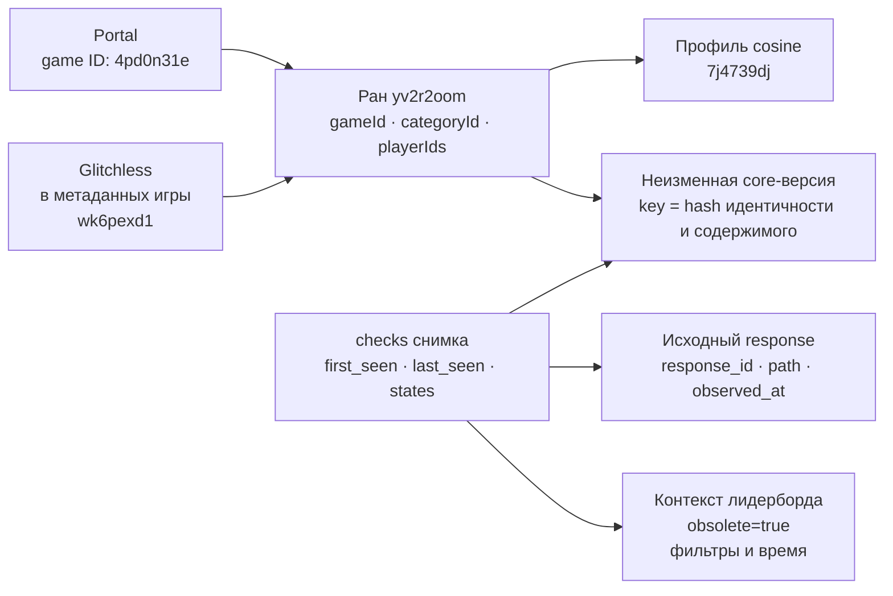

# Один ран: сайт → исходный JSON → три ODS

Пример взят из завершённого снимка Portal текущей очереди. Новых запросов
Speedrun.com для него не выполнялось. Исходный ответ восстановлен из ODS,
его SHA-256 проверен; содержимое рана прочитано во всех трёх хранилищах.

| Поле | Реальное значение |
|---|---|
| Страница рана | [yv2r2oom на Speedrun.com](https://www.speedrun.com/portal/runs/yv2r2oom) |
| Игра | Portal, `4pd0n31e` |
| Категория | Glitchless, `wk6pexd1` |
| Участник | cosine, `7j4739dj`; исходный профиль содержит `areaId=us` |
| Исходное время | `1072.660s`, то есть 17:52.660 |
| Выполнен / проверен | `2021-02-16T12:00:00Z` / `2021-02-19T19:38:36Z` |
| Наше наблюдение | `2026-10-30T08:03:45.327338+00:00` |
| Снимок | `lab1-popular500-20261030-g-4pd0n31e-runs` |

Данные относятся к моменту наблюдения; текущая страница сайта могла измениться.
Здесь дана прямая ссылка, а не снимок экрана сайта. `verified=1` означает
верифицированный ран. Исходный `obsolete=true` сохранён; `place` в этом объекте
отсутствует, и мы его не вычисляем. Даты рана не являются временем нашего сбора.

## Что связывает сущности



Это связи по исходным ID. В production ODS нет отдельной нормализованной
таблицы участников или категории и нет объявленных SQL FK между этими JSON.
Они не добавлялись ради диаграммы.

## Какие файлы показывать

Для офлайн-показа сохранены реальные экспорты Mermaid:
[связи сущностей PNG](figures/01_entity_relations.png),
[физическое хранение PNG](figures/02_storage_flow.png).
Рядом находятся исходники `.mmd` и векторные `.svg`.
Экспорт выполнен [официальным Mermaid CLI](https://github.com/mermaid-js/mermaid-cli)
11.12.0 с локальным Edge; это средство подготовки отчёта, не сервис стенда.

| Артефакт | Что в нём |
|---|---|
| [source_run.json](source_run.json) | Полный объект из восстановленного `runList[8]`, включая комментарий, submitter/moderator, таймеры, даты и `obsolete` |
| [run_core.json](run_core.json) | Логическая запись ODS: исходный ID, hash, проекция и полное core-содержимое |
| [check.json](check.json) | Наблюдение снимка, версия, response ID, путь, время и отдельный контекст |
| [game_and_rules.json](game_and_rules.json) | Полный `GetGameData`: карточка, категории с их правилами, переменные, платформы и прочие поля |
| [player.json](player.json) | Доступный встроенный профиль cosine целиком; это не обещание всех полей веб-страницы пользователя |
| [mongo_record.json](mongo_record.json) | Реальная физическая обёртка MongoDB с `_id`, индексируемыми атрибутами и `document` |
| [verification.json](verification.json) | Равенство трёх чтений, digest пакета и происхождение исходного ответа |

`run_core.raw.value` совпадает с исходным объектом после выделения только
`place` и `obsolete` в контекст. Все остальные исходные поля остаются на месте.
В полном `responses` восстанавливается объект вместе с этими двумя полями.

## Как выглядит физическое хранение

| PostgreSQL | MongoDB | Garage S3 |
|---|---|---|
| `entity_v3.runs`, PK `key`, JSONB `document` | `entity_v3.runs`, `_id=key`, вложенный `document` | gzip JSONL-чанк со строкой того же логического документа |
| Поля для поиска вынесены в колонки | Поля для поиска вынесены в обёртку | Шард по hash ID, индекс объектов снимка |
| `runs_current` соединяет последнюю версию и общий контекст | Версии и checks читаются по ID/проекции/снимку | Клиент читает индекс и нужные чанки, проверяет SHA-256 |

В S3 нет отдельного объекта на каждый ран. Индекс этого пакета находится по ключу:

```text
entity_v3/entity-v3/snapshots/lab1-popular500-20261030-g-4pd0n31e-runs/runs/90ccb8bbb313e445e9941045be3b1ae3a41db1d1e143f2a76f5a919c439b576e.json
```

Он ссылается на `entity_v3/entity-v3/chunks/runs/<shard>/<sha256>.jsonl.gz`.
Поэтому число S3-объектов не равно числу ранов.

### PostgreSQL: удобное чтение

```sql
SELECT id, game_id, category_id,
       data->>'time' AS source_time,
       data->'playerIds' AS players,
       data->>'verifiedAt' AS source_verified_at,
       observed_at, obsolete, place,
       unfiltered_observed_at, unfiltered_response_id
FROM entity_v3.runs_current
WHERE id = 'yv2r2oom';
```

История конкретного снимка:

```sql
SELECT source_id, document->'first_seen' AS first_seen,
       document->'last_seen' AS last_seen,
       document->'states' AS states,
       document->'unfiltered_leaderboard' AS context
FROM entity_v3.checks
WHERE source_id = 'yv2r2oom'
  AND projection = 'run_core'
  AND document->>'snapshot_id' = 'lab1-popular500-20261030-g-4pd0n31e-runs';
```

### MongoDB: тот же ID

```javascript
db.getSiblingDB('entity_v3').runs.find(
  {source_id: 'yv2r2oom', projection: 'run_core'},
  {_id: 1, source_id: 1, 'document.raw.value': 1}
)
```

## Почему здесь больше одной строки

Ран, профиль, карточка и событие WR — разные предметные сущности. Версия рана
и подтверждение её наблюдения тоже решают разные задачи: содержимое может не
меняться, хотя сайт проверен повторно. Неизменное содержимое не копируется
на каждую страницу. В последовательности A → B → A достаточно двух версий
и трёх последовательных наблюдений.

В полном ODS Portal сравнения: 20 202 run ID, 6122 profile ID, 277 полученных
WR-событий; вместе со служебными записями 53 498 записей. Историческое раздувание
до миллионов записей на десятки тысяч ранов относится к прежней модели;
оно не является правилом текущей entity-v3. WR coverage остаётся partial.

Экспорт можно повторить внутри работающего стенда:

```powershell
Get-Content -Raw infra/export_ods_example.py | docker compose exec -T scheduler python -
```

Команда только читает сохранённые данные. Полная модель и ограничения —
[DATA_MODEL.md](../../../DATA_MODEL.md), результаты доступа —
[сравнение хранилищ](../comparison_20261030/README.md).
