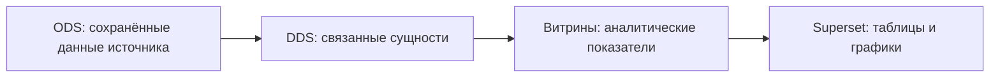

# Как защищать лабораторную работу 3

На защите нужно объяснить путь от сохранённых данных о спидранах до аналитического вывода: откуда взялся показатель, как он рассчитан и почему выбранный график помогает его понять. Не нужно заучивать весь код. Достаточно уверенно разобрать один пример и показать остальные возможности.

## 1. С чего начать рассказ

Можно сказать своими словами:

> В предыдущих работах мы собрали данные о спидранах и подготовили детальный слой. В третьей работе на его основе построили аналитические витрины. Airflow управляет их обновлением, Superset показывает показатели, а OpenMetadata позволяет проследить происхождение данных.

Затем назови понятный вопрос: «Какие страны лидируют по призовым местам?» На его примере удобно объяснить всю архитектуру.

## 2. Что требуется по заданию

В [условии ЛР3](../../Лабораторные_работы_Технологии_хранения_больших_данных_-1.md) шесть основных пунктов:

1. Развернуть Superset и OpenMetadata через Docker Compose.
2. Построить витрины на основе детального слоя.
3. Автоматизировать их формирование и связать с обновлением детального слоя.
4. Сделать дашборд минимум с пятью различными визуализациями и объяснить выбор.
5. Построить Data Lineage от исходных данных через детальный слой до витрин.
6. Предоставить отчёт, SQL и ETL-код; показать интерфейсы и данные в БД.

Сложный рейтинг раннеров — дополнительный аналитический пример. Основная цель защиты — показать, что эти пункты выполнены и ты понимаешь устройство решения.

## 3. ODS, DDS и витрина простыми словами



| Слой | Что в нём находится | Для чего нужен |
|---|---|---|
| ODS | Исходные данные и их сохранённые версии | Сохранить материал источника и возможность повторной обработки |
| DDS | Игры, категории, игроки, раны и связи между ними | Получить согласованную модель для расчётов |
| Витрины | Подготовленные результаты под конкретные вопросы | Упростить аналитику и чтение графиками |

Например, в DDS есть отдельные раны и участники. В витрине стран уже посчитано, сколько у каждой страны первых, вторых и третьих мест.

**Витрина — это данные, дашборд — их отображение.** Одну витрину можно использовать в нескольких графиках. Витрина не обязательно содержит только суммы: иногда для анализа нужны подробные строки.

Ещё полезное слово — **гранулярность**. Это ответ на вопрос «Что означает одна строка?». В таблице итогового зачёта одна строка означает страну в выбранной совокупности соревнований.

## 4. Как объяснить расчёт на примере стран

Сначала определяем сопоставимое поле: игру, категорию, таймер и необходимые условия. Затем выбираем лучшие результаты участников и присваиваем места. Только после этого считаем медали стран.

Несколько публикаций одного игрока не должны превращаться в несколько медалей за один и тот же зачёт. Для командного результата повторяющаяся страна участников не должна удваивать медаль внутри этого результата.

Олимпийский порядок означает последовательное сравнение:

1. Больше первых мест — выше позиция.
2. При равенстве первых сравниваем вторые.
3. При равенстве первых и вторых сравниваем третьи.

Это отличается от суммы баллов. При весах 3/2/1 одна золотая даёт 3 балла, две серебряные — 4. Но по олимпийскому порядку страна с золотой всё равно выше. Поэтому числовую сумму и итоговое место нужно объяснять отдельно.

Пример чтения подготовленной витрины:

```sql
SELECT country_name, gold, silver, bronze,
       medal_score, overall_rank
FROM speedrun_marts.country_medals
ORDER BY overall_rank
LIMIT 10;
```

Этот запрос читает готовые итоги. Сам расчёт находится в SQL формирования витрин.

## 5. Какую роль играет Airflow

Airflow управляет порядком выполнения обработки и показывает её состояние. Данные хранятся в PostgreSQL.

В аналитической цепочке проекта:

```text
normalize_entity_v3
        ↓
check_data_quality
        ↓
refresh_marts
        ↓
sync_analytics_metadata
```

Первый процесс подготавливает DDS из сохранённых данных, второй проверяет качество, третий строит витрины, четвёртый обновляет каталог метаданных.

| Термин | Как объяснить |
|---|---|
| DAG | Граф задач и зависимостей между ними |
| Task | Отдельный шаг обработки |
| Assets | Механизм связи процессов через обновление данных |
| Идемпотентность | Повторная обработка тех же входов не создаёт дублей |
| Атомарная публикация | Пользователь видит целую готовую сборку, а не частично обновлённые таблицы |

В нашем процессе новая сборка проходит проверки перед публикацией. При ошибке её подготовки прежние опубликованные витрины сохраняются.

На защите открой успешный запуск, покажи задачи и лог. Объясни разницу между зелёным статусом выполнения и качеством исходных данных: успешный DAG сам по себе не доказывает полноту выборки.

## 6. Что понимать в SQL

Для объяснения витрин достаточно уверенно различать пять конструкций:

| Конструкция | Пример назначения |
|---|---|
| `JOIN` | Связать ран с игрой, категорией или участником |
| `WHERE` | Оставить результаты нужного статуса или нужной игры |
| `GROUP BY` | Объединить строки по стране для подсчёта медалей |
| `COUNT`, `SUM` | Посчитать количество или сумму |
| `RANK() OVER (...)` | Присвоить места в заданном порядке |

`RANK()` учитывает равенства: два одинаковых лучших результата получают места **1, 1, 3**. `ROW_NUMBER()` просто нумерует строки: **1, 2, 3**. Выбор функции влияет на смысл рейтинга.

Важно и место применения фильтра. Если мы выбираем игру, состав зачёта меняется и рейтинг пересчитывается. Если ищем конкретного раннера в уже рассчитанном общем рейтинге, его глобальное место должно сохраниться.

## 7. Как обосновать пять визуализаций

На дашборде «Раннер» можно показать пять разных способов представления данных:

| Визуализация | Какой вопрос решает | Почему подходит |
|---|---|---|
| Линейный график формы | Как менялся результат со временем? | Показывает последовательность изменений |
| Тепловая карта сходства игр | Какие игры связаны общими участниками? | Удобна для сравнения множества пар |
| Sankey, диаграмма потоков | Между какими играми наблюдаются переходы игроков? | Ширина потока показывает величину перехода |
| Box plot, ящик с усами | Насколько различаются результаты? | Показывает медиану и разброс |
| Паутинка профиля | В каких типах категорий у раннера есть сильные результаты? | Позволяет сопоставить несколько характеристик |

У box plot линия внутри коробки — медиана, а коробка охватывает средние 50% наблюдений. Точная трактовка усов зависит от настройки графика.

Для заполненного примера паутинки в подготовленной демонстрации используется `Chexhuman [5j5o2pzx]`. Паутинка описывает наблюдаемые результаты в категориях. Она не измеряет интеллект, реакцию или физическую выносливость человека.

При показе графика придерживайся трёх шагов: **что отложено по осям → что видно → какой осторожный вывод можно сделать**. Например, общие игроки показывают связь аудитории игр, но не доказывают, что одна игра развивает навыки для другой.

## 8. Что такое Data Lineage и OpenMetadata

**Data Lineage — происхождение данных и путь их преобразований.** Он помогает ответить: «Из каких исходных таблиц получился этот показатель?»

Для медального зачёта путь можно объяснить так: исходные данные о ранах и игроках → сущности DDS → лучшие результаты и места → медали стран.

OpenMetadata хранит описания таблиц, колонок, процессов и связей. Сами раны остаются в PostgreSQL. В проекте связи происхождения регистрируются программно; каталог не угадывает всю логику Python автоматически.

На защите найди `country_medals`, открой вкладку Lineage и пройди по связям к источникам. Если показываешь происхождение отдельной колонки, объясни, какое преобразование создаёт её значение.

## 9. Как рассказать про рейтинг раннеров

Начни с проблемы: победа среди двух участников и высокое место среди тысяч дают разные основания для сравнения. Простое количество медалей этого не отражает.

В экспериментальной методике мы рассматриваем качество места, размер поля, плотность результатов топ-10/25 и прошлые периоды удержания топ-3. Для универсальности выбирается лучший зачёт каждой игры, а вклад следующих игр постепенно уменьшается. Накопленный исторический бонус сохраняется после потери призового места.

**Это авторская модель, а не объективная шкала силы.** Плотность времён не доказывает сложность игры. Долгий ран сам по себе не означает более высокое мастерство. Неполная история не позволяет уверенно вычислить бонус удержания.

В репозитории есть ранее проверенная версия на десять игр и последующая экспериментальная формула. На защите объясняй ту версию, которую показывает демонстрируемый стенд; готовность развёртывания экспериментальной версии нужно проверить отдельно. Формулы и ограничения собраны в [описании рейтинга](../../docs/analytics/RUNNER_RANKING.md).

## 10. Какие ограничения назвать

Достаточно четырёх честных уточнений:

- Аналитика относится к сохранённому срезу, а не к состоянию сайта прямо сейчас.
- Собранная выборка не охватывает автоматически все игры и всех игроков сайта.
- Отсутствующие данные — не нулевые значения: например, неизвестная страна или неполная история.
- Сравнение требует сопоставимых условий: категория, таймер, направление результата и платформенные ограничения имеют значение.

Календарные дни от первой видимой публикации до достижения места не равны часам тренировок. Резкое улучшение WR может быть признаком новой стратегии, но сами числа не доказывают обнаружение бага.

## 11. Частые вопросы преподавателя

| Вопрос | Короткий ответ |
|---|---|
| Зачем витрина, если есть DDS? | Чтобы заранее подготовить показатели под аналитический вопрос и упростить их использование |
| Чем витрина отличается от дашборда? | Витрина содержит данные, дашборд отображает их |
| Почему не считать всё прямо из ODS? | Тогда в каждом запросе пришлось бы повторять разбор исходных данных и согласование сущностей |
| Что произойдёт при повторном запуске? | Те же входы не должны создавать дубликаты; готовая неизменившаяся сборка может быть использована повторно |
| Что произойдёт при ошибке сборки? | Незавершённая сборка не должна заменять опубликованную |
| Зачем OpenMetadata? | Чтобы видеть определения данных, зависимости и происхождение показателей |
| Почему выбран этот график? | Потому что он отвечает конкретному вопросу: динамика, распределение, связь или сравнение |
| Доказывает ли зелёный DAG правильность аналитики? | Нет, дополнительно нужны проверки данных и осмысленная методика |
| Почему нельзя просто складывать места? | Места имеют разный смысл при разном размере и составе поля |
| Рейтинг определяет самого сильного в мире? | Он сравнивает участников нашей выборки по выбранным правилам |

## 12. Порядок демонстрации

1. **Вступление, около минуты.** Назови цель и объясни ODS → DDS → витрины.
2. **Airflow, около двух минут.** Покажи аналитические DAG, успешный запуск и зависимости.
3. **PostgreSQL, около минуты.** Открой строки витрины стран, объясни смысл одной строки и колонок.
4. **Superset, около четырёх минут.** Покажи медальный зачёт, изменение фильтра и пять видов визуализации на дашборде раннера.
5. **OpenMetadata, около двух минут.** Пройди по lineage от витрины к исходным данным.
6. **Ограничения, полминуты.** Назови дату среза, границы выборки и отличие неизвестного значения от нуля.

Перед защитой открой страницы заранее и проверь, что графики загружаются. Для демонстрации сохранённого среза не требуется возобновлять сбор с сайта. Команды подготовки и конкретные примеры находятся в [сценарии демонстрации](DEMO.md).

## Что прочитать перед защитой

Сначала [условие ЛР3](../../Лабораторные_работы_Технологии_хранения_больших_данных_-1.md), затем эту памятку. После этого один раз пройди [демонстрацию](DEMO.md) и просмотри [отчёт](REPORT.md). Непосредственно перед защитой достаточно [короткой памятки](DEFENSE_SHORT.md).
