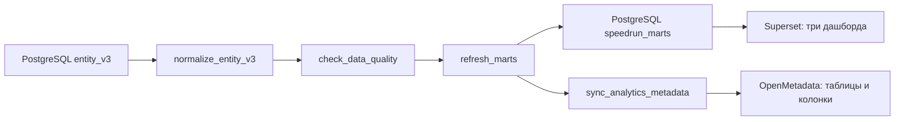

# ЛР3. Витрины, Superset и OpenMetadata

Источник требований — [задание](../../Лабораторные_работы_Технологии_хранения_больших_данных_-1.md).
Реализация находится в ветке `lab3`. Она объединяет десять выбранных аналитических идей и медальный зачёт стран.

## Архитектура

Сервисы добавлены в профиль `lab3` существующего Compose. Версии образов закреплены digest: Superset 6.1.0, OpenMetadata 2.0.9 и Elasticsearch 9.3.0. Служебные базы Superset и OpenMetadata размещены в том же PostgreSQL 16. Используется существующий Airflow 3.3.2. Отдельный Airflow для каталога не разворачивается.

## Данные и воспроизводимость

Вход — завершённые цепочки коллекции `lab1-popular500-20261030`, имеющие подтверждения PostgreSQL для всех четырёх этапов. Незавершённая игра не включается в анализ. Это архив ограниченной выборки, а не актуальная полная копия сайта.

Для анализа в DDS добавлены наблюдения исходных мест и obsolete, состав участников, точная длительность в наносекундах, публичная страна игрока с различением отсутствующего поля и явного null, исходная история WR и ограничения снимков. Исходные JSON не перезаписываются. Преобразования описаны в [lab3_dds.sql](../../sql/lab3_dds.sql) и [analytics_dds.py](../../src/speedrun_etl/analytics_dds.py).

Каждая сборка фиксирует список снимков, `as_of` и хеш кода расчётов. Физические таблицы строятся в отдельной схеме `speedrun_build_*`. Проверенные результаты публикуются представлениями `speedrun_marts` в одной транзакции. Ошибка до commit сохраняет предыдущую публикацию. Повтор той же сборки не дублирует данные. Преобразования сериализованы advisory lock, чтение выполняется в Repeatable Read.

Шлюз качества сверяет объёмы ODS и DDS и проверяет аномалии. Записи с верификацией раньше подачи сохраняются в DDS и исключаются из аналитики с отдельным счётчиком. Другие проверяемые аномалии и расхождение покрытия блокируют публикацию. Дополнительные проверки контролируют места, диапазон перцентилей, временные интервалы когорт и соответствие баллов медальному порядку.

## Витрины и аналитические решения

| Идея | Расчёт и вывод |
|---|---|
| 1. Следующая цель | Один текущий PB на участника или команду в сопоставимом поле. Пороги top3/5/10/50/100/1%, необходимое улучшение и размер поля. |
| 2. Приближение к WR | Отставание от WR, длительность результата, число активных участников в пределах 1% за 30 дней (включая выбранного раннера, если он подходит). Это ориентиры выбора цели. |
| 3. Новые игры | Переходы между играми за 365 дней, сглаженный lift относительно частоты назначения. Минимум пять переходов и 30 потенциальных участников. Уже освоенные игры исключены из персонального списка. |
| 4. Путь к цели | Фиксированный порог архивного поля, год первой видимой публикации, стартовый разрыв с шагом 10%. Доли за 30/90/365 дней и Kaplan–Meier с правым цензурированием. Минимум 30 наблюдений. |
| 5. Форма раннера | Публикации, накопительный PB, медиана и межквартильный интервал последних десяти публикаций. |
| 6. Возвращение после плато | Период без строгого улучшения WR, участники с PB в топ-10 до, в день и после события. Начальные пороги: 730 дней, три автора до WR, улучшение 1%. |
| 7. Разбор скачка | Предыдущий WR, новый WR и раны после события, лучшие относительно прежнего WR, со ссылками на раны и видео. Последующие раны не обязательно являются новыми WR. Причину скачка нужно подтверждать внешним датированным источником. |
| 8. Паутинка | Any%, 100%, Low%, All Bosses, Glitchless, No Major Glitches по явным названиям источника. Среднее лучших игровых перцентилей по полям минимум из десяти участников. |
| 9. Соперники | Ближайшие медианы последних максимум десяти публикаций за 7/30/90 дней, минимум пять публикаций. |
| 10. Активные гонки | Строгие улучшения WR, авторы, PB и входы в топ-10, плотность вершины за 7/30/90 дней относительно архивной даты. |
| Страны | Призовые места источника, один вклад run × страна. Международная команда учитывается каждой представленной страной. Неизвестная страна показана отдельно. |

Сопоставимое поле содержит игру, категорию, значимые переменные, основной таймер, направление сравнения, версию правил и платформу. Предусмотрены общее поле и отдельные платформы. При равенстве используется `RANK`, например 1, 1, 3. Команда идентифицируется упорядоченным набором участников.

Переменные, привязанные к отдельным уровням, исключены из full-game полей.
Одинаковые названия переменных не считаются одинаковыми ID. Архивные определения
и правила остаются в DDS; расчёт использует наблюдаемую версию метаданных среза.

Медальный порядок лексикографический: золото, серебро, бронза. Чтобы показать итоговые баллы без нарушения порядка, используется `G × B² + S × B + Br`, где `B = 1 + max(S, Br)` в выбранной совокупности стран. Выбор игры и категории пересчитывает совокупность; выбор страны происходит после ранжирования.

SQL находится в [sql/marts](../../sql/marts). Расчёт исторических событий — [record_history.py](../../src/speedrun_etl/record_history.py), кривых достижения — [cohort_survival.py](../../src/speedrun_etl/cohort_survival.py). Исходная история WR представлена отдельно от реконструкции.

## Визуализации

| Тип | Почему выбран |
|---|---|
| Таблица | Точные пороги, знаменатели, рейтинг и основания рекомендации можно проверить построчно. |
| Линия / ступени | Показывает накопительные PB, смены WR и долю достижения порога во времени. |
| Паутинка | Позволяет сопоставить наблюдаемые специализации одного раннера. Пропущенные оси не означают нулевую способность. |
| Тепловая карта | Сходство сообществ по Jaccard и календарь активности показывают концентрации событий. |
| Sankey | Потоки между исходными и новыми играми показывают объём наблюдаемых переходов. |
| Box plot | Показывает разброс опубликованных результатов, а не только лучший результат. |
| Столбцы | Сопоставляют число призовых мест стран. |
| Числовой индикатор | Делает видимым объём вкладов с неизвестной страной. |

Дашборды: «Раннер», «Борьба за рекорды», «Страны». Определения SQL, графиков и фильтров хранятся в [superset_assets.py](../../infra/superset_assets.py). Скрипт [provision_superset.py](../../infra/provision_superset.py) повторно создаёт или обновляет объекты по устойчивым UUID. Подключение аналитики имеет только права чтения представлений.

На дашбордах 24 графика восьми типов и 28 виртуальных datasets. Полная паутинка
строится только при наличии всех шести характеристик: библиотека радара помещает
пропуски в центр, что создавало бы ложную нулевую оценку. Для любого раннера рядом
показана таблица шести осей с числом игр/полей и явным отсутствием данных.
Пример полного профиля — `Chexhuman [5j5o2pzx]`.

Перед публикацией выполняется ANALYZE новых таблиц, для когорт создан индекс.
Запросы пользователя `analytics_reader` ограничены 110 секундами, чтобы
прекращаться до таймаута веб-интерфейса. Фильтры со знаком `%` проверены
через настоящий Superset: экранирование кавычек сохраняется, лишнее повторное
экранирование процентов из `where_in` снимается перед компиляцией SQLAlchemy.

## Проверка рекомендаций

Отдельная витрина строит обучающую выборку до `as_of − 365 дней` и проверяет новые игры в следующем году. До просмотра исходов выбирается детерминированная выборка максимум 2000 раннеров. Сравниваются попадания top-5 по lift и по популярности обучающего периода. Показываются размер выборки, число раннеров с новой игрой, покрытие рекомендациями и попадания. Наличие такой проверки само по себе не означает превосходства модели.

В персональном списке средний lift — геометрическое среднее по играм раннера,
для которых переход имеет достаточную поддержку. «Сильных раннеров, не менее» —
максимальное число в одной из исходных групп, а не сумма пересекающихся групп:
один человек мог перейти из нескольких знакомых игр. Сильный результат означает
текущий перцентиль не ниже 75 в поле минимум из десяти участников.

## Lineage

[analytics_metadata.py](../../src/speedrun_etl/analytics_metadata.py) через REST регистрирует схемы и колонки PostgreSQL, четыре аналитических DAG и три дашборда. Явные связи показывают декодирование ODS JSON, нормализацию DDS и зависимости витрин. Для основных метрик добавлен lineage колонок: `duration_ns → seconds → place → goal` и `source_place → gold/medal_score`. Синхронизация повторяется отдельно от расчёта данных и не запускает сбор источника.

## Ограничения интерпретации

- Статус верификации взят из архивного среза. Реконструкция не доказывает точный вид лидерборда в прошлом.
- Версия правил соответствует наблюдаемым метаданным выбранного среза. Правила на дату выполнения старого рана могут быть неизвестны; смена правил также может объяснять скачок времени.
- Первая видимая публикация не является первым тренировочным раном. Календарные дни нельзя переводить в часы тренировок.
- Плотность времён и число участников не являются универсальной мерой сложности игры.
- По жанру игры нельзя делать выводы об интеллекте, реакции или физических способностях человека.
- Переходы между играми отражают поведение наблюдаемой выборки, а не доказанный перенос навыка.
- Отсутствующая ось профиля, недостаточная когорта или пустое окно активности отображают ограничения данных.

## Первый промежуточный прогон 26 ноября

Витрины опубликованы: 654705 уникальных аналитических ранов, 126 игр,
580728 PB и 3385304 реконструированных события. Все шесть проверок перед
публикацией дали ноль нарушений; 47 аномалий дат исключены из аналитики.
Четыре интеграционных теста ЛР3 прошли, включая откат ошибочной публикации.
Цепочка Airflow Data Quality → витрины → синхронизация каталога прошла успешно.
В OpenMetadata зарегистрированы 83 таблицы, 4 pipeline, 3 дашборда и 149 связей.

В тестовой выборке рекомендаций из 2000 раннеров у 19 наблюдалась новая игра:
lift дал 4 попадания top-5, популярность — 5. Эти результаты не подтверждают
превосходство рекомендаций по lift.

Проверка интерфейсов продолжается. Запросы графиков проходят без HTTP/JS ошибок,
но часть графиков выбранного поля с `%` пуста при наличии данных: проверяется
повторное экранирование значения фильтра. Также требуется уточнить отображение
NULL на радаре и счётчик свидетельств рекомендаций. Снимки в `screenshots/`
фиксируют промежуточное состояние, а не окончательную приёмку. Численные
результаты — [validation.json](validation.json); протокол запросов интерфейса —
[ui_validation.json](ui_validation.json). Полная проверка ЛР3 ещё не завершена.

## Текущий checkpoint, 26 ноября 17:04 UTC

Проблемы фильтра `%`, нулевого отображения NULL и суммирования пересекающихся
групп исправлены. Исключение переменных отдельных уровней вернуло в full-game
анализ ещё 6034 рана. Текущая публикация `cef0cb6d…`: **660739 ранов,
129 игр, 586002 PB, 3421655 событий**. Подробные числа и сохранность ODS —
[final/validation.json](final/validation.json).

Последний прогон: 194 теста, 167 прошли, 27 явно пропущены, 0 ошибок.
Полный повтор Airflow от DDS (`lab3-final-replay`) до каталога завершился success.
Проверки фильтров стран, игры, Any% и цели прошли; сценарий остановился на поиске
Chexhuman в списке раннеров, причина ещё проверяется. Обновление снимков и
окончательная приёмка интерфейсов не завершены. Каталог `final/` содержит
результаты разных стадий проверки; актуальная точка продолжения —
[HANDOFF](../../docs/HANDOFF.md).
